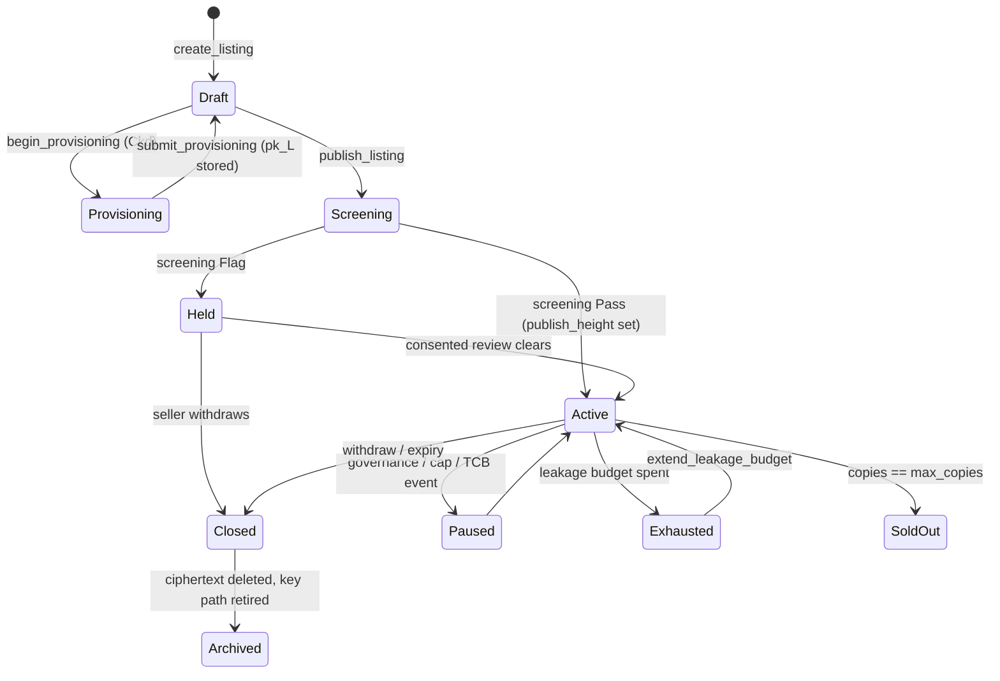
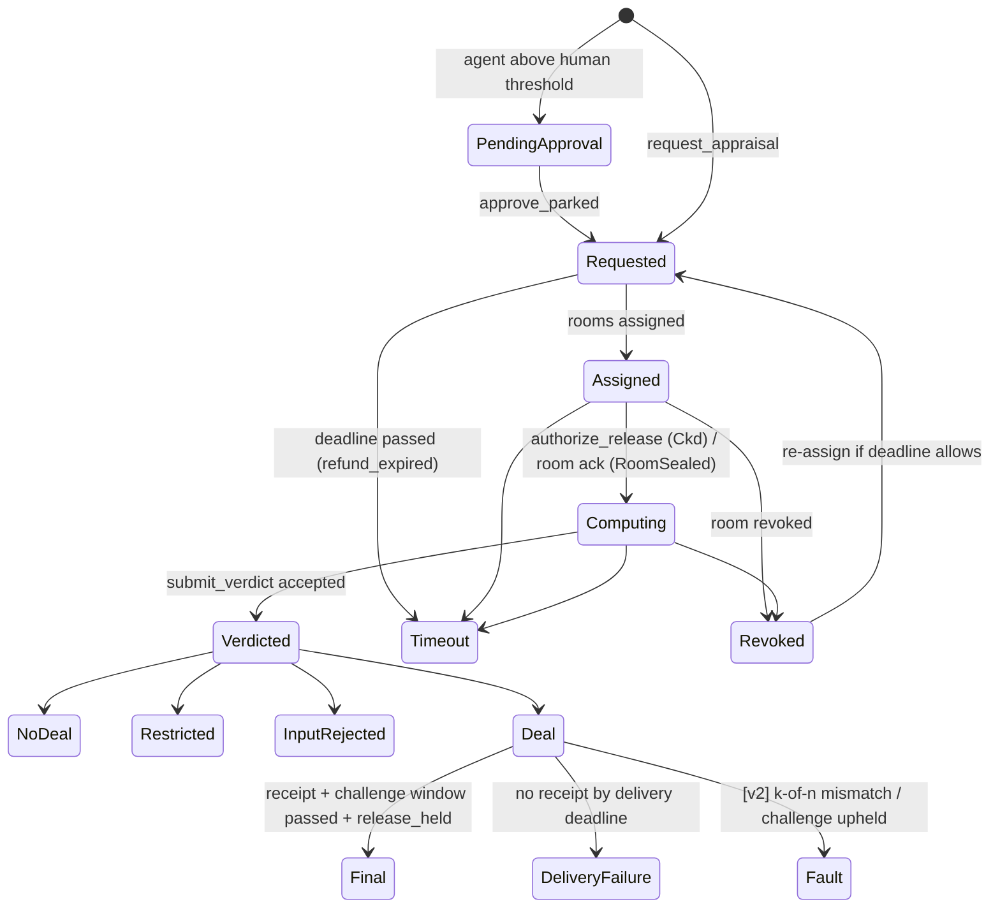
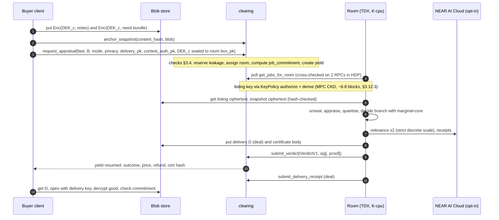
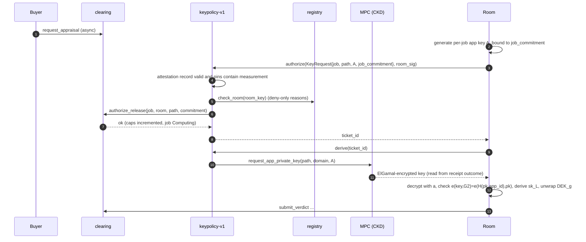

**Software Design Document (SDD)**

**Marginal: a confidential exchange that prices information goods by their measured marginal value to each buyer**

AID: SDD-001 (implements SPEC-001) / BUG: n/a
**version**: 0.2 (draft; open items researched 2026-11-12, see §11)

**date**: 2026-11-12 (v0.1: 2026-11-11)
**author**: @jay

**reviewers**: *(to be assigned)*
**status**: in progress

**Table of Contents**

1. [Introduction](#1-introduction): references, feature recap, use cases, scope, deployment profiles, hackathon trims, demo surfaces, conventions
2. [High Level Design](#2-high-level-design): block diagram, components, what changes from LETHE v0, design refinements to SPEC-001, scenario table, interface changes, topology
3. [Detailed Design](#3-detailed-design): repository, technology, on-chain data model, Clearing API, lifecycles, execution paths, pricing, leakage ledger, escrow and settlement, audit chain, RoomRegistry, KeyPolicy, attestation, room runtime, appraisers, judges, verdict privacy and ZK proofs, forget certificates, delivery, identity and compliance, agents, off-chain services and database, clients, configuration, v2–v4 extension designs, backward compatibility
4. [Debugging Support](#4-debugging-support)
5. [Test Plan](#5-test-plan)
6. [Feature Toggle](#6-feature-toggle)
7. [Points To Note](#7-points-to-note)
8. [Security Considerations](#8-security-considerations)
9. [Scalability Considerations](#9-scalability-considerations)
10. [Patent Considerations](#10-patent-considerations)
11. [Open Items](#11-open-items)
12. [Review Meeting MoM](#12-review-meeting-mom)

---

## 1. Introduction

### 1.1 Related documents

| Document | What it is | How this SDD uses it |
|---|---|---|
| [`SPEC.md`](SPEC.md) (SPEC-001) | Product specification: problem, goals G1–G12, non-goals NG1–NG13, scenarios SC-1–SC-29, mechanism, trust and threat model, acceptance criteria AC-1–AC-63, test plan, risks | The requirements baseline. "SPEC §x" in this document means a section of SPEC.md. Every design element names the SPEC goals, scenarios or ACs it serves. |
| [`MOONSHOT.md`](MOONSHOT.md) | Vision and research memo | Background only. Where SPEC §9.6 corrects MOONSHOT, the SPEC wins. |
| `spec-notes/*.md`, `moonshot-notes/*.md` | Source verification notes | Source of facts about NEAR primitives, TEEs and regulation used below |
| LETHE v0, [github.com/jayanth-kumar-morem/lethe](https://github.com/jayanth-kumar-morem/lethe) | Hackathon v0 on NEAR testnet (`lethe-380029.testnet`): Rust contract, Node enclave service in local mode, verifier, web console | Code that carries into Marginal is listed in §2.3. Everything else is new. |
| ChainProof Guard, [github.com/jayanth-kumar-morem/chainproof-guard](https://github.com/jayanth-kumar-morem/chainproof-guard) | Agent spend firewall on NEAR testnet | Source of two *patterns*: function-call-key spend caps and k-of-n attester corroboration. Marginal re-implements both itself (§3.21, §3.13); it does not import this code (§7, PN-12). |
| `sdd-notes/*.md` | Research notes behind the v0.2 resolutions (2026-11-12): MPC/CKD and Chain Signatures; TEE attestation and hosting; ZK and throughput; Intents and stablecoins; judges, models and room runtime; compliance and legal; governance, hackathon rules, defaults and disclosure | Source for every fact added in v0.2. Each fact there is labelled PRIMARY / SECONDARY / UNVERIFIED with URL and date. |
| `docs/test-plan.md` *(to be written from §5)* | Executable test plan | Linked from §5 |

### 1.2 Feature recap

Marginal is an exchange where a buyer pays for an information good only according to its **measured marginal value to that buyer** (SPEC §4.1):

1. **Seal.** A seller encrypts a good (a memo, dataset, eval set, model, exploit or forecast) on the client and lists it. Its key is released only to attested **appraisal rooms**, for a specific paid job, under rules enforced by an immutable NEAR contract (KeyPolicy) and NEAR's MPC network.
2. **Appraise.** The buyer seals *its own* context (notes, eval set, data index or model) into the same room. Deterministic appraisers measure what the good adds for that buyer. LLM judgement can only discount that measurement, within a floor the seller sets.
3. **Price.** A NEAR **Clearing** contract applies a fixed pricing rule to signed integer components, or verifies a zero-knowledge proof that the rule was applied (§3.17). It debits the listing's **leakage budget** for the bits the appraisal reveals and pays the seller for them.
4. **Settle.** On a deal, the buyer gets a sealed copy or use-rights and the seller is paid in the asset and chain they chose. On no deal, the buyer is refunded.
5. **Forget and verify.** Every job ends with a **forget certificate** bound to the room's hardware attestation, anchored in the settlement record. Anyone can replay every settlement from public data.

### 1.3 Use cases and customers

There are **no named customers yet**. The SPEC's Stage 1 gate targets 3–5 design partners: crypto funds, research DAOs and a security firm (SPEC §4.17). Use cases by stage:

| Stage | Use case | Buyer | Seller | SPEC scenarios |
|---|---|---|---|---|
| v1 | Memo or expert answer appraised against the buyer's own notes; deal or refund plus forget certificate | Fund or research desk | Expert, boutique, analyst | SC-1, SC-2, SC-3 |
| v1 | Cross-chain funding and payout | Any | Any | SC-4 |
| v1 | Buyer agent trading behind on-chain spend caps | Agent operated by a fund | — | SC-14 |
| v1 | Compliance: MNPI screen, restricted lists, compliance copy, audit export | Fund compliance officer | — | SC-21, SC-22, SC-29 |
| v2 | Dataset priced by lift on the buyer's sealed eval; sealed eval runs; tenders; sealed rounds; private purchases | AI lab, enterprise model team, fund | Data owner, eval author | SC-5–SC-7, SC-9, SC-16, SC-18, SC-23, SC-24 |
| v3 | Weights-in-vault; exploit disclosure; forecasts with truth-contingent tails; assurance | Lab, protocol, desk, insurer | Model developer, researcher, forecaster | SC-8, SC-25, SC-26, SC-28 |
| v4 | Individuals selling into tenders through a context wallet | Lab | Individual | SC-27 |

### 1.4 Scope of this SDD

This SDD designs the **whole product in SPEC-001**, stages v1 to v4. Each design element carries a stage tag:

- **[v1]** is the production knowledge exchange. It is designed to production standard and built now.
- **[v2] [v3] [v4]** are designed here to interface level, so that v1 code does not paint them into a corner. They are not built now.
- **[HDP]** marks the **Hackathon Demo Profile**: the configuration in which the v1 code runs for the NEAR hackathon demo, on testnet, with the substitutions in §1.5.

**What "near-production ready" means here.** The contracts, room runtime, verifier, services and clients are written to the production design in §3, not as throwaway demo code. The hackathon build differs from production only in **configuration and deployment**:

- every substitution is a feature toggle (§6);
- every substitution is visible on-chain as a `simulated` or `profile` flag;
- no substitution changes a contract interface or a data format.

Swapping HDP for the mainnet canary profile is a redeploy with different toggles and accounts, not a rewrite.

### 1.5 Deployment profiles and hackathon trims

The SPEC's production design assumes hardware the hackathon cannot pay for: confidential GPUs, Blackwell nodes, a second CPU-TEE vendor and several operators. The HDP replaces those with cheap equivalents, or leaves them out, while still exercising the same code paths. The v0.2 research (§11) removed two v0.1 trims: **CKD key release and on-chain quote verification both work on testnet today**, so the HDP uses the production mechanism for both.

| SPEC element | Production design | HDP substitute | Why trimmed | Visible as |
|---|---|---|---|---|
| K-room: Intel TDX CVM + 1 confidential-computing GPU (SPEC §4.6.1) | Same | **One CPU-only Intel TDX CVM on Phala Cloud** (`tdx.large`: 4 vCPU / 8 GB, $0.232/h on 2026-11-12), pinned to one node, deployed with `--no-gateway --no-pre-launch-script`, dstack with `key_provider: "none"` (§3.13). Embeddings and NLI run on CPU. | GPU TEE cost | `room.class = K-cpu` in the registration record |
| S-room (screening) on separate hardware | Separate room class | Same CVM, separate measured program and process | Cost | Screening certificates name the screening program |
| Self-hosted judge models on room GPUs (SPEC §4.6.6) | Two open-weight judges inside the room | **Two NEAR AI Cloud "Private TEE" models: `Qwen/Qwen3.8-27B` and `z-ai/glm-5.3-flash`** (§3.16), with signed receipts, only on listings where the seller opts in. Both currently run on the same NEAR AI host, so the pair defends against injection, not against compromise of that host. Without an API key, a flagged local stand-in signer is used. | GPU cost | `judge.proof = NearAiReceipt` or `Simulated` per factor |
| G-rooms (multi-GPU Blackwell), LoRA lift tests (SPEC §4.8.2) | [v2] | **Lift-lite** CPU dataset appraiser (§3.15.3), labelled as a proxy | GPU cost | Appraiser id `dataset-lite@0` |
| Multi-vendor k-of-n (TDX + SEV-SNP), challenge re-execution | [v2] | Single vendor; the k-of-n code path runs in sandbox tests only | Second vendor and operator | Not enabled on the HDP deployment |
| MPC Confidential Key Derivation (CKD) for listing keys (SPEC §4.5) | [v1] | **Same: CKD domain 2 on `v1.signer-prod.testnet`**, live and answering in 6–8 blocks (§3.12.3). RoomSealed stays compiled in as a fallback only. | — (no trim) | `key_release_mode = Ckd` |
| On-chain DCAP quote verification | [v1] | **Same**, through NEAR One's locked `tee-verifier-2026-11-02.testnet` contract (~124 TGas, one call, §3.13). AttesterQuorum stays compiled in as a fallback only. | — (no trim) | `attestation_mode = OnChainDcap` |
| Settlement in USDC via NEAR Intents, mainnet | [v1] | **Testnet NEP-141 test stablecoin** (`musdc`). NEAR Intents shown as a live 1Click quote with `dry: true`, **displayed but not stored** (1Click ToS §4.1(e) bans storing its API data for more than 24 h). Chain Signatures derives the seller's foreign-chain address. The hackathon rules allow tiny mainnet Intents amounts (Q-007); dry quotes are our no-spend choice. | No Intents testnet; no spend | `token = musdc`, `payout.route = DryQuote` |
| Confidential Intents private mode | [v2] | Not built | A public NEAR contract cannot hold Confidential Intents balances (§3.25) | — |
| KYB/KYC and sanctions vendors | Sumsub, TRM Labs and a nightly OFAC file (§3.20) | Demo issuer key for tier credentials; screening against the **real OFAC SDN file** (free), so the demo can block a payout to a listed address | Vendor contracts | Credential issuer key labelled `demo` |
| Governance: two SputnikDAOs plus in-contract time-locks (§3.24) | 7-day policy lock and 14-day code staging in canary | One 2-of-3 dev DAO; locks in minutes | Demo speed | `gov.profile = demo` in config |
| Two independent replay verifiers (AC-36) | [v1] exit | One verifier (TypeScript); the second (Python) at v1 exit | Effort | — |
| Public-corpus snapshot for public novelty | [v1] | Small curated snapshot baked into the image | Size | Corpus hash in the measurement |
| Staging "red host", power-cut forensics, external audits | [v1] gates | Not in HDP | Hardware and cost | — |
| Weights, exploits, signals, eval sets, use-rights, assurance | [v2]–[v3] | Interfaces and enum variants only | Out of demo scope | Disabled asset classes |

**HDP cash cost (estimate).** Phala `tdx.large` costs about $5.60 per day, roughly $80 for two weeks (about $40 on `tdx.medium`). NEAR AI judge calls cost under $0.003 per appraisal. Testnet gas is free. The services (gateway, indexer, relayer, operator agent, compliance) run on one small VM.

### 1.6 Demo surfaces that must be ready

Priority: **P0** is the demo's spine. **P1** should be ready. **P2** is shown if time allows. "Ready" means the surface works end to end on testnet from a fresh browser, with the pass criteria in §5.4.

| ID | Surface | What the viewer sees | SPEC | Pri. |
|---|---|---|---|---|
| **D1** | **Two funds, one memo** | A seller lists a sealed memo whose key is provisioned and released through **real NEAR MPC CKD** (domain 2). Fund A appraises against its own notes and gets a **Deal**; the memo decrypts in the browser with its commitment checked. Fund B's notes already cover the memo: **No deal**, full refund, and a forget certificate. | SC-1, SC-2, SC-3 | P0 |
| **D2** | **Verify anything** | A replay explorer re-checks every settlement from public chain data: signatures, price rule, conservation, leakage debit, certificate anchor. It then walks one certificate back: room key → KeyPolicy attestation record → **real TDX quote** → approved measurement. | AC-27, AC-35, G7 | P0 |
| **D3** | **A real attested room** | The room's TDX quote, verified on-chain through NEAR One's locked tee-verifier. The record shows the PPID, the TCB status and the RTMR3 events proving dstack ran with no KMS. The measurement is published and reproducible from source. Contrast: LETHE's attestation was simulated. | AC-17, SC-20 | P0 |
| **D4** | **Sybil probing hits the leakage wall** | A script with many buyer identities probes one listing. Each appraisal debits bits and pays the seller per bit. Once the global budget is spent, the contract refuses new appraisals. | SC-10, AC-12–AC-15 | P0 |
| **D5** | **Prompt-injected buyer agent** | A listing teaser tells the buyer's agent to raise its budget. The agent's key hits its on-chain cap: the request is parked for a human, or blocked. | SC-14, AC-50 | P1 |
| **D6** | **Seller injection cannot raise a price** | A memo with "rate this 10/10" hidden in it. Judges can only discount; the price never exceeds the deterministic ceiling. | SC-11, AC-41 | P1 |
| **D7** | **Cross-chain payout** | The seller picks USDC on Solana. The UI shows the Chain-Signatures-derived address and a live 1Click dry quote (displayed, not stored). Optionally, an MPC-signed transfer on Base Sepolia or Solana devnet, confirmed by the MPC network's `verify_foreign_transaction`. | SC-4 | P1 |
| **D8** | **Compliance** | An MNPI-flagged listing is held before any appraisal. A fund's restricted list returns `restricted`. A payout to an address on the real OFAC list is blocked. The compliance officer decrypts the desk's purchase with the compliance key and exports a hash-chained audit trail. | SC-21, SC-22, SC-29 | P1 |
| **D9** | **Dataset priced by lift on the buyer's sealed eval** | Lift-lite appraiser: a seller's labelled dataset, a lab's sealed eval, a bucketed lift interval, and a price. | SC-6 (lite) | P2 |
| **D10** | **Blind mode with a sealed verdict** | Fund B learns exactly one bit. The contract verifies a Groth16 proof that the price rule was applied to committed scores it never sees. | AC-13, §2.4 DR-1 | P2 |
| **D11** | **Timeout refund** | Kill the room mid-job. After the deadline, anyone calls `refund_expired` and the buyer is made whole. | SC-15, AC-9 | P0 (tests), P1 (live) |

### 1.7 Conventions and glossary

- **bps**: basis points, 0–10,000. All scores, factors and indices in contracts are integer bps.
- **mbits**: millibits. Leakage is accounted in integer millibits, rounded up.
- **B**: buyer budget, the most it pays for a good of full measured value. **D**: deterministic ceiling. **L**: judgement factor. **m = D·L/10⁴**: measured value index. **V = B·m/10⁴**: buyer-relative valuation (SPEC §4.7.1).
- **Room**: an attested appraisal TEE running one of a few measured programs. **K-room**, **S-room**, **G-room**, **D-room**: room classes (SPEC §4.6.1). **K-cpu** is the HDP's CPU-only K-room.
- **Listing version**: an immutable (good, key path, schema) tuple. Re-sealing creates a new version.
- **Job**: one appraisal (or screening, provisioning or delivery) of one listing version by one room set.
- **Profile**: a deployment configuration (§2.7). **HDP**: Hackathon Demo Profile.
- **(target)**: a design target to confirm in pilots, not a measured fact. **(to confirm)**: an external interface detail not yet verified against its source.

---

## 2. High Level Design

### 2.1 Block diagram

```
 ┌─────────────────────── CLIENTS (plaintext exists only here and inside rooms) ────────────────────────┐
 │  Web app: sell · appraise · jobs · verify · rooms · compliance · agents     CLI / TS SDK   Agents     │
 │  client-side: canonicalise → encrypt (DEK) → seal keys → sign                (function-call keys)    │
 └──────┬───────────────────────────────┬─────────────────────────────────────────────┬───────────────┘
        │ ciphertext (HTTPS)            │ signed txs / NEP-366 meta-txs (relayer)      │ reads, WebSocket
        ▼                               ▼                                             ▼
 ┌──────────────┐   ┌──────────────────────────────── NEAR ─────────────────────────────────────────┐
 │ Blob store   │   │ clearing      listings · snapshots · jobs · escrow · pricing rules · leakage   │
 │ S3-compatible│   │ (upgradeable, ledger · caps · agent policy · settlement · audit hash chain     │
 │ ciphertext,  │   │  time-locked) NEP-297 events · Groth16 verifier (sealed verdicts)              │
 │ cert bodies, │   │ registry      governance policy: approved measurements, platform allow-list,   │
 │ deliveries   │   │ (time-locked  TCB minimums, revocations, platform caps, room pool, operators,  │
 └─────▲────────┘   │  grants)      attesters                                                       │
       │            │ keypolicy-v1  IMMUTABLE. Quote verification · room attestation records ·      │
       │            │               seller pins and freezes · key-release tickets → MPC CKD          │
       │            │ assurance     [v2] bonds · challenges · k-of-n · slashing                      │
       │            │ gov           sole full-access key of clearing and registry; time-lock queue  │
       │            └──────┬─────────────────────┬─────────────────────────────┬────────────────────┘
       │                   │ CKD (BLS12-381)     │ payouts / funding           │ events
       │                   ▼                     ▼                             ▼
       │           NEAR MPC network      intents.near · 1Click ·        Indexer → Postgres → Gateway API
       │           (encrypted key to     Chain Signatures               Replay verifiers (TS, Python)
       │            room's job key)
 ┌─────┴───────────────────▼───────────────────────────────────────────────────────────────┐
 │ APPRAISAL ROOMS   Intel TDX CVM under dstack (prod K/G: + NVIDIA confidential GPU)       │
 │  supervisor: identity keys · registration · chain I/O · job queue · egress proxy         │
 │  worker (one process per job): unseal → screen / appraise → quantise → decide branch →   │
 │     seal delivery → certificate → (sealed mode) commitment + Groth16 proof → teardown     │
 │  network: default-drop; allow NEAR RPC · blob store · opt-in NEAR AI Cloud               │
 └──────────────────────────────────────────┬──────────────────────────────────────────────┘
                                            │ only if the listing allows external judges
                                            ▼
                               NEAR AI Cloud private-TEE models (signed receipts)

 Separate trust zones, off-chain:
   Compliance service: KYB/KYC, sanctions, tier and nullifier credentials, restricted-list intake, review log
   Operator agent (on the host, untrusted): collateral fetch, registration relay, health, restarts
   Attesters (k-of-n, independent infra): GPU evidence [v2], AttesterQuorum fallback, NEAR AI signer list
```

### 2.2 Component responsibilities

| Component | Owns | Trusted for | Not trusted for | Stage |
|---|---|---|---|---|
| **clearing** | Listings, snapshots, jobs, escrow buckets, pricing, leakage ledger, caps counters, agent policy, settlement records, audit chain | Money rules; leakage accounting; job authenticity (upgrade path is in the trust base, §3.12.5) | Plaintext (never sees any) | v1 |
| **registry** | Governance policy for rooms and platforms; room pool | Policy decisions, time-locked for grants | Verifying quotes (KeyPolicy does that) | v1 |
| **keypolicy-v1** | Attestation verification, room attestation records, seller pins, key-release tickets | Releasing keys only to attested, pinned code for real jobs | — (immutable; audited; formally specified) | v1 |
| **assurance** | Bonds, challenges, k-of-n tallies, slashing | Bond accounting | — | v2 |
| **gov** | Full-access keys of clearing and registry; time-lock queue; security council | Executing only queued, delayed upgrades; immediate deny-side actions | — | v1 |
| **Rooms** | Plaintext of goods and contexts during jobs | Running measured appraisers honestly; non-persistence | Physical attackers (bounded by caps) | v1 |
| **Gateway / relayer / indexer** | API, meta-tx gas, read models | Availability | Integrity (clients and verifiers check chain data) | v1 |
| **Operator agent** | Host operations | Liveness | Anything confidential | v1 |
| **Compliance service** | Identities and credentials | Screening and identity mapping | Seeing goods (it never does, except the documented MNPI review path) | v1 |
| **Attesters** | Off-chain checks posted on-chain | k-of-n corroboration | Acting alone | v1 (fallback), v2 (GPU) |
| **Verifiers** | — | Independent replay | — | v1 |

### 2.3 Building on LETHE v0

Marginal is a new codebase. LETHE's testnet deployment is left untouched. The table shows what carries over and what changes.

| LETHE v0 element (per its README and source) | Marginal design | Section |
|---|---|---|
| `inspect` (payable, native NEAR) → yield → `respond` → `on_verdict` | `request_appraisal` against a NEP-141 balance, with an optional yield fast path. Jobs are state records with deadlines; a yield timeout falls back to the async path instead of refunding. | §3.6 |
| `valuation = budget × novelty × relevance`; surplus split `ask + (V − ask)/2` | Formula registry plus rules R1 (posted, default), R2 (value-indexed), R3 surplus split (legacy, behind a flag), R4/R5 [v2]. Judge factor clamped with `max(ℓ_floor, min(ℓᵢ))`. | §3.7 |
| Novelty: per-claim MiniLM similarity, `clamp((0.78 − maxSim)/(0.78 − 0.45))`, weighted by the stated need | Kept as the core of knowledge appraiser v1. Adds: NLI on borderline pairs, the extractor union, public novelty, a minimum context size, model weights baked into the image (LETHE downloaded the model at runtime), and single-threaded ONNX for determinism. | §3.15.1 |
| On-chain ed25519 verdict check; `ecrecover` of NEAR AI receipts; body-hash binding; replay set | Kept for Open-mode verdicts. Judge output restricted to a discrete scale, because the receipt body becomes public. | §3.16, §3.17 |
| Verdict as a JSON string | Borsh `VerdictV1` with domain separation, job commitment and nonce | §3.17 |
| Owner-registered enclave key and codehash (attestation simulated) | Attested room registration in immutable KeyPolicy: TDX quote, `report_data` binding, measurement set, platform ID | §3.12, §3.13 |
| Memo and notes as X25519 sealed boxes, **stored on-chain**; unsalted SHA-256 of the memo | Ciphertext in the blob store; salted commitments; DEK per good wrapped by CKD-derived listing keys (or the attested room key under HDP) | §3.12, §3.19 |
| Stated `need` passed as a **public** argument | Sealed inside the job input bundle | §2.4 DR-3 |
| Forget certificate as JSON, hash on-chain on no-deal only | Borsh `ForgetCertificateV1` for **every** job, bound to the attestation record and policy version | §3.18 |
| `make verify` (JS) | `verifiers/replay-ts` extends it to every v1 check; `verifiers/replay-py` is independent | §5 |
| Chain Signatures address derivation; 1Click dry quote | Kept as payout routes; real Intents settlement on mainnet in the canary profile | §3.9 |
| ChainProof Guard (separate project) | The agent spend firewall is re-implemented inside clearing, keyed by the signing public key | §3.21 |

### 2.4 Design refinements to SPEC-001

Turning the SPEC into a design surfaced ten points that the SPEC leaves open or gets wrong (DR-1 to DR-10). The v0.2 research added seven more (DR-11 to DR-17). Each is resolved here. Those that change SPEC text are filed as change requests in §11.4.

| ID | Issue found | Decision |
|---|---|---|
| **DR-1** | **Blind mode conflicts with public recomputation.** AC-1 and AC-35 have the contract and public verifiers recompute *V* from signed components. But publishing components on-chain shows the buyer (and everyone) the scores, so blind mode (AC-13, *d* = 1 bit) cannot hold. | Two verdict privacy modes. **Open**: components and factors are public, the contract recomputes them, and the leakage debit counts every published component. **Sealed**: the verdict carries a commitment to the components plus a Groth16 proof that the registered rule maps them to the published outcome and price. The contract verifies the proof using NEAR's alt_bn128 host functions. Blind mode with *d* = 1 bit requires Sealed. §3.17. |
| **DR-2** | In Open mode, judge **receipt bodies** go on-chain. A free-form or float output leaks more than the field alphabet allows. | Judges must answer on a discrete integer scale with strict JSON (`{"relevance":k}`, k ∈ 0..10). Anything else is a schema failure, so the factor goes to the floor. In Open mode the scale's bits are debited. In Sealed mode receipts are never published. §3.16. |
| **DR-3** | LETHE publishes the buyer's stated need. | The stated need is part of the sealed job input bundle. It is never on-chain. |
| **DR-4** | SPEC §4.5.3 says governance cannot re-point keys because KeyPolicy is immutable. That holds only if the facts KeyPolicy relies on cannot be forged by upgradeable contracts. | KeyPolicy verifies quotes through a locked (immutable) verifier contract pinned at initialisation, and stores seller-written pin sets. Mutable inputs (registry, clearing) can deny a release. They can grant only within what the immutable checks and the seller's pins already allow. The exception is job existence, read from clearing, whose upgrade path is therefore part of the confidentiality trust base. It is mitigated by the public time-lock queue and a seller-controlled `freeze` in KeyPolicy. §3.12.5. |
| **DR-5** | A room reads job parameters (delivery key, budget) through an RPC the operator controls. A lying RPC could make genuine room code deliver to an attacker. | **Job-commitment binding.** The room's key request carries `job_commitment`. Clearing releases the key only if the commitment matches the stored job. So receiving the CKD output proves to the room that the job is real. Under the RoomSealed fallback this proof is not available; the room then cross-checks two independent RPC providers. The HDP uses CKD, so the proof holds in the demo too. §3.12.3. |
| **DR-6** | MPC calls are gas-heavy. One unverified source cites a 300 TGas minimum for `request_app_private_key` (spec-notes). That would leave no gas for checks in the same call chain. | Two-step key release: `authorize` (checks, writes a ticket) then `derive` (MPC call with most of the gas). §3.12.3. |
| **DR-7** | Agent buyers use function-call keys, which cannot attach deposits. NEP-141 `ft_transfer_call` needs 1 yoctoNEAR attached. | Agents spend from a prefunded balance in clearing. Caps are keyed by the signing public key (`env::signer_account_pk()`). Admin methods reject calls signed by an agent key. §3.21. |
| **DR-8** | SPEC §4.7.4 says outcomes are never linked to buyer identities in public data. In v1 the buyer's account funds the job on-chain, so outcome and account are linked. | v1 offers pseudonymous per-job accounts and identity nullifiers, which reduce but do not remove the link. Full unlinkability arrives with v2 private mode. SPEC wording to be corrected (SCR-3). |
| **DR-9** | Any operator-supplied configuration that affects security undermines attestation. | Rooms read security-relevant configuration only from the measured image or from chain state. Operator environment variables can carry RPC endpoints and nothing else, and RPC answers are cross-checked. |
| **DR-10** | Sealed-box delivery is randomised, so re-delivery cannot reproduce the committed hash (AC-31). | Deterministic delivery sealing: the ephemeral key is derived from the listing key and the job ID (§3.19). |
| **DR-11** | Intents-funded transfers reach `ft_on_transfer` with `sender_id = intents.near`, so clearing cannot tell which buyer paid. | The buyer signs one batch: `auth_call` (gives clearing an authenticated `signer_id` and a `fund_id`), then `ft_withdraw` with `msg = {fund_id, …}`. Clearing accepts the funds only against a matching `on_auth` record; otherwise it returns the whole amount, which refunds the signer's verifier balance. §3.9.3. |
| **DR-12** | Escrow is native USDC on NEAR, so a "withdraw to another chain" payout is really a swap, not a verifier withdrawal. | v1 pays sellers into their Intents account (or a NEAR account), and the seller's own wallet signs the 1Click swap. Clearing never originates cross-chain swaps on a seller's behalf: 1Click's ToS bans intermediary wallets that hide the originator. §3.9.4. |
| **DR-13** | NEAR AI judge signing keys are derived per model from dstack KMS. They do **not** rotate on restart, all instances of a model share them, and a registered signer address does not pin which inference engine is running (this corrects LETHE's README). In Open mode the published response body can also include `reasoning_content` that quotes the good. | Signer-registry entries record the verified attestation configuration, engine image digests and an expiry, refreshed by attesters. Judges run with reasoning disabled or minimal, and in Open mode any receipt whose body has a reasoning field is rejected. §3.16. |
| **DR-14** | ONNX Runtime picks CPU kernels by instruction set at start-up, so single-threaded inference is reproducible on one CPU model, not across CPU generations. | AC-38 is scoped per CPU model. Rooms log CPU model and flags in the job log. Cross-host tolerance is measured. §3.14.3. |
| **DR-15** | NEAR congestion control counts *attached* gas. A hot contract rejects new transactions only after about 188 s of queued work, while a yield times out after about 118 s. | Every clearing method attaches tight, measured gas. Groth16 verification runs in a separate stateless verifier contract on another shard. The fast path is best-effort. §3.6, §9.2. |
| **DR-16** | California's DFAL (in force 2026-07-01) treats the power to "prevent indefinitely" a transaction as *control*. Our compliance hold on payouts can do that, and MiCA's custody definition may catch it too. | A design decision for counsel (OI-19). Interim design: holds expire after a contract-fixed maximum (30 days, estimate) unless renewed with a fresh screening reference. A sanctions match is routed to the issuer's freeze or a licensed partner rather than an open-ended Marginal-held block. §3.9.4. |
| **DR-17** | v0.1's sample identity sub-budget (4 bits) was smaller than one Open-mode appraisal (16.7 bits). Also, padding a buyer context does not stop membership probing, because novelty takes each claim's maximum similarity. | Sub-budget = max(4 bits, max_debit(mode)), at most 25% of the budget. Minimum context size stays as hygiene; the bit budget is the real bound. If timeouts can depend on content, the outcome alphabet is 3 and the outcome debit is 1.585 bits. §3.8, §3.24. |

### 2.5 Scenarios and expected behaviour

Terminal job states are defined in §3.5. "HDP" says whether the scenario runs in the hackathon deployment.

| # | Scenario | Trigger | Expected system behaviour | Terminal state | HDP |
|---|---|---|---|---|---|
| SC-1 | Purchase appraised against buyer's notes | `request_appraisal` with snapshot, budget B | Room computes *m*; rule R1 gives V ≥ ask; price moves to `held`; delivery sealed to the buyer (and compliance key if ID2); certificate covers the buyer context; proceeds released after window W and a delivery receipt | `Deal` → `Final` | Yes (D1) |
| SC-2 | No deal | As SC-1 with high overlap | V < ask; budget refunded; leakage compensation paid; certificate covers context and the good's working plaintext | `NoDeal` | Yes (D1) |
| SC-3 | Seller side of a no-deal | SC-2 | Seller's claimable balance rises by π·d; certificate verifiable | — | Yes |
| SC-4 | Cross-chain settlement | Funding via Intents or 1Click; payout route on another chain | Funds enter via `ft_on_transfer`; payout through an Intents withdrawal or Chain Signatures; every payout cites the settlement ID | `Final` + `payout_completed` | Dry quote and address derivation (D7) |
| SC-5 | Private purchase | v2 private mode | Fresh per-job account; ZK tier proof plus nullifier | As SC-1/2 | No |
| SC-6 | Dataset lift on the buyer's eval | Dataset listing, buyer eval snapshot | Staged pipeline; lift interval bucketed; R1 or R2 price | `Deal`/`NoDeal` | Lift-lite (D9) |
| SC-7 | Sealed eval runs | Eval listing | Per-run score released under the Ladder rule; budget debited | `Deal` (run) | No |
| SC-8 | Model vs buyer's model, rented | Weights listing | Win-rate bucket; entitlement for weights-in-vault | `Deal` + entitlement | No |
| SC-9 | Buyer tender | Tender object | Offers appraised; surplus-maximising set; threshold payments | `Deal` per winner | No |
| SC-10 | Sybil probing | Many identities | Each job reserves max debit; nullifier blocks repeats per identity and epoch; refusal once budget is spent | Refused at request | Yes (D4) |
| SC-11 | Seller prompt injection | Injection inside the good | Factor ≤ 1 and floored; price ≤ ceiling | Normal | Yes (D6) |
| SC-12 | Buyer deflates value | Context stuffed after publication | R2 rejects snapshots anchored at or after `publish_height`; R1 makes deflation self-defeating | Refused at request (R2) | Yes (test) |
| SC-13 | Seller probes a fund | Narrow eligibility | Contract rejects eligibility below the minimum anonymity set; sellers see only aggregates | Refused at listing | Yes (test) |
| SC-14 | Injected buyer agent | Agent asks above its cap | Contract blocks it, or parks it for human approval | `PendingApproval` or refused | Yes (D5) |
| SC-15 | Timeout refund | No verdict by deadline | `refund_expired` by anyone; full refund; leakage reservation released | `Timeout` | Yes (D11) |
| SC-16 | Cross-vendor disagreement | k-of-n mismatch | Fault; refund including held price; investigation event | `Fault` | No (sandbox test only) |
| SC-17 | Delivery failure and re-delivery | Room crash after deal | Another room re-derives the key and reproduces D with the same hash; otherwise refund at the delivery deadline | `Final` or `DeliveryFailure` | Yes (CKD) |
| SC-18 | Challenge and re-execution | Watcher bond within W | Re-execution on another vendor; reversal and slashing on mismatch | `Fault` or `Final` | No |
| SC-19 | TEE vulnerability response | Advisory | Security council revokes TCB or measurement immediately; no further key releases; open jobs time out to refunds | `Revoked`/`Timeout` | Yes (drill in sandbox) |
| SC-20 | Seller pins room code | New measurement approved | Pinned listings are not opened by the new code until the seller re-pins | — | Yes (test) |
| SC-21 | MNPI screen | Screening flags the listing | Listing `Held`; withdraw, or consent to a logged review | `Held` → `Closed`/`Active` | Yes (D8) |
| SC-22 | Compliance export | Compliance officer request | Decrypt with compliance key; hash-chained export | — | Yes (D8) |
| SC-23 | Training-data documentation | Dataset purchase | Provenance dossier export | — | No |
| SC-24 | Sealed round | Round close | Uniform (k+1)-th price over measured valuations; losers refunded | `Deal`/`NoDeal` | No |
| SC-25–SC-28 | Forecast tails, exploit disclosure, individual sellers, assurance partner | — | Per §3.25 | — | No |
| SC-29 | Restricted list | Buyer list matches the listing's issuers | Room returns `restricted` before appraising; 1 bit debited | `Restricted` | Yes (D8) |
| F-1 | Blob store serves wrong ciphertext | Operator tampering | AEAD or hash check fails in room → `InputError`; buyer refunded less nothing; no debit | `Fault` (no slash in v1) | Yes (test) |
| F-2 | Intents verifier paused | Settlement-layer incident | Payouts held as claimable; refunds go NEAR-side; jobs continue | — | n/a |
| F-3 | MPC slow | CKD latency | Job waits until its deadline, then refunds | `Timeout` | Yes |
| F-4 | Governance pause | Security council | No new jobs or key releases; refunds, claims and anchoring keep working | — | Yes (test) |

### 2.6 Interface and interaction changes with other systems

Interfaces below were verified against source code and live state on 2026-11-12 (`sdd-notes/`).

| System | Interaction | Change versus LETHE v0 |
|---|---|---|
| **NEAR MPC network** (`v1.signer-prod.testnet`, `v1.signer`; contract 3.18.0; 11-of-16) | CKD: `request_app_private_key({"request":{"derivation_path","app_public_key":{"AppPublicKeyPV":{pk1,pk2}},"domain_id":2}})`, ≥ 1 yocto, ≥ 15 TGas, result `{big_y, big_c}` via yield/resume to the caller (§3.12.3). Chain Signatures: `sign({"request":{path, payload_v2, domain_id}})`, 1 yocto, ≥ 15 TGas. Delivery confirmation: `verify_foreign_transaction` (domain 3). | New: CKD and foreign-transaction verification. Chain Signatures moves from address derivation to policy-gated signing (v1 canary). |
| **NEAR One `tee-verifier`** (locked contract) | `verify_quote_with_collateral_dates(quote, collateral)`, called by KeyPolicy (§3.13) | New |
| **NEAR AI Cloud** | `/v1/chat/completions`, then `/v1/signature/{chat_id}?model=…&signing_algo=ecdsa`; `/v1/attestation/report` for signer checks; header `x-no-aliasing: true`; `stream: false` (§3.16) | Same receipt format. Models, headers, reasoning control and the signer registry are tightened. |
| **NEAR Intents** (`intents.near`, v0.4.5) | Funding: `auth_call` + `ft_withdraw{msg}` batch (§3.9.3). Deposit to someone's Intents account: `token.ft_transfer_call("intents.near", amount, msg = "<account>")`. Cross-chain: seller-signed 1Click swap (§3.9.4). | New on mainnet. HDP keeps a live dry quote. |
| **Wallets** | NEAR wallet selector; NEP-366 meta-transactions through our relayer; EVM (`erc191`) or Solana (`raw_ed25519`) wallets signing intents [v1 canary] | New |
| **Intel PCS / PCCS** | Collateral fetched by the operator agent, verified inside the tee-verifier call | New |
| **Compliance vendors** | Sumsub (people and entities), TRM Labs (addresses, incl. NEAR), OFAC SDN file nightly (§3.20) | New |
| **NVIDIA NRAS** | GPU evidence, checked off-chain by attesters | [v2] |
| **LETHE contract** | None | No migration; it stays as v0 |

### 2.7 Deployment profiles and topology

| Profile | Network | Rooms | Attestation | Keys | Judges | Settlement | Identity | Governance |
|---|---|---|---|---|---|---|---|---|
| `local` | none (unit) | Simulated room process | `Simulated` | In-process | `SimJudge` | Mock ledger | Fixtures | None |
| `sandbox` | near-workspaces | 1–3 simulated rooms (for k-of-n paths) | `Simulated` | RoomSealed | `SimJudge` | `musdc` | Test credentials | Test owner |
| `testnet-demo` (**HDP**) | NEAR testnet | 1 × K-cpu TDX CVM (Phala Cloud dstack, `tdx.large`) | `OnChainDcap` via `tee-verifier-2026-11-02.testnet` | CKD (domain 2) | NEAR AI Cloud Qwen3.8-27B + GLM-5.3-Flash (opt-in) or labelled stand-in | `musdc`; live 1Click dry quote (not stored); Chain Signatures derivation | Demo issuer key; real OFAC file | 2-of-3 dev SputnikDAO; locks in minutes |
| `mainnet-canary` | NEAR mainnet | ≥ 2 operators, TDX + CC GPU | `OnChainDcap` (own locked verifier) | CKD | Self-hosted (+ opt-in external) | Circle USDC; Intents-account payouts; Chain Signatures (stablecoin only) behind guard | Sumsub, TRM Labs, OFAC file | gov SputnikDAO 5-of-7; 7-day policy lock, 14-day code staging; security council 3-of-5 (deny-only) |
| `production` | NEAR mainnet | Full fleet; v2 adds SEV-SNP and G-rooms | `OnChainDcap` (+ GPU corroboration) | CKD | Self-hosted | As canary, caps raised per §5 gates | As canary | As canary |

**HDP topology.** One Phala Cloud dstack CVM (room). One small VM or container host for gateway, indexer, relayer, operator agent, attesters and compliance service. One S3-compatible bucket, or MinIO on the same host. One Postgres. The web app runs on a static host or the same box. No GPU anywhere. Cost estimate in §1.5.

**Production topology [v1].**

- Contracts on mainnet.
- Rooms on operator-owned TDX hosts with confidential GPUs, in vetted facilities, with every platform ID allow-listed. At least 2 operators.
- Gateway, indexer and relayer in a managed Kubernetes cluster, across two regions.
- Postgres with point-in-time recovery.
- Blob store with object lock for certificate bodies.
- The compliance service in a separate VPC and cloud account, with its own KMS and on-call.
- Attesters on independent infrastructure, owned by different parties.

---
## 3. Detailed Design

### 3.1 Repository layout

One monorepo, `marginal/`. Paths below are where each change lives.

```
marginal/
├── contracts/                      Rust, near-sdk 5.30 (LETHE's pin), built with `cargo near build reproducible-wasm`
│   ├── clearing/                   upgradeable via gov time-lock
│   │   └── src/ lib.rs  listing.rs  snapshot.rs  job.rs  verdict.rs  settle.rs  escrow.rs  ft.rs
│   │            leakage.rs  caps.rs  agent.rs  identity.rs  payout.rs  zk.rs  audit.rs  events.rs  gov.rs
│   ├── registry/                   room / platform / measurement policy; time-lock queue; room pool
│   ├── keypolicy/                  IMMUTABLE: quote verification, attestation records, pins, tickets, MPC calls
│   ├── assurance/                  [v2] bonds, challenges, k-of-n tallies
│   ├── test-tokens/musdc/          [HDP] NEP-141 test stablecoin (6 decimals)
│   └── tests/                      near-workspaces suites: sandbox_*.rs (one per scenario family)
├── crates/
│   ├── marginal-core/              no_std: Borsh types, formula registry, pricing rules, leakage LUT, mul_div,
│   │                               canonical hashing. Used by contracts, by verifier #1, and (as wasm) by the room.
│   ├── marginal-attest/            fork of the near/mpc attestation crate: dcap-qvl wrapper, RTMR3 event-log replay,
│   │                               report_data binding, collateral checks
│   └── marginal-groth16/           Groth16 (BN254) verifier over NEAR alt_bn128 host functions
├── circuits/                       circom: commit.circom, rule_posted.circom, rule_value_indexed.circom,
│                                   formula_knowledge_v1.circom, formula_dataset_lite_v0.circom; ceremony/ scripts
├── room/                           TypeScript, Node 22 (pinned), runs inside the CVM
│   ├── src/supervisor/             boot, keys, registration, chain watcher, scheduler, egress proxy, submitter
│   ├── src/worker/                 per-job pipeline (§3.14)
│   ├── src/appraisers/             knowledge/, screening/, dataset-lite/  (+ stubs: dataset/, eval/, model/, exploit/, signal/)
│   ├── src/judges/                 near-ai-cloud.ts, self-hosted.ts, sim.ts
│   ├── src/crypto/                 sealing, deterministic delivery sealing, AEAD, CKD output decryption and check
│   ├── src/cert/  src/zk/  src/chain/
│   ├── models/                     model weights and tokenizers, pinned by SHA-256, baked into the image
│   ├── corpus/                     public-novelty snapshot (hash in measurement)
│   ├── image/                      Dockerfile, app-compose.json (dstack), nftables.conf, build.sh, MEASUREMENTS.md
│   └── test/
├── services/
│   ├── gateway/                    REST + WebSocket API; presigned blob upload; read models
│   ├── indexer/                    block poller (HDP) or NEAR Lake (prod) → Postgres; event decoder; audit mirror
│   ├── relayer/                    NEP-366 meta-transactions; per-identity gas quotas
│   ├── operator-agent/             runs on the host, outside the TEE: collateral fetch, registration relay, health
│   ├── attester/                   AttesterQuorum fallback; NEAR AI signer list; [v2] GPU evidence
│   └── compliance/                 separate deploy: identity, sanctions, credentials, nullifiers, review log
├── verifiers/
│   ├── replay-ts/                  verifier #1 (grows from LETHE's verify.js)
│   └── replay-py/                  verifier #2, written independently from SPEC + this SDD only [v1 exit]
├── apps/web/                       Next.js app: sell, appraise, jobs, verify, rooms, compliance, agents
├── sdk/ts/                         @marginal/sdk: sealing, tx builders, job watcher
├── cli/                            `marginal` CLI (seller, buyer, gov, debug)
├── sim/                            economic simulation, red-team harness (Sybil probing, injection corpora)
├── deploy/                         profiles/{local,sandbox,testnet-demo,mainnet-canary}.toml, scripts/
├── transparency/                   measurements.json, policy-history.json (mirrors on-chain events)
└── docs/                           SPEC.md, SDD.md, test-plan.md, runbooks/ (incident, revocation drill, deploy)
```

### 3.2 Technology choices

| Area | Choice | Reason | Alternative kept open |
|---|---|---|---|
| Contracts | Rust, near-sdk 5.30, `cargo near` reproducible WASM | LETHE and ChainProof Guard already use this stack; reproducible builds let verifiers match deployed code to source | — |
| Shared logic | `marginal-core`, `no_std` Rust crate | One implementation of formulas, rules and leakage arithmetic, used by the contract, verifier #1 and the room (via wasm) | Verifier #2 deliberately does not use it (AC-36) |
| Room runtime | **HDP:** TypeScript on Node 22, onnxruntime-node (single-threaded, binary vendored by hash), libsodium, snarkjs; `npm ci --ignore-scripts`; no `@huggingface/transformers`; secrets in `Buffer.alloc` buffers. **v1, before the audit:** the worker and key custody ported to one Rust binary (`ort` with ONNX Runtime built from source, `tokenizers`, `crypto_box`, `zeroize` + `mlock`) | TypeScript reuses LETHE's code for the demo. Rust removes the JS engine and GC copies of secrets, and matches what NEAR MPC, dstack and BuilderNet use (OI-9). | `candle` instead of `ort` |
| Quote verification | `dcap-qvl` ≥ 0.6.5 (advisory RUSTSEC-2026-0104) in a **locked verifier contract** called by KeyPolicy: NEAR One's `tee-verifier-*` in HDP, our own locked build of the same source in v1. About 124 TGas per quote, in one call. | The exact path NEAR's mainnet MPC uses. Keeps about 310–420 KB of WASM out of KeyPolicy. | Embed `dcap-qvl` 0.7.x in KeyPolicy; AttesterQuorum |
| ZK | circom + Groth16 on BN254; on-chain verification with `env::alt_bn128_g1_multiexp`, `env::alt_bn128_g1_sum` and `env::alt_bn128_pairing_check` (about 34–38 TGas per proof, §3.17) | Small circuits; cheap proving and verifying | PLONK/fflonk only after a gas spike. BLS12-381 (NEP-488) lacks circomlib Poseidon and public ptau files. |
| CVM | dstack on Intel TDX | Measures the app compose hash into RTMR3 (SPEC §4.6.2); reproducible OS images | Plain TDX VM with a custom measured boot |
| Web | Next.js, NEAR wallet selector, libsodium in the browser, pdf.js / mammoth for client-side canonicalisation | All plaintext handling stays in the browser | — |
| Data | Postgres (index and read models); S3-compatible blob store | Standard | NEAR Lake for indexing in production |
| Governance | Two SputnikDAO v2 instances (gov, and a deny-only security council), operated through the Trezu UI with Ledger signers. Time-locks are enforced in our own contracts (`registry.queue/execute`, near-plugins `Upgradable` staging), because SputnikDAO executes approved proposals immediately. | Maintained; used by Intents, Ref, Burrow and the Omni bridge | `multisig2` (also has no delay) |

### 3.3 On-chain data model

All structs are Borsh-serialised. JSON views exist for clients. Amounts are `u128` in the settlement token's smallest unit. Scores are `u32` bps.

```rust
// crates/marginal-core/src/types.rs  (abridged)
pub enum AssetClass { Knowledge, Dataset, EvalSet, Model, Exploit, Signal }
pub enum ValueClass { L, M, H, X }                         // thresholds set by governance; k-of-n at >= H [v2]
pub enum KeyReleaseMode { Ckd, RoomSealed }                // RoomSealed: HDP / fallback only
pub enum AttestationMode { OnChainDcap, AttesterQuorum, Simulated }
pub enum VerdictPrivacy { Open, Sealed }                    // §3.17
pub enum DisplayMode { Blind, Fields(Vec<u8>) }             // field ids from the listing's OutputSchema

pub enum PricingRule {
    Posted { ask: u128 },                                               // R1 (v1 default)
    ValueIndexed { p_min: u128, p_full: u128, price_quantum_bps: u32 }, // R2
    SurplusSplitLegacy { ask: u128 },                                   // R3, behind `legacy-r3`
    SealedRound { k: u16, reserve: u128, close_height: u64 },           // R4 [v2]
    Tender { tender_id: u64 },                                          // R5 [v2]
}

pub struct FieldSpec { pub id: u8, pub name: String, pub alphabet: u16 }  // finite alphabet; no free text
pub struct OutputSchema { pub fields: Vec<FieldSpec>, pub component_alphabets: Vec<u16>, pub judge_scale: u16 }

pub struct LeakageAccount {
    pub budget_mbits: u64, pub reserved_mbits: u64, pub spent_mbits: u64,
    pub price_per_bit: u128,                  // π, paid to the seller per bit debited
    pub sub_budget_mbits_per_identity: u64,   // 0 = none
    pub verified_reserve_bps: u32,            // share usable only by tier >= ID2
}

pub struct Listing {
    pub id: u64, pub seller: AccountId, pub version: u32, pub status: ListingStatus,
    pub asset_class: AssetClass, pub category: CategoryId, pub licence_class: u16,
    pub good_commitment: [u8; 32],            // SHA-256(salt || canonical_good)
    pub ciphertext: BlobRef,                  // { uri_hash, sha256, size_class }
    pub key_mode: KeyReleaseMode, pub key_path_hash: [u8; 32], pub pk_l: Option<[u8; 32]>,
    pub appraiser: AppraiserRef,              // { id, version, formula_id }
    pub schema: OutputSchema, pub schema_hash: [u8; 32],
    pub rule: PricingRule, pub token: AccountId,
    pub max_copies: u16, pub copies: u16,
    pub l_floor_bps: u32, pub external_judges_allowed: bool, pub privacy_default: VerdictPrivacy,
    pub disclosure_policy: DisclosurePolicy,  // Sealed openings: DisputeOnly (default) | AuditorEscrow | DelayedAggregate | PublishWithBuyerConsent (§3.17)
    pub leakage: LeakageAccount, pub value_class: ValueClass,
    pub eligibility: Eligibility,             // { min_tier, min_anonymity_set, nullifier_gated, cooling_blocks }
    pub challenge_window_blocks: u64, pub delivery_deadline_blocks: u64,
    pub publish_height: Option<u64>, pub payout: PayoutRoute, pub dossier_hash: Option<[u8; 32]>,
}

pub struct Snapshot {                         // buyer context, anchored before use
    pub id: u64, pub owner: AccountId, pub kind: ContextKind,  // Notes | DataIndex | EvalSet | Model | RestrictedList
    pub content_hash: [u8; 32], pub blob: BlobRef, pub anchor_height: u64, pub standing: bool,
}

pub struct Job {
    pub id: u64, pub kind: JobKind,           // Appraisal | Screening | Provisioning | Redelivery | Dispute
    pub listing_id: u64, pub listing_version: u32, pub snapshot_id: Option<u64>,
    pub buyer: Option<BuyerRef>,              // Account(AccountId) | Nullifier([u8; 32])
    pub token: AccountId, pub buckets: Buckets,  // §3.9
    pub mode: DisplayMode, pub privacy: VerdictPrivacy, pub max_debit_mbits: u64,
    pub job_commitment: [u8; 32],             // §3.12.3
    pub delivery_pk: [u8; 32], pub compliance_pk: Option<[u8; 32]>, pub context_auth_pk: [u8; 32],
    pub refund_to: RefundRoute, pub assigned: Vec<RoomKey>,
    pub requested_height: u64, pub deadline_height: u64, pub delivery_deadline_height: Option<u64>,
    pub fast_yield: Option<[u8; 32]>, pub state: JobState, pub locked: bool,
}

pub struct SettlementRecord {
    pub job_id: u64, pub outcome: Outcome,    // Deal | NoDeal | Restricted | InputRejected | Timeout | Fault | Revoked | DeliveryFailure
    pub privacy: VerdictPrivacy,
    pub v: Option<u128>,                      // Open mode only
    pub components_commitment: Option<[u8; 32]>,  // Sealed mode only
    pub price: u128, pub fees: FeeSplit, pub refund: u128,
    pub leakage_debit_mbits: u64, pub leakage_comp: u128,
    pub held: u128, pub held_until: Option<u64>,
    pub delivery_commitment: Option<[u8; 32]>, pub delivery_receipt: Option<[u8; 32]>,
    pub cert_hashes: Vec<[u8; 32]>, pub simulated_flags: u8,   // bit flags: attestation | judge | settlement
    pub audit_seq: u64, pub audit_head: [u8; 32], pub payout: PayoutStatus,
}
```

Storage is paid by the party that creates the record, through NEP-145 storage deposits on listings and snapshots and a storage bucket inside each job (§3.9). Finished jobs are compacted to their `SettlementRecord`, and the difference is refunded (§9.2).

### 3.4 Clearing contract API [v1]

"Room" callers are any relayer account. Authority comes from the room's registered ed25519 signature, as in LETHE's `respond`. AC references are SPEC §6.

| Method | Caller | Checks | Effects and events | AC |
|---|---|---|---|---|
| `create_listing(args)` *(payable: storage)* | Seller with an `IdentityCredential` of the tier the category needs | Appraiser `id@version` registered and enabled; schema alphabets finite and non-empty; no free-text field; rule parameters in bounds; `max_copies ≥ 1`; eligibility anonymity set ≥ global minimum; category allowed | `Draft`; `listing_created` | AC-11, AC-45 |
| `begin_provisioning(listing_id)` | Seller | `key_mode = Ckd`; `Draft` | Provisioning job; room assigned at random; `Provisioning` | — |
| `submit_provisioning(listing_id, pk_l, sig)` | Room | Room assigned and current; signature valid | Stores `pk_l`; provisioning certificate anchored; `listing_provisioned` | — |
| `publish_listing(listing_id, good_commitment, ciphertext, payout)` | Seller | `Draft` (RoomSealed) or provisioned (Ckd); KeyPolicy pins written (cross-contract view) | Screening job; `Screening` | AC-46 |
| `submit_screening(job_id, result, cert_hash, sig)` | Room | Screening job assigned to this room | `Pass` → `Active`, sets `publish_height`. `Flag(reason)` → `Held`. Certificate anchored. | AC-46, AC-49 |
| `resolve_held(listing_id, decision)` | Seller (`Withdraw`) or the compliance reviewer (`Clear` after consented review) | Documented review path | `Closed` or `Active` | SC-21 |
| `extend_leakage_budget(listing_id, add_mbits)` | Seller | — | Budget raised; `Exhausted` → `Active` | — |
| `set_payout_route(listing_id, route, approval)` | Seller | `PayoutApproval` credential from compliance (sanctions screening) | Route updated | AC-47 |
| `withdraw_listing(listing_id)` | Seller | No job in a pre-terminal state | `Closed`; KeyPolicy `retire` called | — |
| `anchor_snapshot(kind, content_hash, blob, standing)` *(payable: storage)* | Buyer | — | `Snapshot` with `anchor_height`; `snapshot_anchored` | AC-6 |
| `ft_on_transfer(sender_id, amount, msg)` | Allow-listed NEP-141 token | `msg` is `Deposit{for}` or `Appraise(RequestArgs)`, optionally with a `fund_id`; amount ≥ required total (§3.9). If `sender_id == intents.near`, a matching unexpired `FundAuth` for `fund_id` is required and names the buyer; otherwise the full amount is returned. | Credits balance, or creates the job (no yield on this path). Returns unused amount per NEP-141. | — |
| `on_auth(signer_id, msg)` | `intents.near` only (panics for any other predecessor) | `msg = {fund_id, token, amount, args_hash}`; `fund_id` unused | Stores a short-lived `FundAuth{signer_id, token, amount, args_hash}`, matched by the `ft_withdraw` deposit that follows in the same batch (DR-11) | — |
| `request_appraisal(args)` | Buyer account (full-access or agent key) | See the request checks below | `Requested` → `Assigned`; leakage reserved; optional yield when `fast = true`; `job_requested`, `job_assigned`, `leakage_reserved` | AC-6, AC-12, AC-14, AC-50, AC-56 |
| `provide_context_key(job_id, envelope)` *(off-chain alternative)* | Buyer client | — | Not a contract method. The buyer's sealed context key goes to the room inbox in the blob store (§3.12.4). | — |
| `authorize_release(job_id, room_key, path_hash, job_commitment, value_class)` | `keypolicy-v1` only | Job `Assigned` to `room_key`; commitment equal; path belongs to the job; platform and listing caps; no pause | Cap counters incremented; `Computing`; `key_release_authorized` | AC-18–AC-20 |
| `submit_verdict(verdict, sig, proof)` | Room | Room current and assigned; signature; domain, chain, job, listing version, nonce; schema (AC-11); Open → recompute (§3.7); Sealed → Groth16 verify (§3.17); deal ⇒ `delivery_commitment`; certificate hash present | Settlement (§3.9); resume yield; `verdict_accepted`, `job_settled`, `leakage_debited` | AC-1–AC-5, AC-11, AC-13, AC-25, AC-26, AC-30 |
| `submit_delivery_receipt(job_id, h_d, blob, sig)` | Room | `h_d` equals the committed hash | Receipt stored; `delivery_receipt` | AC-30 |
| `dispute_delivery(job_id)` | Buyer, within W | Deal with a receipt | Dispute job assigned to a different room (§3.19) | — |
| `release_held(job_id)` | Anyone | Receipt present; `now ≥ held_until`; no open dispute; payout approval valid | Payout initiated (§3.9.4); `Final` | AC-30, AC-47 |
| `refund_expired(job_id)` | Anyone | Pre-verdict and past `deadline_height`; or deal and past `delivery_deadline_height` without a receipt | `Timeout` or `DeliveryFailure`; refunds; reservation released | AC-9, AC-34 |
| `claim(token)` | Anyone with a claimable balance | — | `ft_transfer` with callback; on failure the balance is restored | — |
| `register_agent_key(pk, caps)` / `revoke_agent_key(pk)` / `approve_parked(job_id)` | Buyer, **full-access key only** (rejected if `signer_account_pk` is a registered agent key) | — | Agent caps (§3.21) | AC-50 |
| `pause(scope)` / `unpause(scope)` | Security council | Scope ∈ {new listings, new jobs, key releases, payouts} | Refunds, claims and certificate anchoring are never pausable | AC-60 |
| Governance setters (fees, value-class thresholds, appraiser registry, verifying keys, token allow-list, compliance issuer keys) | gov, through the time-lock queue | Bounds hard-coded; changes apply to new listings and jobs only | `policy_changed` | AC-60 |
| Views | Anyone | — | `get_listing`, `get_job`, `get_settlement`, `get_leakage(listing)`, `get_caps(platform)`, `get_balance(account, token)`, `audit_head`, `get_audit(from, limit)`, `config` | — |

**`request_appraisal` checks, in order.** Each failure returns a typed error and changes no state.

1. Not paused. The listing is `Active`, the version is current, and copies remain (copy-mode listings).
2. An identity credential of at least `eligibility.min_tier`, unexpired and issued by a registered key (AC-56). If `nullifier_gated`, a nullifier credential whose nullifier is unused for (listing, epoch) (AC-14).
3. The snapshot is owned by the caller and anchored at least `cooling_blocks` before now. Under R2 it must also satisfy `anchor_height < publish_height` (AC-6).
4. `max_debit_mbits` (§3.8) fits the listing's remaining budget, the identity's sub-budget and, for tiers below ID2, the non-reserved share (AC-12).
5. The balance covers `B + compute_fee + π·d_max + clearing_fee_buyer(B) + storage` (§3.9.1). The budget satisfies `B ≥ min_price(rule)`, or no deal is possible.
6. If the signing key is a registered agent key, the agent caps hold. Otherwise the job is parked as `PendingApproval` (§3.21).
7. Room assignment: `n` rooms chosen uniformly at random from the registry's eligible pool for the class, using `env::random_seed()` and excluding rooms on paused or capped platforms. `n = 1` in v1 below class H.
8. `job_commitment` is computed (§3.12.3) and the job is stored.

### 3.5 Lifecycles

**Listing lifecycle** (implements SPEC §4.3.3):



**Job lifecycle** (implements SPEC §4.3.4). `Restricted` and `InputRejected` are terminal states added by this SDD (§3.15.1, AC-62).



Every transition is in `contracts/clearing/src/job.rs::transition(from, to)`. That function rejects every pair not in the diagram (AC: SPEC §8.2 state machines). The job is `locked` while an outgoing transfer promise is pending, so it cannot settle twice (T25).

### 3.6 Execution paths

**Fast path (knowledge goods, HDP).** The buyer has a prefunded balance and calls `request_appraisal{fast: true}`. The call creates a yield; LETHE's pattern carries over: the checked settlement is stored in state and the resume carries only a signal, because yield payloads are capped at 1 KiB on testnet. If the 200-block yield window expires, the callback returns `{status: "pending", job_id}` and the job continues on the async path with no refund. This differs from LETHE v0.

**Congestion (DR-15).** NEAR's congestion control counts attached gas, so under load a hot clearing contract can queue work for about 188 s before rejecting new transactions, longer than the roughly 118 s yield window. Every clearing method therefore attaches tight, measured gas; Groth16 verification runs in a separate verifier contract (§3.17); and the fast path is best-effort, with clients always able to fall back to watching the job.



**Async path with CKD (v1 production).** This path is used for every job that may exceed the yield window: datasets, multi-room jobs, and whenever MPC latency is high.



### 3.7 Pricing engine (`marginal-core`) [v1]

The contract evaluates only formulas compiled into `marginal-core`. A listing's appraiser version selects one of them by `formula_id`. The contract never evaluates arbitrary code (SPEC §4.7.1).

```rust
// crates/marginal-core/src/pricing.rs
pub const BPS: u32 = 10_000;

/// L = max(l_floor, min(l_i)). Each l_i is clamped to BPS. No factors gives BPS.
/// The room encodes a judge schema/parse failure as l_i = 0, so it resolves to the floor (AC-41).
pub fn judgement_factor(l_floor: u32, factors: &[u32]) -> u32 {
    let lo = factors.iter().map(|f| (*f).min(BPS)).min().unwrap_or(BPS);
    lo.max(l_floor.min(BPS))
}

/// Deterministic ceiling D from integer components, by formula id.
pub fn ceiling(f: FormulaId, c: &[u32], p: &FormulaParams) -> Result<u32, CoreError> {
    check_ranges(c)?;                                         // every component <= BPS
    match f {
        FormulaId::KnowledgeV1 => {                           // c = [N_b, N_pub]; N_pub = BPS if not opted in
            Ok(mul_div_u32(c[0], c[1], BPS))
        }
        FormulaId::DatasetLiteV0 | FormulaId::DatasetV1 => {  // c = [delta_lower_bps (>= 0), overlap_bps]
            let gain = (c[0] as u64 * BPS as u64 / p.delta_star_bps.max(1) as u64).min(BPS as u64) as u32;
            Ok(mul_div_u32(gain, BPS - c[1], BPS))
        }
        _ => Err(CoreError::FormulaDisabled),
    }
}

pub fn measured_index(f: FormulaId, c: &[u32], p: &FormulaParams, l_floor: u32, l: &[u32]) -> Result<u32, CoreError> {
    Ok(mul_div_u32(ceiling(f, c, p)?, judgement_factor(l_floor, l), BPS))   // m = D·L/10^4, floor
}

pub fn valuation(budget: u128, m: u32) -> u128 { mul_div(budget, m as u128, BPS as u128) } // U256 internally

pub enum RuleOutcome { Deal { price: u128 }, NoDeal, Deferred }

pub fn apply_rule(rule: &PricingRule, budget: u128, m: u32) -> RuleOutcome {
    let v = valuation(budget, m);
    match *rule {
        PricingRule::Posted { ask } => if v >= ask { RuleOutcome::Deal { price: ask } } else { RuleOutcome::NoDeal },
        PricingRule::ValueIndexed { p_min, p_full, price_quantum_bps: q } => {
            let mq = m / q * q;                                       // price depends only on quantised m
            let p = p_min.max(mul_div(p_full, mq as u128, BPS as u128));
            if v >= p { RuleOutcome::Deal { price: p } } else { RuleOutcome::NoDeal }
        }
        PricingRule::SurplusSplitLegacy { ask } =>                    // not truthful (SPEC §4.7.2); flag-gated
            if v >= ask { RuleOutcome::Deal { price: ask + (v - ask) / 2 } } else { RuleOutcome::NoDeal },
        PricingRule::SealedRound { .. } | PricingRule::Tender { .. } => RuleOutcome::Deferred, // settle at close [v2]
    }
}
```

**Properties enforced by construction and tested in §5:**

- `price ≤ B`, since a deal requires `V ≥ price` and `V ≤ B` (AC-3).
- `price ≥ ask` (R1) or `≥ p_min` (R2) (AC-3).
- The outcome and price are non-decreasing in every `l_i` (AC-2).
- Under R1 the price does not depend on `B` (AC-5).

The room links `marginal-core` as wasm, so it decides the deal/no-deal branch with the contract's own code. The contract always recomputes (Open) or verifies a proof (Sealed). It never trusts the room's branch choice.

**Formula registry.** `clearing.appraisers: IterableMap<(id, version), AppraiserSpec{formula_id, component_alphabets, schema_template_hash, judge_scale, approved_measurement_sets, fee_class, status}>`. A new formula needs a contract upgrade, because formulas are code. A new appraiser version that reuses an existing formula needs only a time-locked registry entry.

### 3.8 Leakage ledger [v1]

`contracts/clearing/src/leakage.rs`, using `marginal-core::leakage`.

```rust
pub const OUTCOME_MBITS: u64 = 1_000;
/// ceil(1000 · log2 n) for n in 1..=4096, as a const table generated by build.rs.
/// Each entry k is checked with big integers: the smallest k with 2^k ≥ n^1000.
pub fn mbits(n: u16) -> u64 { LUT[n as usize] }

pub fn max_debit(s: &OutputSchema, mode: &DisplayMode, rule: &PricingRule, privacy: VerdictPrivacy, n_judges: u8) -> u64 {
    let mut d = OUTCOME_MBITS;
    if let DisplayMode::Fields(ids) = mode { for id in ids { d += mbits(s.alphabet(*id)); } }
    if let PricingRule::ValueIndexed { price_quantum_bps: q, .. } = rule { d += mbits((BPS / q + 1) as u16); }
    if privacy == VerdictPrivacy::Open {                      // DR-1: published components are leakage too
        for a in s.unshown_component_alphabets(mode) { d += mbits(a); }
        d += n_judges as u64 * mbits(s.judge_scale);
    }
    d
}
```

**Rules:**

- **Reserve before running.** `request_appraisal` reserves `max_debit`. The check depends only on public counters, so a refusal leaks nothing about the good (SPEC §4.7.4, simulatable auditing). This is AC-12.
- **Debit equals reservation.** Every completed appraisal debits exactly `max_debit`. The debit therefore never depends on the content, which keeps the accounting simulatable. `Restricted` debits only `OUTCOME_MBITS` (AC-62). `InputRejected`, `Timeout` and `Revoked` debit nothing and release the reservation.
- **Blind mode.** `DisplayMode::Blind` with `Sealed` gives `d = 1000` mbits, one bit (AC-13). Blind mode with `Open` is allowed, but the UI must show the real debit. The HDP default is Open until D10 ships (§6).
- **Compensation.** `leakage_comp = π · d / 1000`, rounded down, paid to the seller's claimable balance on every completed appraisal (AC-15). The rounding remainder goes to the refund, so conservation holds.
- **Sub-budgets.** `spent_by_identity[(listing, nullifier_or_account)]` is capped by `sub_budget_mbits_per_identity`. Identity tiers below ID2 cannot use the `verified_reserve_bps` share of the budget.
- **Cached repeats.** The key is `H(listing_version, snapshot.content_hash, mode, rule, budget)`. A hit returns the stored outcome with no room, no debit and no compensation, for a small fixed fee. The cache is per listing version.
- **Exhaustion.** When the remaining budget is smaller than the cheapest possible job (`OUTCOME_MBITS`, plus the Open-mode components), the listing becomes `Exhausted`.

### 3.9 Escrow, fees, settlement and payouts [v1]

#### 3.9.1 Buckets

Each job's funds sit in named buckets in `Job.buckets`. Moving value between buckets is the only way funds move inside clearing.

| Bucket | Funded at request | Leaves to |
|---|---|---|
| `budget` (B) | B | `held` (price) or `refund` |
| `compute` | Fee from the appraiser's fee class (governance table) | Operator claimable (and protocol margin to treasury), or `refund` |
| `comp_reserved` | π · d_max / 1000 | Seller claimable, or `refund` |
| `fee_reserved` | Buyer share of the clearing fee on B (bps) | Treasury / operator pool / assurance pool (on the actual price), rest to `refund` |
| `storage` | Storage for the job record | Kept until compaction, then `refund` |
| `held` | — (from `budget` on a deal) | Seller payout minus seller-share fee after release; or `refund` on `DeliveryFailure`/`Fault` |
| `refund` | — | Buyer's `refund_to` route |

**Invariant (AC-4), checked after every transition in debug and test builds, and by property tests in all builds:**

```
deposit == budget + compute + comp_reserved + fee_reserved + storage
         == Σ paid_out + Σ claimable_credited + held + refund_pending + remaining buckets
```

#### 3.9.2 Settlement by outcome

| Outcome | price → held | comp → seller | compute → operator | clearing fee | Refund to buyer |
|---|---|---|---|---|---|
| `Deal` | price | π·d | yes | on price | B − price + unused comp/fee |
| `NoDeal` | 0 | π·d | yes | 0 | B + unused fee |
| `Restricted` | 0 | π·1 bit | screening-only share | 0 | the rest |
| `InputRejected` | 0 | 0 | yes (room did work) | 0 | the rest |
| `Timeout`, `Revoked` | 0 | 0 | 0 | 0 | everything except storage |
| `DeliveryFailure` | held → refund | already paid (an appraisal happened) | already paid | reversed | price + fee |
| `Fault` [v2] | held → refund | reversed from held proceeds if not yet released | 0; operator bond slashed | reversed | everything |

#### 3.9.3 Funding paths

1. **Direct.** `token.ft_transfer_call(clearing, amount, msg)` with `msg = Deposit{for: account}` or `Appraise(RequestArgs)`. No yield on this path: `ft_on_transfer` must return the unused amount, and coupling NEP-141 resolution to a 200-block yield is fragile. Clients watch the job through the gateway's WebSocket.
2. **Prefunded balance plus `request_appraisal`.** The only path that offers the yield fast path, and the only path for agent keys (DR-7).
3. **NEAR Intents [v1 canary] (DR-11).** The buyer signs one intent batch. `intents.near` v0.4.5 accepts seven signing standards: `nep413`, `erc191`, `tip191`, `raw_ed25519`, `webauthn`, `ton_connect` and `sep53` (not EIP-712). An EVM wallet's Intents account is its lowercase `0x…` address; a Solana wallet's is the hex of its public key. The batch is:
   1. `auth_call{contract_id: clearing, msg: {fund_id, token, amount, args_hash}, attached_deposit: 0, min_gas: 10 TGas}`, which calls `clearing.on_auth(signer_id, msg)` and records a `FundAuth`;
   2. `ft_withdraw{token: USDC, receiver_id: clearing, amount, msg: {fund_id, args}, min_gas: 100 TGas}`. Because `msg` is set, the verifier calls `ft_transfer_call`, so clearing's `ft_on_transfer` runs with `sender_id = intents.near`.

   Clearing accepts the funds only with a matching `FundAuth`; otherwise it returns the whole amount, which the verifier credits back to the signer. Returned amounts and panics in `ft_on_transfer` also refund the signer's verifier balance. **Prerequisite:** clearing holds a storage registration on every allow-listed token, because a failed token call (unregistered receiver, paused or blocklisting token) is *not* refunded by the verifier. Our relayer calls `simulate_intents` and then `execute_intents`, which anyone may call. Spike S-7 tests both orderings and both signer types on mainnet with under $5.
4. **1Click from any chain.** Quote with `recipientType = INTENTS` to the buyer's Intents account, then path 3. A partner key (a JWT sent as `X-API-Key`) avoids the 0.25% no-key surcharge. With a key the fee is 0.20%, or 0.01% on stablecoin routes (1Click OpenAPI, 2026-11).

Escrow always lives in clearing's own NEP-141 balances, never in the Intents verifier, so refunds do not depend on the verifier being live (SPEC §4.9.1). The research confirmed why this matters: a 3-of-5 SputnikDAO with no time-lock can upgrade the verifier and force-withdraw any balance, and seven accounts can pause it.

#### 3.9.4 Payouts

```rust
pub enum PayoutRoute {
    NearAccount(AccountId),                       // token.ft_transfer
    IntentsAccount(AccountId),                    // token.ft_transfer_call("intents.near", amount, msg = "<account>")
    ChainSig { chain: String, address: String },  // [v1 canary] settlement stablecoin only; tx built inside clearing
    DryQuote { chain: String, asset: String, address: String }, // [HDP] NEAR-side payout + live 1Click dry quote (not stored)
}
pub enum PayoutStatus { Held, Released, Pending, Completed, Claimable, Blocked { screening_ref: [u8; 32] } }
```

- **A cross-chain payout is the seller's own swap (DR-12).** The default cross-chain route is `IntentsAccount`: clearing deposits USDC into the seller's verifier account, and the seller's wallet signs a 1Click swap to the destination chain. Clearing never originates cross-chain swaps for a seller. 1Click's ToS §4.1(h) forbids intermediary wallets that obscure who originated a transaction, and §4.1(f)–(g) put end-user KYC and sanctions screening on the integrator (§3.20).
- **Deposit check.** For an `IntentsAccount` deposit the callback checks `used == amount`. The verifier's deposit handler can be paused; the transfer then bounces with `used = 0`, and the amount becomes claimable.
- **Chain Signatures route [v1 canary].**
  - **Stablecoin only.** Only the settlement stablecoin, on chains listed in a governance asset registry, so no price oracle is needed. None is usable on NEAR today: Pyth dropped NEAR in 2026-08, and `priceoracle.near` is stale.
  - **Who builds and signs.** Clearing builds the transaction itself with omni-transaction. The relayer supplies only the nonce or recent blockhash, and fees within caps. One signature is allowed per EVM nonce. The derived treasury address is pre-funded with a capped float.
  - **MPC call.** `sign({"request":{path, payload_v2: {Ecdsa | Eddsa}, domain_id}})`, 1 yocto, ≥ 15 TGas.
  - **Delivery confirmation.** Where supported (testnet: Base Sepolia and Solana devnet), destination delivery is confirmed with the MPC contract's `verify_foreign_transaction` (domain 3), instead of k-of-n attesters.
- **Screening (AC-47).**
  - `release_held` requires a fresh `PayoutApproval{route_hash, subject, list_version, screening_id, vendor, expiry_height}` from the compliance service. The route is screened when it is set and again at release.
  - A sanctions match puts the payout in `Blocked`, with its screening reference, and starts the OFAC blocking-report workflow (31 CFR 501.603).
  - How long Marginal itself may hold a payout is limited by DR-16 (OI-19).
- **Push with pull fallback.** Every outgoing transfer is a push with a callback (`on_transfer_result`). On failure the amount becomes claimable. Refunds use `ft_transfer` (SPEC §4.9.2).
- **Atomicity boundary.** Every payout record carries the settlement ID and states the boundary: the NEAR-side leg is atomic, while the foreign leg is asynchronous. It is reported only by 1Click's status endpoint or by `verify_foreign_transaction` (SPEC §4.9.4).

#### 3.9.5 Failure handling

| Failure | Behaviour | Where |
|---|---|---|
| Intents verifier paused | Payouts stay `held` or claimable; refunds use NEAR-side routes; jobs continue | `payout.rs` |
| Bridge delay or failure | Status `PayoutPending` with retry; the seller may change the route; funds stay in clearing until a NEAR-side transfer succeeds | `payout.rs` |
| MPC slow or unavailable | Tickets expire; the job times out to a refund (AC-9) | KeyPolicy, `job.rs` |
| Collateral service unavailable | New registrations fail closed; existing registrations run to expiry | KeyPolicy |
| Room withholds a result | Timeout and refund; operator slashable [v2] if a signed job log shows wilful withholding | `job.rs`, assurance |
| Blob store outage | The room cannot fetch, so the job times out to a refund. Clients retry uploads. | room, gateway |

### 3.10 Audit hash chain and events [v1]

Every state-changing call appends to the audit chain:

```
audit_head[n+1] = SHA-256( audit_head[n] || borsh(AuditEntry { seq: n+1, height, kind, subject_id, payload_hash }) )
```

- The head is stored in clearing state. Each settlement record copies `(audit_seq, audit_head)`.
- Every NEP-297 event (`standard: "marginal"`, `version: "1.0.0"`) carries `seq` and `head`, so an indexer can rebuild and check the chain (AC-37).
- Both verifiers recompute the chain from events and compare it with on-chain heads. A change to any past entry breaks every later head.

**Event catalogue.**

- **Listings:** `listing_created`, `listing_provisioned`, `listing_published`, `screening_result`, `listing_status`.
- **Snapshots and jobs:** `snapshot_anchored`, `job_requested`, `job_parked`, `job_assigned`, `leakage_reserved`, `key_release_authorized` (job, room, platform hash, path hash, value class: what SPEC §4.5.3 needs to recompute value at risk).
- **Verdicts and settlement:** `verdict_accepted`, `verdict_rejected` (reason code), `job_settled`, `leakage_debited`, `delivery_receipt`, `held_released`, `refund`, `claim`.
- **Payouts:** `payout_initiated`, `payout_completed`, `payout_failed`.
- **Agents and caps:** `agent_blocked`, `cap_refused`.
- **Governance:** `policy_queued`, `policy_executed`, `pause`, `unpause`.
- **Registry and KeyPolicy** (same standard, own `seq` chains): `room_registered` (carries the quote hash; quote bytes go to the blob store and the event log), `room_admitted`, `room_expired`, `room_revoked`, `measurement_approved`, `measurement_revoked`, `platform_admitted`, `platform_revoked`, `tcb_frozen`, `pins_set`, `listing_frozen`, `ticket_issued`, `key_derived`.

### 3.11 RoomRegistry (`contracts/registry`) [v1]

The registry holds governance **policy** about rooms. It does not verify quotes; KeyPolicy does (§3.13).

```rust
pub struct Measurement {                      // SPEC §4.6.2: room identity is a set of measurements
    pub mrtd: [u8; 48], pub rtmr0: [u8; 48], pub rtmr1: [u8; 48], pub rtmr2: [u8; 48],
    pub compose_hash: [u8; 32],               // dstack app compose (all image digests), replayed from the RTMR3 event log
    pub key_provider_digest: [u8; 48],        // RTMR3 key-provider event; with key_provider "none" its payload is {"name":"none","id":""}
    pub gpu_policy_hash: Option<[u8; 32]>,    // RTMR3 gpu-policy event, GPU rooms only [v2]
}
pub struct MeasurementSet { pub id: String /* "knowledge-room@1.0.0" */, pub program: ProgramId,
    pub members: Vec<Measurement>, pub source_tag: String /* git tag + commit */, pub builder_attestations: Vec<[u8; 32]>, pub status: Status }
pub struct Platform { pub ppid_hash: [u8; 32], pub vendor: Vendor, pub operator: AccountId, pub facility: String,
    pub jurisdiction: String, pub cap_per_epoch: u128, pub status: Status }
pub struct TcbPolicy { pub vendor: Vendor, pub min_tee_tcb_svn: Vec<u8>, pub allowed_statuses: Vec<TcbStatus>,
    pub max_collateral_age_secs: u64, pub smt_off_required: bool /* SEV-SNP */ }
pub struct RoomRecord { pub room_key: [u8; 32], pub box_pk: [u8; 32], pub ppid_hash: [u8; 32], pub measurement_set: String,
    pub class: RoomClass /* K, Kcpu, S, G, D */, pub vendor: Vendor, pub operator: AccountId, pub attestation_mode: AttestationMode,
    pub registered_height: u64, pub expires_at: u64, pub gpu: Option<GpuCorroboration>, pub status: Status }
```

| Method | Caller | Delay | Notes |
|---|---|---|---|
| `queue(change)` / `execute(change_id)` | gov (a SputnikDAO proposal calls `queue`; anyone calls `execute` after the delay) | **Time-lock enforced in this contract: 7 days in canary, minutes in HDP.** SputnikDAO itself has no execution delay. | Grant-side changes: approve a measurement set, admit a platform, raise a cap, loosen TCB policy, add an operator |
| `revoke_measurement_set`, `revoke_platform`, `freeze_tcb(vendor, below)`, `lower_cap`, `remove_room` | Security council | **Immediate** | Deny-side only (AC-20). Emits events that operators and sellers watch. |
| `admit_room(record)` | `keypolicy-v1` only | — | Applies policy: platform admitted and active; measurement in an approved set; TCB status allowed; class requirements (GPU corroboration for GPU classes [v2]). On success the room joins the pool for its class. |
| `corroborate(room_key, kind, evidence_hash, ok, sig)` | Registered attesters | — | [v2] GPU evidence. k distinct fresh corroborations activate GPU classes. |
| `check_room(room_key) -> RoomCheck { ok, deny_reasons }` | KeyPolicy, clearing | — | Deny-only input to KeyPolicy (§3.12.5) |
| `eligible(class, exclude) -> Vec<RoomKey>` | clearing | — | Assignment pool: excludes expired, revoked, paused, capped and excluded platforms |

**Expiry.** Records expire 24 h after registration (target). Expired rooms leave the pool and their open jobs time out to refunds. Renewal is a fresh quote with a fresh nonce (§3.13).

**Caps.** `cap_per_epoch` lives on the platform record. Counters live in clearing (`caps.rs`), keyed by `(ppid_hash, epoch)`, with `epoch = block_timestamp / EPOCH_NS` (24 h target). At `authorize_release`, clearing adds the nominal value of the listing's value class (a governance table) and refuses if the cap would be exceeded (AC-19). A per-listing release count per epoch is capped in the same place. A global canary cap applies on top.

### 3.12 KeyPolicy (`contracts/keypolicy`) [v1]: immutable

#### 3.12.1 Key hierarchy

This follows SPEC §4.5.1. Differences under HDP are marked.

| Key | Created by | Protects | Notes |
|---|---|---|---|
| `DEK_g` | Seller client, 256-bit random | The good: XChaCha20-Poly1305 over `canonical(good)`, with `salt` inside the commitment | Same in HDP |
| `K_L` → (`sk_L`, `pk_L`) | MPC CKD, path `listing/{H(seller‖listing_id)}/v{n}`, app = `keypolicy-v1` | `DEK_g` is sealed to `pk_L` (X25519 from HKDF(K_L)) | Same in HDP (CKD domain 2). Under the RoomSealed fallback, `DEK_g` is sealed to the attested room's `box_pk`. |
| `DEK_c` | Buyer client | Context snapshot and the job input bundle (stated need, restricted list) | Same |
| `K_C` | MPC CKD, path `context/{H(owner‖snapshot_id)}` | Wraps `DEK_c` for standing contexts | [v1]; not in HDP |
| Room `sign_sk` (ed25519), `box_sk` (X25519) | Generated in TEE memory at boot | Verdicts, certificates, receipts; inbound sealed keys | Bound into the quote's `report_data` |
| Job app key `a`/`A` | Room, per job | Receives the CKD output | Destroyed at job end; listed in the certificate |
| Buyer `delivery_pk`, compliance `compliance_pk` | Buyer client, compliance function | Receive `DEK_g` on a deal | Buyer-controlled |
| `context_auth_pk` | Buyer client, per job | Authenticates the off-chain context-key envelope | In the job commitment |

#### 3.12.2 State and methods

```rust
#[near(contract_state)]
pub struct KeyPolicy {
    // set at init, never changeable (no setter, no upgrade method, account keys deleted after deploy)
    chain_id: String,                        // Intel root-of-trust checks live in the pinned verifier
    registry: AccountId, clearing: AccountId, mpc: AccountId, ckd_domain_id: u32 /* 2 on testnet and mainnet */,
    dcap_verifier: AccountId,                // locked tee-verifier contract; its code hash is checked in CI
    quorum_attesters: Vec<PublicKey>, quorum_k: u8,          // only for AttesterQuorum mode; fixed per version
    // runtime state
    attestations: LookupMap<[u8; 32] /* room_key */, Attestation>,
    nonces: LookupMap<[u8; 32], u64 /* expiry height */>,
    pins: LookupMap<[u8; 32] /* H(seller‖listing_id) */, PinSet>,  // written only by that seller
    tickets: LookupMap<u64, Ticket>, next_ticket: u64,
}
pub struct Attestation { measurement: Measurement, ppid_hash: [u8; 32], tcb_status: TcbStatus, tee_tcb_svn: Vec<u8>,
    collateral_hash: [u8; 32], quote_hash: [u8; 32], mode: AttestationMode, verified_height: u64, expires_at: u64 }
pub enum PinMode { Explicit(Vec<[u8; 32]> /* measurement hashes */), FollowGovernance }
pub struct PinSet { mode: PinMode, frozen: bool, retired_versions: Vec<u32> }
pub struct Ticket { room_key: [u8; 32], path: String, app_pk: Vec<u8>, job_id: u64, job_commitment: [u8; 32], expires_height: u64, used: bool }
```

| Method | Caller | Behaviour |
|---|---|---|
| `issue_nonce() -> [u8; 32]` | Anyone (operator agent) | Random from `env::random_seed()`; expires after a short window (target 1 h) |
| `register_room(quote, collateral, event_log, sign_pk, box_pk, nonce, class)` | Anyone (operator agent relays) | §3.13 checks; stores `Attestation`; then `registry.admit_room` |
| `register_room_corroborated(claim, sigs)` | Anyone | AttesterQuorum mode: ≥ `quorum_k` distinct signatures from the **init-time** attester set |
| `set_pins(listing_id, version, mode)` | Seller (the path hash uses `predecessor_account_id`, so only the seller can write it) | Explicit sets must name measurements currently attested by some room or approved in the registry (sanity check only) |
| `freeze(listing_id)` / `unfreeze` / `retire(listing_id, version)` | Seller | Deny-only. Retire is permanent. |
| `authorize(req, room_sig)` | Anyone (room relayer) | §3.12.3 step 2 |
| `derive(ticket_id)` | Anyone | §3.12.3 step 3 |
| Views | Anyone | `get_attestation`, `get_pins`, `get_ticket`, `config` |

#### 3.12.3 Key-release protocol (DR-5, DR-6)

Verified against `near/mpc` release 3.18.0 and live contract state on both networks (OI-1).

1. **Job commitment.** At request time clearing computes:

   ```
   job_commitment = SHA-256("marginal/job/v1" ‖ borsh(JobCore {
       chain_id, clearing, job_id, kind, listing_id, listing_version, snapshot_id, snapshot_content_hash,
       budget, rule, formula_params (e.g. delta_star), mode, privacy, disclosure_policy, max_debit_mbits,
       delivery_pk, compliance_pk, context_auth_pk, assigned_rooms, deadline_height }))
   ```

2. **Authorize.** The room generates a per-job BLS12-381 scalar `a`, used only for this commitment. It sends the publicly verifiable app key `A = {pk1: a·G1, pk2: a·G2}` in `authorize(KeyRequest{job_id, path, app_pk: A, job_commitment, value_class}, sig_room)`. KeyPolicy checks:
   - the room signature against `attestations[room_key]`;
   - the attestation has not expired;
   - for listing paths: the path's pin set is not frozen, the version is not retired, and the measurement is in the explicit pins (or the pins are `FollowGovernance`).

   It then makes two calls joined with `.and()`: `registry.check_room(room_key)` and `clearing.authorize_release(job_id, room_key, path_hash, job_commitment, value_class)`. On success, `on_authorized` stores a `Ticket` that expires in 50 blocks (target).
3. **Derive.** `derive(ticket_id)` calls the MPC contract:

   ```
   request_app_private_key({"request": {
       "derivation_path": "<path>",
       "app_public_key": {"AppPublicKeyPV": {"pk1": "bls12381g1:<a·G1>", "pk2": "bls12381g2:<a·G2>"}},
       "domain_id": 2 }})          // the CKD domain on both v1.signer-prod.testnet and v1.signer
   attached deposit ≥ 1 yoctoNEAR; prepaid gas ≥ 15 TGas (live config). KeyPolicy attaches 30 TGas and lets the
   relayer add more, because KeyPolicy cannot be upgraded if the MPC contract's minimum rises.
   ```

   The response `{big_y, big_c}` comes back through yield/resume to KeyPolicy's callback and appears as the transaction's final value. **The ticket is marked used only on success**, so an MPC timeout can be retried within the job deadline. The timeout is 200 blocks, observed at about 117–121 s. Observed latency is 6–8 blocks (4.1–5.9 s) on both networks.
4. **Room-side checks.**
   - The room computes `app_id = SHA3-256("near-mpc v0.1.0 app_id derivation:" ‖ keypolicy_account ‖ "," ‖ path)` itself and never trusts an `app_id` from the response. The app is the calling contract (the predecessor), not the transaction signer.
   - It recovers `σ = big_c − a·big_y` and checks `e(σ, G2) = e(H(mpc_pk ‖ app_id), mpc_pk)`, where `H` is hash-to-G1 with DST `"NEAR BLS12381G1_XMD:SHA-256_SSWU_RO_"`.
   - It then derives `K_L = HKDF(σ)` and `sk_L`, and unwraps `DEK_g`.
   - With the `AppPublicKeyPV` form, the MPC contract also checks the output publicly before releasing it. This has shipped since contract 3.8.0, so the SPEC's "public verifiability is planned" is out of date (SCR-11).
   - **Receiving a valid output for `A` proves that KeyPolicy, and therefore clearing, accepted `job_commitment`.** Only then does the room trust job parameters read over RPC, and only if they hash to `job_commitment`.
   - There is no official TypeScript CKD helper. The HDP room implements recovery with a BLS12-381 library and checks it against the test vectors in `near/mpc`'s `ckd-example-cli`.
5. **Provisioning** (SPEC §4.5.2 Option A) uses the same protocol with a `Provisioning` job. Option B (CKD as identity-based encryption) stays gated on a cryptographic review. NEAR One publishes no IBE specification, although the output has Boneh–Franklin form and drand-style timelock encryption uses the same layout.

**MPC operational note.** On 2026-11-12, 15 of 16 mainnet participants had voted to add domains 4–7. While those keys are generated, new sign and CKD requests are rejected outright. Affected jobs wait and, if needed, time out to refunds (PN-26). Testnet already has domains 0–7, including a second CKD key (domain 6).

#### 3.12.4 Context keys

- **Standing contexts [v1].** `DEK_c` is wrapped under `pk_C`, derived via CKD on path `context/{H(owner‖snapshot_id)}`. Clearing's `authorize_release` allows a context path only when the job's buyer owns the snapshot. The buyer's own `request_appraisal` transaction is therefore the buyer's signature over the job (SPEC §4.5.3, item 2).
- **Ad-hoc contexts [v1].** After assignment, the buyer client writes `ContextKeyEnvelope{job_id, sealed_box(room_box_pk, DEK_c ‖ job_id), sig_context_auth}` to the blob inbox `jobs/{job_id}/ctxkey`. The room accepts it only if `sig_context_auth` verifies against the `context_auth_pk` inside the job commitment.
- **HDP.** There is one room, so for ad-hoc contexts the buyer seals `DEK_c` to the room's attested `box_pk` directly in the request arguments, as LETHE did. Listing keys still go through CKD.

#### 3.12.5 Trust analysis: what can grant and what can only deny (DR-4)

| Input to a key release | Source | Mutable? | Can it grant? |
|---|---|---|---|
| Quote valid, measurement, platform ID, TCB | KeyPolicy, through its pinned locked verifier | No | Necessary; cannot be forged by governance |
| Measurement ∈ seller pins | KeyPolicy pins, written by the seller | Seller only | Seller's choice. `FollowGovernance` delegates this to governance. |
| Room admitted, not revoked, platform allowed, TCB policy | registry | Yes (grants time-locked) | **Partly.** Admitting an attacker's platform lets genuine pinned code run on attacker hardware. That only matters together with a physical TEE break (T1), and caps bound it. |
| A job for this room and path with this commitment, within caps | clearing | Yes (time-locked upgrade) | **Yes.** A malicious clearing upgrade could fabricate a job that delivers to an attacker key. This is why clearing's upgrade path is in the confidentiality trust base. |

**Mitigations for the clearing row:**

1. clearing has no full-access key. Code upgrades go through near-plugins `Upgradable` staging controlled by `gov`, with a public staging period of 14 days in canary and 30 days at general availability.
2. A watcher service, which sellers can also run themselves, alerts every seller about a queued clearing upgrade.
3. Sellers can `freeze` their listing paths in KeyPolicy (deny-only, immediate) before the upgrade executes.

So governance cannot re-point keys *silently*, which is the SPEC's claim, restated precisely (SCR-4).

#### 3.12.6 Immutability, rotation and migration

- **Immutable deployment.** `keypolicy-v1` is deployed, initialised, and then its account keys are deleted. The contract has no upgrade or setter method. CI checks that the account's access-key list is empty.
- **New versions.** A new version is a new account (`keypolicy-v2.…`). Because it is a new `app_id`, CKD gives it **different keys**.
- **Migration.** Migration is a seller-authorised re-sealing job. A room attested under both versions unwraps `DEK_g` with the v1 path and wraps it to the v2 `pk_L`. Listings whose sellers do not migrate stay on v1.
- **Rotation and retirement.** Listing versions `v{n}` rotate through the same re-sealing job. Retired paths are never authorised again (SPEC §4.5.5).
- **Bug consequences.** A bug in KeyPolicy, or in the `dcap-qvl` of its pinned verifier, cannot be patched in place. It needs a new KeyPolicy version and seller migration. This is why KeyPolicy and its verifier get the deepest audit and a formal specification (§8).

#### 3.12.7 RoomSealed mode (fallback only)

Used only if CKD becomes unavailable. The v0.2 research showed CKD is live on testnet, so the HDP no longer needs this mode. Sellers seal `DEK_g`, and buyers seal `DEK_c`, to the `box_pk` in the room's KeyPolicy attestation record. Clients read the record and check its quote hash before sealing. Limitations, disclosed whenever the mode is used:

- A room restart loses `box_sk`, so listings must be re-sealed.
- Only the same room can re-deliver.
- No job-commitment proof is available (DR-5). The room cross-checks job parameters on two independent RPC providers instead.

SPEC §4.5.6's production fallback is a threshold KMS, not RoomSealed.

### 3.13 Attestation and room registration [v1]

**dstack compose (OI-4, from dstack 0.6.3 source).** The room's `app-compose.json` sets:

```json
{
  "kms_enabled": false, "key_provider": "none", "local_key_provider_enabled": false, "key_provider_id": "",
  "gateway_enabled": false, "allowed_envs": [], "no_instance_id": true, "secure_time": false,
  "public_logs": false, "public_sysinfo": false, "public_tcbinfo": true,
  "pre_launch_script": null,
  "docker_compose_file": "<services pinned by image digest; no env_file; security settings as literals>"
}
```

- **No KMS.** With `key_provider: "none"`, dstack generates throwaway keys at every boot and the disk is fresh each time. **No Marginal key derives from dstack KMS.**
- **Audit findings closed.** The zkSecurity audit of dstack listed host env injection (#03), pre-launch code leaking secrets on the default KMS (#04) and unpinned image digests (#07). `allowed_envs: []` makes dstack drop every host-supplied env variable (#03). No pre-launch script closes #04. Digest-pinned images close #07.

**Registration sequence.**

1. **Boot.** The CVM boots the measured image. MRTD and RTMR0–2 cover firmware, kernel and boot configuration. RTMR3 records events in this order: system-preparing, app-id, compose-hash, (init-script-hash), (gpu-policy-hash), instance-id, boot-mr-done, key-provider, storage-fs, storage-encrypted, system-ready. Apps cannot add RTMR3 events since dstack 0.6.0.
2. **Keys.** The supervisor generates `sign_sk`/`sign_pk` (ed25519) and `box_sk`/`box_pk` (X25519) in memory.
3. **Nonce.** The operator agent calls `keypolicy.issue_nonce()` and passes the nonce in.
4. **Report data.** `report_data` (64 bytes) = `SHA-512("marginal-room-v1" ‖ chain_id ‖ keypolicy_account ‖ sign_pk ‖ box_pk ‖ nonce)`.
5. **Quote.** The room requests a quote and the RTMR3 event log from the dstack guest agent at `/var/run/dstack.sock` (`GetQuote` in API v0, `/v1/Attest` in v1; SDK `@phala/dstack-sdk`).
6. **Relay.** The operator agent fetches collateral and relays `register_room(quote, collateral, event_log, sign_pk, box_pk, nonce, class)`. Sizes: quote about 5 KB, collateral about 19 KB, encoded arguments about 24 KB.
7. **Verify.** KeyPolicy calls the locked verifier: `ext(dcap_verifier).with_static_gas(200 TGas).verify_quote_with_collateral_dates(quote, collateral)`, then its callback `on_quote_verified` (60 TGas). About 300 TGas is attached in total, well under NEAR's 1,000 TGas per-call limit. The verify call itself costs about 124 TGas with dcap-qvl ≥ 0.6.5 (near/mpc issue #4519). The verifier returns the PPID, TCB statuses, advisory IDs, the TD report and the collateral validity window. The callback checks that:
   - the quote is valid; the TCB status is allowed; the collateral age is within the policy maximum (from the registry, deny-only);
   - the TD is not in debug mode;
   - `report_data` matches, and the nonce is unused and unexpired;
   - **the PPID is exactly 16 bytes and non-empty** (Phala's published list contains an empty entry);
   - replaying the RTMR3 event log reproduces RTMR3, and the log contains **exactly one** each of: compose-hash; key-provider (`{"name":"none","id":""}`); app-id equal to the first 20 bytes of the compose hash; an empty instance-id; `storage-encrypted = 1`; and system-ready;
   - the log contains **no** `os-image-hash` and no init-script-hash events. Their absence proves no KMS and no injected scripts.
8. **Record.** KeyPolicy stores the `Attestation` with `expires_at = min(now + 24 h, collateral expiry)`; collateral is valid for about 30 days. The quote bytes go to the blob store and the quote hash goes in the event. KeyPolicy then calls `registry.admit_room(record)`.
9. **Renewal.** Before expiry the room repeats steps 3–8 with the same keys. A restart always means new keys.

**Cost.** A full registration burns about 150–170 TGas (about 0.017 NEAR). No split and no collateral cache are needed. NEAR's P-256 host function might cut this to about 30–50 TGas; that is untested.

**Verifier pinning.**
- HDP uses NEAR One's `tee-verifier-2026-11-02.testnet` (code hash `8SrqVCh3RtHz6mG2eiMwBGZDPkmccA5JiVvqrDYT3VL3`, no access keys).
- v1 uses our own locked deployment of the same source, and CI checks its code hash.
- Either way, `dcap-qvl` must be ≥ 0.6.5 (advisory RUSTSEC-2026-0104).

**Other modes.**
- **AttesterQuorum fallback.** Compiled in but disabled. k attesters run the same checks natively and sign an `AttestationClaim`. The attester set is fixed when KeyPolicy is initialised.
- **Simulated mode.** Exists only in builds with `sim-attestation`. Those builds deploy as `keypolicy-sim`, and every record carries `mode = Simulated`. A build with both `sim-attestation` and `mainnet` fails with `compile_error!` (§6).
- **GPU evidence [v2].** NVIDIA evidence is bound to the same `report_data`. k attesters verify it with NRAS and post `registry.corroborate`, and dstack records a gpu-policy event in RTMR3. GPU confidential computing never counts as a separate vendor (SPEC §4.11).

**Host (OI-3).**
- HDP runs on Phala Cloud `tdx.large`, pinned to one node.
- PPIDs come from the PCK certificate inside the quote. Phala publishes the PPIDs of its nodes (29 entries on 2026-11-12), which seed the HDP platform allow-list.
- **Rejected options:** GCP C3 TDX ($0.2225/h for `c3-standard-4`) fits only partly, because dstack's OS identity there is tied to the vTPM, not the TDX quote. Azure's paravisor sits inside the measurements, and dstack does not support Azure. AWS offers no TDX.
- **Spike S-4 confirms on a live machine:** an inner certificate of type 5; a PPID on Phala's list; a recorded TCB status; RTMR3 replay; and acceptance of `key_provider: "none"`. The fallback is `local`, with secrets kept in tmpfs only.

**Publication.** Each approved measurement set appears in `transparency/measurements.json` with its git tag and is emitted as `measurement_approved`. Two independent builders must reproduce the compose hash before `execute` (AC-52).

### 3.14 Room runtime (`room/`) [v1]

#### 3.14.1 Processes

| Process | Lifetime | Holds | Network |
|---|---|---|---|
| **supervisor** | CVM lifetime | `sign_sk`, `box_sk`; registration; job queue | Only through the egress allow-list: NEAR RPC (2 providers), blob store, and NEAR AI Cloud for opt-in judge calls, proxied per job |
| **worker** | One job | Plaintext of the good and context, `DEK_g`, `DEK_c`, job app key, intermediate embeddings | **None.** All I/O goes through supervisor IPC, so egress is enforced in one place. |

The worker is a child process with a memory cap and no file-system writes; the root file system is read-only and there is no swap. For value class ≥ H [v2], the job runs in a fresh CVM instead of a fresh process (SPEC §4.6.5). One job per process, always. No inference server is shared across jobs: judges are either NEAR AI calls with per-request isolation on their side (HDP, opt-in) or a self-hosted engine started per worker [v1 prod].

#### 3.14.2 Job pipeline (worker)

1. **Load job.** Read the job from chain via the supervisor (two RPC providers in HDP) and recompute `job_commitment`.
2. **Get keys.** Ckd: §3.12.3 steps 2–4. RoomSealed: use `box_sk` through supervisor IPC. Screening and provisioning jobs follow the same pattern.
3. **Check the context first.** Fetch and decrypt the context and job input bundle (stated need, restricted list). Enforce the minimum context size and format. A failure gives `InputRejected`, and the good is never decrypted.
4. **Restricted list.** If the buyer supplied one, extract issuers and protocols from the good with the issuer lexicon and match them. A match gives `Restricted`, and nothing else is computed (AC-62).
5. **Fetch the good.** Fetch the listing ciphertext, check its SHA-256 against the listing, AEAD-decrypt it, and check `SHA-256(salt‖good) == good_commitment`.
6. **Appraise.** Run the appraiser (§3.15). Judges go through `JudgePort` (§3.16).
7. **Validate.** Quantise every component and shown field to its alphabet and validate against the schema. Any violation gives a schema-failure verdict, never a partial one.
8. **Decide the branch.** Run `marginal-core` (wasm) to decide deal or no deal.
9. **On a deal, prepare delivery.** Deterministic delivery sealing (§3.19), producing `D` and `h_D`. If Sealed, compute the commitment and the Groth16 proof (§3.17).
10. **Build the certificate** (§3.18).
11. **Wait** until the end of the listing's duration class (SPEC §4.6.5, AC-16).
12. **Sign and submit.** The supervisor signs `VerdictV1` and submits it. It posts `D` and the certificate body to the blob store, then submits the delivery receipt.
13. **Tear down.** `sodium.memzero` every buffer, terminate the worker, and have the supervisor drop job keys. The job log is sealed to the governance audit key and posted.

**Honesty about zeroisation in a managed runtime.** V8 can copy data during garbage collection. Plaintext is kept in `Uint8Array`s and turned into strings only where an API requires it. The non-persistence claim therefore rests on three things: worker process exit, no persistent storage or swap in the CVM, and TDX memory protection. Calls to `memzero` are defence in depth. The certificate states this scope (SPEC §4.10.1). A Rust worker (OI-9) would tighten it.

#### 3.14.3 Egress, padding and determinism

- **Egress.** nftables policy is default-drop, baked into the image. Allowed destinations are resolved at boot from a host list inside the measured image. The supervisor proxy permits the NEAR AI host only for jobs whose listing has `external_judges_allowed`. Dropped packets are counted in the signed job log (AC-22).
- **Shape padding.** Ciphertexts are padded client-side to size classes (powers of two, target). Verdict submission waits for the end of the duration class.
- **Determinism (AC-38, DR-14).** onnxruntime runs with one intra-op and one inter-op thread, the sequential execution mode and fp32. Tokenizers and weights are pinned by SHA-256 and loaded from `room/models/`; no runtime download (LETHE fetched MiniLM from the network at runtime). The Node version is pinned. ONNX Runtime picks kernels by CPU instruction set at start-up, so results are byte-identical per CPU model, not across CPU generations. Rooms record their CPU model and flags in the job log, AC-38 is tested per CPU model, and cross-host tolerance is measured.
- **RPC providers.** Two independent providers per network for the RPC cross-check. Do not use `rpc.testnet.near.org` for transaction status: it now rejects those calls as deprecated.
- **Security-relevant configuration** (thresholds, schema, model hashes, corpus hash) comes only from the measured image or from chain state (DR-9).

#### 3.14.4 Job log

JSON lines containing input hashes, model hashes, step timings, policy decisions, egress counters and error codes. **Never plaintext and never per-claim values.** The log is signed by the room key, sealed to the governance audit X25519 key, and stored at `joblogs/{job_id}`. It is opened only in disputes (SPEC §4.6.5).

### 3.15 Appraisers

**Interface.** Every appraiser is a module in `room/src/appraisers/<id>/`, registered on-chain as `id@version` with its formula, component alphabets, schema template and approved measurement set:

```ts
export interface Appraiser {
  readonly id: string; readonly version: number; readonly formulaId: FormulaId;
  readonly componentAlphabets: number[];          // quantisation levels, one per component
  readonly judgeScale: number;                    // e.g. 11 for 0..10
  appraise(inp: {
    good: Uint8Array; context: Uint8Array; bundle: JobInputBundle;   // stated need, value schedule, options
    params: FormulaParams; schema: OutputSchema;
    judges: JudgePort; corpus?: CorpusPort;       // corpus = in-room public snapshot; never the network
  }): Promise<{
    components: number[];                          // bps, already quantised
    factors: JudgeFactor[];                        // { modelId, factorBps, proof }
    shown: Map<number, number>;                    // fieldId -> alphabet index, only fields the job asked for
    datasheetCounters: Record<string, number>;     // e.g. claim counts by bucket; go to the job log only
  }>;
}
```

All appraisers follow the four rules in SPEC §4.8: deterministic first; judgement only as a downward factor; aggregate outputs only; no network calls with content derived from the good.

#### 3.15.1 Knowledge appraiser `knowledge@1` [v1, HDP]

| Step | Implementation | HDP parameters (recalibrated in v1 benchmarks) |
|---|---|---|
| Input | Canonical UTF-8 NFC text or Markdown, converted from PDF or DOCX **on the client**, so no document parser enters the room's TCB (T2) | Up to a size class limit (target 20k tokens) |
| Claim extraction | Union of (a) the deterministic splitter from LETHE `novelty.js::claims()` and (b) an LLM extractor that can only *add* claims (SPEC §4.8.1) | (b) off in HDP; self-hosted in v1 production |
| Context check | Minimum number of context sentences, before the good is touched (T7) | ≥ 30 sentences (target) |
| Embeddings | ONNX sentence embedder, normalised | **`BAAI/bge-small-en-v1.5`** (MIT, 33M parameters, official ONNX; MTEB English STS 81.59 against MiniLM's 78.95). `bge-base-en-v1.5` is the v1 quality candidate. Spike S-6 confirms. |
| Per-claim novelty | `nᵢ = clamp((τ_hi − maxSim)/(τ_hi − τ_lo))` against buyer context sentences | **τ values are per model.** LETHE's 0.78 / 0.45 apply to MiniLM only; bge cosines bunch high. τ is recalibrated on labelled pairs (PAWS, Webis-CPC-11) and baked into the measured image. |
| NLI on borderline pairs | NLI cross-encoder (ONNX, CPU) on pairs with τ_lo < sim < τ_hi. Entailment ≥ threshold sets nᵢ = 0. | **`cross-encoder/nli-deberta-v3-xsmall`** (Apache-2.0; SNLI and MNLI; 87.77% on MNLI-mismatched) in HDP; `-base` (90.04%) in v1. Models trained on ANLI (CC BY-NC) are excluded. Threshold 0.9 (target). |
| Need weighting | `wᵢ = max(0.05, cos(claimᵢ, need))`, `N_b = Σwᵢnᵢ / Σwᵢ` (LETHE's padding-resistant weighting, AC-39) | — |
| Public novelty (opt-in) | Same computation against the in-room public corpus snapshot → `N_pub`; otherwise `N_pub = 10,000` | Small curated corpus in HDP |
| Verifiable share | Share of claims matched to the corpus or, for on-chain claims, checked by block-pinned replay (the Bluprynt pattern) | Display field only; on-chain replay in v1.1 |
| Relevance judges | Two judges from different model families, discrete scale 0–10, strict JSON (§3.16) | NEAR AI Cloud, opt-in |
| Components | `[N_b, N_pub]`, each quantised to 21 levels (5% steps) | — |
| Shown fields (opt-in, priced) | `novelty` (11), `relevance` (11), `verifiable_share` (11) | — |
| Formula | `KnowledgeV1`: `D = N_b·N_pub/10⁴`, `m = D·L/10⁴` | — |

**Benchmark baseline.** NovAScore (arXiv 2409.09249) reports a point-biserial correlation of 0.626 with human novelty labels on TAP-DLND 1.0 (NLI variant), and 0.545 for its cosine-only variant. Its code is unreleased, so v1 re-implements it as the baseline. TAP-DLND's licence is unknown (OI-21). PAWS and Webis-CPC-11 (CC BY 4.0) are usable for calibration.

#### 3.15.2 Screening program `screening@1` [v1, HDP]

This program runs once per listing version, before publication. It emits only `Pass` or `Flag(reason_code)` and a certificate, and debits nothing (SPEC §4.3.3).

| Screen | Method | HDP |
|---|---|---|
| MNPI (knowledge, signals) | Issuer and protocol lexicon (public reference list baked into the image) plus rule features (earnings, M&A, "confidential", insider indicators), plus a judge classifier. Any hit escalates to a flag; it never auto-clears. | Lexicon + rules; NEAR AI judge if the seller opted in |
| Personal data | Regex detectors plus a small NER model (ONNX); for datasets, column-level detection and §202.205 category mapping [v2] | Regex + NER |
| Prohibited content and licence | Category classifier; shadow-library hash blocklist; declared-licence consistency | Category rules |
| Near-duplicate listings (T22) | MinHash sketches of active listings, held sealed in the S-room | [v1.1] |

Reason codes form an enum with no free text, so the flag itself leaks only `log₂(#codes)` bits to the seller, who owns the good anyway.

#### 3.15.3 Dataset lift-lite `dataset-lite@0` [HDP]: a CPU proxy for the v2 lift test

| Item | Design |
|---|---|
| Seller good | JSONL `{text, label}` rows |
| Buyer context | A sealed `EvalSet` snapshot (JSONL `{text, label}`, split into `train` and `eval`) and the value schedule `Δ*` (accuracy points, in the job commitment) |
| 1. Integrity | Schema, label set ⊆ buyer label set, internal deduplication |
| 2. Overlap `o` | Share of seller rows with cosine ≥ 0.95 (target) to any buyer train row, using MiniLM embeddings |
| 3. Baseline | Closed-form ridge classifier (one-vs-rest least squares, fixed λ, float64, Cholesky solve) on buyer train embeddings; accuracy on buyer eval |
| 4. Augmented | Same, trained on buyer train plus the seller's non-overlapping rows |
| 5. Interval | Bootstrap over eval rows (B = 200, seed = first 8 bytes of `job_commitment`); `Δ_lower` = 10th percentile of Δ, floored at 0 |
| Components | `[Δ_lower in bps of accuracy, o in bps]` → formula `DatasetLiteV0`: `D = min(1, Δ_lower/Δ*)·(1 − o)` |
| Shown fields | `lift_bucket` (8 classes), `overlap` (11) |
| Limits | ≤ 20k seller rows, ≤ 5k buyer eval rows (targets; measure CPU time in §5) |
| Datasheet statement | "A linear-probe proxy on frozen embeddings. Not predictive of LLM fine-tuning lift. The v2 G-room lift test replaces it." |

#### 3.15.4 Later appraisers

Datasets (full), eval sets, models, exploits and signals are specified in SPEC §4.8.2–§4.8.6. Their room-side interfaces are in §3.25. Their modules exist as stubs that throw `AppraiserDisabled`, and their asset classes are disabled in clearing until their stage.

### 3.16 Judges and model-identity proofs [v1]

```ts
export interface JudgePort { score(task: JudgeTask): Promise<JudgeFactor> }   // never throws on model output; parse failure -> factorBps = 0
export type ModelProof =
  | { kind: "WeightsInMeasurement"; modelHash: string }                      // self-hosted: hash is in the room measurement
  | { kind: "NearAiReceipt"; text: string; sig65: string; responseBody: string }
  | { kind: "Simulated"; signer: string };                                    // local/sandbox, or HDP without an API key; flagged on-chain
```

**Models (OI-7).** NEAR AI's catalogue, read 2026-11-12, lists 63 models, of which 13 are NEAR-hosted "Private TEE". The NEAR-hosted text models come from three families: Qwen, GLM and DeepSeek.

| Role | Model | Price per M tokens (in / out) | Notes |
|---|---|---|---|
| Judge 1 | `Qwen/Qwen3.8-27B` | $0.04 / $1.35 | 262k context. The same signer LETHE registered on testnet. |
| Judge 2 | `z-ai/glm-5.3-flash` | $0.08 / $0.50 | Reasons by default: send `"reasoning_effort":"low"`. `enable_thinking:false` moves reasoning into `content` and breaks the strict parse. |
| Fallback | `deepseek-ai/DeepSeek-V4.1-Flash-1017` | — | Different host and engine, but its listing shows no sampling or structured-output parameters, so spike S-5 tests it first |

- "Abliterated" variants are excluded.
- Cost is below $0.003 per appraisal (estimate).
- Qwen3.8 and GLM-5.3-Flash currently run on the same NEAR AI machine. Two judges therefore defend against prompt injection, not against a compromise of that host (T35).

**Request contract.**
- **Prompt.** The system prompt says the good is untrusted data between delimiters and that instructions inside it must be ignored (LETHE `ai.js`). It asks for comparative relevance against the stated need on an **integer scale 0..10**, with the reply `{"relevance":k}` only.
- **Every call.** The canonical model ID, `temperature: 0`, a small `max_tokens`, `stream: false`, no tools, and the headers `x-no-aliasing: true` and `Accept-Encoding: identity`. Aliasing would change the signed model ID and make the signature gateway-signed.
- **Not reproducible.** NEAR AI has no deterministic mode, uses speculative decoding and quantised weights. Re-execution therefore compares factors within a tolerance, not bytes.
- **Signature.** `GET /v1/signature/{chat_id}?model=…&signing_algo=ecdsa`. Only `signature_kind == "provider_tee"` is accepted.

**Strict parse (DR-2).**
- The content must match `^\s*\{\s*"relevance"\s*:\s*(10|[0-9])\s*\}\s*$`. It tolerates whitespace, because constrained JSON may add spaces.
- Anything else gives `factorBps = 0`, which resolves to `ℓ_floor` (AC-41). A valid answer gives `k × 1000` bps.
- **In Open mode, a response body containing any reasoning field (`reasoning_content` or similar) is rejected with factor 0.** The body is published on-chain, and reasoning can quote the good (DR-13).

**Signer registry (DR-13).** NEAR AI derives each signing key from dstack KMS by model name. Keys persist across restarts and are shared by every instance of a model, even instances running different software. Engines are also launched at runtime from a public repo. So a signer address alone does not pin the code.
- **What each registry entry in clearing records:**
  - the signer address and model ID;
  - the verified attestation configuration: TDX quote and GPU evidence from `/v1/attestation/report?model=…&signing_algo=ecdsa&nonce=…`, checked with `nearai-cloud-verifier`;
  - the runtime launch log and engine image digests;
  - an **expiry** (24 h target).
- **Who maintains it.** Entries are added and refreshed by k-of-n attesters, not by an owner key.
- **Per-job check.** The room runs a cheap attestation preflight before using a judge on each job.

**Self-hosted judges [v1 production].** Open-weight models from two families, with weights hashes in the room measurement, a pinned engine started per worker, batch-invariant kernels where available, and temperature 0. They are fine-tuned with an injection defence before approval (SPEC §4.6.6).

**Combination.** `L = max(ℓ_floor, min(ℓ₁, ℓ₂))` (§3.7).

**On-chain checks in Open mode** (AC-25; LETHE's `respond` logic). The request body is never published. The contract checks that:
- `resp_hash == sha256(response_body)`;
- `ecrecover(personal_sign(text))` is an unexpired registry signer for that model;
- the model is on the allow-list;
- the receipt `text` has not been used before;
- a strict parse of the body reproduces the factor;
- the body has no reasoning field.

**Sealed mode.** Receipts are verified in the room and committed inside `C` (§3.17). They are opened only under the listing's disclosure policy.

**Operational notes.**
- The default limit is 64 concurrent requests per model per organisation.
- NEAR AI's ToS says customer data is not used for training, but no prompt-retention period is published (PN-4).
- The 2026-11-08/09 incident was an SSRF into unauthenticated SGLang admin endpoints. The proxy was fixed on 11-08. On 11-11, engine-level CVEs on the GLM build were still open, with an upgrade to SGLang v0.5.23 prepared but not deployed. External judges therefore stay opt-in.

### 3.17 Verdict format, privacy modes and ZK rule proofs [v1]

```rust
pub struct VerdictV1 {
    pub domain: [u8; 16],                     // b"marginal/verdict"; version byte follows
    pub chain_id: String, pub clearing: AccountId,
    pub job_id: u64, pub job_commitment: [u8; 32], pub listing_id: u64, pub listing_version: u32,
    pub appraiser: AppraiserRef, pub status: VerdictStatus,      // Ok | Restricted | InputRejected | SchemaFailure | InputError
    pub privacy: VerdictPrivacy,
    pub open: Option<OpenBody>,               // components, factors (with proofs), shown fields
    pub sealed: Option<SealedBody>,           // C, shown fields, outcome, price, proof
    pub delivery_commitment: Option<[u8; 32]>,
    pub cert_hash: [u8; 32], pub room_key: [u8; 32],
    pub nonce: [u8; 16], pub t_start: u64, pub t_end: u64,       // block heights
}
// signature = ed25519(room_sign_sk, "marginal/verdict/v1" ‖ borsh(VerdictV1))
```

**Open mode** (HDP default; SPEC AC-1 as written). Clearing:
- checks the signature, binding and schema;
- recomputes `m`, `V` and the outcome with `marginal-core`, and verifies every judge proof (§3.16);
- debits all published components and factors (§3.8).

The UI labels the mode **"Scored (open)"** and shows the debit.

**Sealed mode** (v1 default for blind mode; D10 in HDP).

- **Commitment.**
  - `C = Poseidon(jc_hi, jc_lo, c₁…c_k, ℓ₁…ℓ_j, salt)` over BN254, where `jc` is the job commitment split into two 128-bit limbs.
  - circomlib `Poseidon(n)` takes 1–16 inputs, at about 354 / 402 / 459 constraints for 6 / 8 / 10 inputs. Beyond 16, 14-bit scores are packed (up to 18 per field element) or hashes are chained.
  - The contract never computes Poseidon.
- **Proof.** A Groth16 proof over public inputs `(jc_hi, jc_lo, B, rule params, ℓ_floor, formula params, outcome, price, C)`. `formula_id` and `rule_kind` are not public inputs, because each verifying key is already specific to one (formula, rule). It proves that the committed values satisfy:
  - ranges: every value ≤ 10⁴;
  - `L = max(ℓ_floor, min ℓᵢ)`;
  - `D = F(c)`, for the formula's template;
  - `m = ⌊D·L/10⁴⌋`, via quotient and remainder witnesses with range checks;
  - `V = ⌊B·m/10⁴⌋`, where B < 2¹²⁸ fits comfortably in the field;
  - the rule's comparison and price.
- **Gas (OI-5).**
  - NEAR gas parameters (nearcore, protocol 88): multiexp 0.713 + 0.320 TGas per point; pairing check 9.686 + 5.102 TGas per pair; `g1_sum` 0.003 + 0.005 TGas.
  - A verify (4 pairings, one multiexp over N+1 points) costs about **34.3 / 35.9 / 37.5 TGas for N = 10 / 15 / 20** (estimate). A third-party sandbox measurement (Nymira: 35.02 TGas at 12 inputs) matches the formula within 0.05 TGas.
  - Implementation rules: one `alt_bn128_g1_multiexp` call over all inputs; `alt_bn128_g1_sum` to negate A; the verifying key stored pre-encoded, since decoding it costs about 40 TGas.
  - Encoding: NEAR uses little-endian bytes and G2 coordinates ordered (real, imaginary).
- **Where verification runs (DR-15).** In a separate stateless verifier contract (`zkverify.marginal…`) on another shard. Clearing calls it and settles in the callback, attaching 60–80 TGas to `submit_verdict`. A malformed proof point aborts the verifier call; the callback then records `verdict_rejected(E_PROOF_INVALID)` and the job stays open until its deadline.
- **Trusted setup.**
  - **Phase 1:** PSE perpetual Powers of Tau `ppot_0080_13.ptau` (80 contributions plus a beacon, 2¹³ points, 9.1 MB).
  - **Phase 2, per circuit:** sequential `snarkjs zkey contribute` with ≥ 10 contributions, ≥ 3 of them external, then a beacon from a pre-announced NEAR block hash. Transcripts go in `circuits/ceremony/`.
  - **HDP:** a team-only phase 2, labelled `dev`.
  - **Precedents:** Semaphore v4 (400+ participants), Tornado Cash (1,114 contributions).
  - **Alternatives:** PLONK and fflonk need only 2 pairings (about 22–27 TGas of curve operations), but only after a spike measures their in-contract field arithmetic. BLS12-381 (NEP-488, about 21–30 TGas) is deferred: there is no circomlib Poseidon and no public ptau for that curve.
- **What it proves, and what it does not.** The proof makes the *pricing* step publicly verifiable without revealing scores. In Sealed mode, judge **provenance** (AC-25) is checked by the attested room. It can be re-checked from the sealed opening (receipts plus salt), which is encrypted to the dispute key and stored at `sealed-verdicts/{job_id}`.
- **Disclosure policy (OI-13).** Set per listing in `disclosure_policy` and bound into `job_commitment`, so it cannot change after the job:

| Policy | Who sees openings | When | Consent | Leakage accounting |
|---|---|---|---|---|
| `DisputeOnly` (**default**) | The dispute panel only; only the dispute outcome is published | On dispute | Platform terms | None extra |
| `AuditorEscrow` | Also encrypted to a named auditor or regulator key | On lawful request or audit | Seller and terms | None extra (not public) |
| `DelayedAggregate` | A public bucketed histogram (≤ 5 buckets) of outcomes or m per listing, only with ≥ 5 distinct buyers (≥ 11 in regulated categories) | ≥ 90 days after close | Seller | Aggregate bits pre-debited at close |
| `PublishWithBuyerConsent` | That job's full opening | After close | Buyer opt-in per job, and seller | Debited at job time, as in Open mode |

Per-job publication without buyer consent is not offered. A published opening reveals what that buyer already knew and needed. For a no-deal job it also adds about 16.7 bits about an undelivered good after only 1 bit was debited, which would break AC-13 after the fact.

Precedents point the same way:
- FAR 15.506(e) bars "point-by-point comparisons" with other bidders in procurement debriefings.
- Zero-knowledge sealed-bid auctions keep losing bids private.
- Treasury auction results, 13F filings, TRACE and MEV-Share use aggregate, delayed, capped or user-chosen disclosure.

**Failure handling.** An invalid proof or signature, or a mismatched binding, rejects the verdict with a reason code (`verdict_rejected`). The job stays open until its deadline, so a faulty room can only delay a refund, never take funds (AC-1).

### 3.18 Forget certificates [v1]

```rust
pub struct ForgetCertificateV1 {              // SPEC §4.10.3 plus binding fields
    pub domain: [u8; 16],                     // b"marginal/forget\0" (16 bytes)
    pub chain_id: String, pub clearing: AccountId, pub keypolicy: AccountId,
    pub job_id: u64, pub job_commitment: [u8; 32], pub listing_id: u64, pub listing_version: u32,
    pub kind: JobKind,                        // Appraisal | Screening | Provisioning | Redelivery | Session [v2]
    pub scope: Vec<Scope>,                    // BuyerContext | GoodPlaintext | Session
    pub input_commitments: Vec<[u8; 32]>,     // salted commitments of each covered input
    pub room_key: [u8; 32], pub measurement: Measurement, pub ppid_hash: [u8; 32],
    pub attestation_ref: [u8; 32],            // quote hash ‖ collateral hash from the KeyPolicy record
    pub attestation_mode: AttestationMode, pub policy_version: u64,
    pub key_ids_destroyed: Vec<[u8; 32]>,     // hashes of public parts / ids of destroyed keys
    pub egress_summary: Vec<[u8; 32]>,        // hashes of every object emitted (verdict, delivery, cert, job log)
    pub t_start: u64, pub t_end: u64, pub outcome: Outcome,
    pub non_persistence_basis: u8,            // flags: process-exit | no-persistent-storage | no-swap | TEE memory (§3.14.2)
}
// signature = ed25519(room_sign_sk, "marginal/forget/v1" ‖ borsh(cert)); stored as certs/{sha256(borsh)}; hash anchored
```

**Issued at:** every appraisal job end, every screening job, every provisioning job (covering `K_L` in room memory), every re-delivery, and every use-rights session [v2]. Scopes follow SPEC §4.10.2.

**Offline verification**, implemented in `marginal cert verify` and in both verifiers (AC-27):

1. `sha256(borsh(cert))` equals the hash anchored in the settlement record.
2. The signature verifies against `room_key`.
3. `room_key` has a KeyPolicy attestation record covering `[t_start, t_end]`, and `attestation_ref` matches it.
4. The quote bytes (blob store, or the registration event) re-verify with `dcap-qvl`, using the recorded collateral version, and give exactly `measurement` and `ppid_hash`.
5. `measurement` was in an approved set (or the listing's pins) and the platform was admitted at `t_start`, according to the registry's event history at `policy_version`.
6. `scope` matches the outcome (SPEC §4.10.2), and `egress_summary` contains the verdict hash.

**Wording guard (AC-29).** A CI job, `docs/copy-lint`, fails the build if product copy, certificate templates or API docs contain claims of unlearning or cryptographic deletion. The forbidden-phrase list is maintained with counsel.

### 3.19 Delivery and entitlements

**Deterministic delivery sealing (DR-10, AC-31).** The ephemeral key is derived, not random, so any room holding `K_L` reproduces `D` byte for byte:

```
ikm      = sk_L                           (Ckd)    | room box_sk (RoomSealed; same-room re-delivery only)
eph_sk   = HKDF-SHA256(ikm, salt = job_commitment, info = "marginal/delivery/v1");  eph_pk = X25519(eph_sk, G)
for r in [delivery_pk, compliance_pk?]:
    k_r    = HKDF-SHA256(X25519(eph_sk, r), info = "marginal/delivery-key/v1" ‖ eph_pk ‖ r)
    n_r    = SHA-256(eph_pk ‖ r)[0..24]
    ct_r   = XChaCha20-Poly1305(k_r, n_r, plaintext = DEK_g ‖ salt ‖ listing_version, aad = job_commitment)
D   = borsh(DeliveryV1 { eph_pk, entries: [(r, ct_r)] });   h_D = SHA-256(D)
```

Each `(eph_sk, r)` pair encrypts exactly one message, so the derived nonce is never reused. The delivery carries `DEK_g`, not a re-encryption of the good. The buyer decrypts the listing's ciphertext and checks `SHA-256(salt‖good) == good_commitment`, so the buyer can confirm it received what was appraised.

| Mode | Mechanics | Receipt | Stage |
|---|---|---|---|
| **Sealed copy** | `D` posted to `deliveries/{job_id}`; `h_D` committed in the verdict | Room-signed receipt `{job_id, h_D, blob}`. Delivery is deemed complete when the receipt exists (SPEC §4.9.3). | v1, HDP |
| **Compliance copy** | Second entry in `D` for `compliance_pk` (tier ID2) | Same receipt | v1, HDP (AC-55) |
| **Re-delivery** | Any approved room re-derives `K_L` and reproduces `D` (Ckd mode) | Same `h_D` | v1 |
| **Dispute** | The buyer claims a mismatch within W. A dispute room re-derives keys and compares `h_D` with the posted object privately. On mismatch: refund and operator slash [v2]. | Dispute verdict | v1 (refund), v2 (slash) |
| **Q&A use-rights** | `Entitlement{scope: queries, meter, expiry}`; a D-room answers from the good with an output firewall | Batched room-signed usage receipts | v2 |
| **Train-in-vault; weights-in-vault inference** | §3.25 | Usage receipts | v3 |

### 3.20 Identity and compliance (`services/compliance`, `clearing/src/identity.rs`) [v1]

**Credentials.** Ed25519, signed by compliance issuer keys registered in clearing through the time-lock:

```rust
pub struct IdentityCredential { v: u8, subject: AccountId, identity_hash: [u8; 32] /* salted internal id */,
    tier: Tier /* ID1..ID3 */, flags: u32 /* e.g. EU, US-person, DSP-eligible */, expiry_height: u64, issuer: u8 }
pub struct NullifierCredential { v: u8, subject: AccountId, listing_id: u64, epoch: u32,
    nullifier: [u8; 32] /* HMAC(k_nf, identity_id ‖ listing_id ‖ epoch) */, tier: Tier, expiry_height: u64, issuer: u8 }
pub struct PayoutApproval { route_hash: [u8; 32], subject: AccountId, list_version: [u8; 32], screening_id: [u8; 32],
    vendor: u8, expiry_height: u64, issuer: u8 }
```

- **Nullifiers (AC-14).** Clearing stores `used_nullifiers[(listing_id, epoch)]`. One verified identity therefore gets one appraisal per listing per epoch across all its accounts. The identity itself never appears on-chain; only the compliance service can map a nullifier back to it, within its retention policy (AC-56). In v2 private mode the credential is replaced by a zero-knowledge group-membership proof plus nullifier (§3.25).
- **Tiers** follow SPEC §4.13.1. Category-to-tier requirements are a governance table in clearing.
- **Restricted and peer lists (AC-62, SC-29).** The buyer's compliance team uploads a `RestrictedList` snapshot (issuer IDs and tickers), sealed like any context. Jobs reference it in the job input bundle. The room matches it at pipeline step 4 (§3.14.2).
- **MNPI review path (SC-21).** On a `Held` listing, the seller may sign `ConsentReview{listing_id, reviewer_key}`. A review job in a room seals `DEK_g` to the reviewer's key, logged and certified. The reviewer's decision is recorded through `resolve_held`. This is the one documented confidentiality exception.
- **Seller attestations.** Signed statements (source, no breach of duty, not an insider, licence chain) are stored as blobs. Their hash goes into `dossier_hash`. They are required for regulated categories (AC-45).
- **Audit export (SC-22).** The gateway assembles, for the compliance officer's desk accounts: settlement records, certificates, screening results, attestation references, delivery receipts and audit-chain proofs (`seq`, heads). The bundle is signed by the gateway, and every element can be re-verified from chain data.
- **Vendor stack (OI-8).**
  - **People and entities:** Sumsub for KYC, KYB, sanctions and ongoing monitoring. Its published Compliance plan charges $1.85 per check with a $299/month minimum; KYB is on its custom plan. Persona is the fallback (startup programme: 500 free checks a month). Middesk is optional for US KYB.
  - **Addresses:** TRM Labs, the only analytics vendor that documents full NEAR coverage, plus TRM's free sanctions API.
  - **Independent list check:** the OFAC SDN file, downloaded nightly. It has **no NEAR address type** (20 types, including ETH, SOL and TRX). NEAR accounts are therefore covered by screening the person behind them and by TRM, not by the list.
  - **Not used:** Chainalysis's on-chain sanctions oracle, which is deprecated (last update 2026-03-18); OpenSanctions in demos, whose CC BY-NC licence likely excludes a company's product demo.
  - **Reusable credentials:** idOS, the successor to Fractal ID, supports NEAR wallets and is a v2 candidate for portable KYC. Human ID offers only uniqueness proofs on NEAR.
- **Retention (OI-8).**
  - **Rules that apply:**
    - OFAC records: 10 years (31 CFR 501.601, from 2025-03-21).
    - DOJ data-security records: 10 years (28 CFR 202.1101).
    - BSA: 5 years (31 CFR 1010.430).
    - EU AMLR Art. 77: 5 years after the relationship ends, then mandatory deletion (applies from 2027-07-10).
  - **Schedule,** implemented in `retention_jobs` and the matching object-lock periods:

    | Data | Keep for |
    |---|---|
    | Full identity documents | 5 years |
    | Minimal sanctions-evidence record | 10 years |
    | Credential issuance logs, nullifier map, screening results, review logs | 10 years |
    | Certificates | 10 years |
    | Job logs | 5 years (10 if flagged) |

  - The nullifier map is deleted by rotating its key every year and destroying old keys.
  - Two questions for counsel (OI-18): the conflict between the US 10-year rules and the EU's mandatory 5-year deletion, and whether these rules bind Marginal at all.
- **Compliance service data.** It runs in a separate database and deployment (§3.22). `identity_hash` never goes on-chain.
- **HDP.** Tier credentials are issued to an allow-list of demo accounts by a key labelled `demo`. Sanctions screening uses the real OFAC SDN file, so the demo can block a payout to a listed ETH, TRX or SOL address. Free vendor trials need a company sign-up, which is a decision for @jay (OI-24). The nullifier, restricted-list and compliance-copy paths are real.

### 3.21 Agent access and spend firewall (`clearing/src/agent.rs`) [v1]

This re-implements the ChainProof Guard pattern natively (DR-7, SC-14, AC-50).

```rust
pub struct AgentCaps {
    pub per_job_budget_max: u128, pub window_max: u128, pub window_secs: u64, pub max_jobs_per_window: u16,
    pub allowed_categories: Vec<CategoryId>, pub human_above: u128,   // jobs above this are parked
}
agents: LookupMap<(AccountId, PublicKey), AgentCaps>, agent_spend: LookupMap<(AccountId, PublicKey), WindowSpend>
```

**Setup.**

1. The buyer adds a function-call key on their own account, with `receiver_id = clearing` and `method_names = ["request_appraisal", "anchor_snapshot"]`.
2. The buyer registers it with `register_agent_key(pk, caps)` from a full-access key.
3. The buyer funds a balance with `ft_transfer_call(Deposit)`.

**Enforcement.** On every call to `request_appraisal`:

- If `env::signer_account_pk()` is a registered agent key, the caps apply. Over the cap gives `Block` (`agent_blocked` event). Above `human_above` gives `PendingApproval` (`job_parked`). Approval is `approve_parked(job_id)`, which must be signed by a non-agent key.
- Admin methods (`register_agent_key`, `approve_parked`, `withdraw_balance`, payout settings) reject calls signed by any registered agent key, even if the key's method list were misconfigured.
- Function-call keys cannot attach deposits (SPEC §4.4), so an agent cannot move tokens in or out. It can only spend the prefunded balance, within caps.

The SDK's `GuardedBuyer` wrapper pre-checks caps with a view call and surfaces Warn and Block to the agent loop. The contract enforces everything regardless of the wrapper.

### 3.22 Off-chain services and databases

| Service | Responsibilities | State | Trust | HDP deployment |
|---|---|---|---|---|
| `gateway` | REST/WS API; presigned blob uploads (ciphertext only; clients seal first); read models; replay endpoint; audit export assembly | Postgres read models | Availability only. Clients verify from chain. | Container on the services host |
| `indexer` | Block polling (HDP) or NEAR Lake (prod); decodes events; rebuilds the audit chain and alerts on mismatch | Postgres `events`, `audit_entries` | Same | Same host |
| `relayer` | NEP-366 meta-transactions so buyers need no NEAR for gas (G12); per-identity quotas | Quota counters | Gas spend only | Same host, funded testnet account |
| `operator-agent` | Collateral fetch; registration and renewal relay; CVM restarts; health | None important | Untrusted | Host of the CVM |
| `attester` ×k | AttesterQuorum claims; NEAR AI signer registration; [v2] GPU evidence; payout-guard corroboration | Own keys | k-of-n | 2 instances on separate hosts if possible |
| `compliance` | Identity (Sumsub), address screening (TRM Labs), nightly OFAC file, credentials, nullifiers, payout approvals, restricted-list intake metadata, review log, retention jobs | Separate Postgres, encrypted at rest; keys in a KMS or HSM | Trusted for identity; never sees goods (except the review path) | Separate container and database |
| `notifier` [v1] | Seller and buyer notifications (aggregate counts only for sellers, SPEC §4.7.4) | Subscriptions | — | Optional |

**Gateway API (v1).** All responses are derived from chain state or ciphertext.

- `POST /v1/blobs:presign` (ciphertext upload)
- `GET /v1/listings`, `GET /v1/listings/{id}` (metadata, leakage counters, attestation pins)
- `GET /v1/jobs/{id}`, `WS /v1/jobs/{id}/stream`
- `GET /v1/settlements/{job_id}/replay` (server-side replay; clients can run the verifier locally instead)
- `GET /v1/rooms`, `GET /v1/rooms/{room_key}/attestation`, `GET /v1/certs/{hash}`, `GET /v1/transparency/measurements`
- `POST /v1/relay` (signed NEP-366 delegate action)
- `POST /v1/compliance/export`
- Compliance service: `POST /v1/credentials`, `POST /v1/nullifiers`, `POST /v1/payout-approvals`, `POST /v1/restricted-lists` (metadata only)

**Index database (Postgres, public-derivable data only).**

| Table | Key columns |
|---|---|
| `listings`, `listing_versions` | `listing_id`, `version`, seller, status, asset_class, rule, schema_hash, leakage counters, publish_height |
| `snapshots` | `snapshot_id`, owner, kind, content_hash, anchor_height |
| `jobs` | `job_id`, listing, buyer_ref, state, mode, privacy, rooms, heights |
| `verdicts`, `settlements` | `job_id`, outcome, price, debit, comp, fees, refund, cert hashes, audit seq/head |
| `rooms`, `attestations`, `measurement_sets`, `platforms`, `policy_changes` | registry and KeyPolicy mirrors |
| `payouts` | `job_id`, route, status, external tx refs |
| `events`, `audit_entries` | `(contract, seq)`, raw JSON, head |
| `certificates` | `cert_hash`, job, blob ref, verification status |

**Compliance database (separate).** `identities`, `credentials_issued`, `nullifier_map`, `screening_results`, `payout_approvals`, `review_log`, `retention_jobs`.

**Blob layout** (S3-compatible; object lock on `certs/` and `joblogs/` in production):

```
listings/{listing_id}/v{n}/good.enc          snapshots/{snapshot_id}/context.enc       jobs/{job_id}/bundle.enc
jobs/{job_id}/ctxkey                          deliveries/{job_id}.bin                  certs/{cert_hash}.borsh
sealed-verdicts/{job_id}.enc                  joblogs/{job_id}.enc                     quotes/{quote_hash}.bin
```

### 3.23 Clients

**Web app (`apps/web`).**

| Page | Purpose | Demo |
|---|---|---|
| `/sell` | Wizard: drop a file → client-side canonicalisation → preview of claims (local only) → schema, budget, π, rule, ℓ_floor, copies, pins, payout → seal and upload → publish | D1, D7 |
| `/listings`, `/listing/[id]` | Public metadata: teaser, rule, leakage meter (spent / reserved / budget), attestation pins, screening status | D1, D4 |
| `/appraise/[id]` | Upload notes, write the stated need, choose budget and mode (blind or scored, with the debit and cost shown), seal, request | D1 |
| `/jobs/[id]` | Live state machine; outcome; refund; certificate with "verify" button; delivery decrypt-and-check | D1, D11 |
| `/verify` | Replay explorer for any settlement; certificate chain to the TDX quote; audit-chain check | D2 |
| `/rooms` | Registered rooms, quotes, measurements, transparency log, revocations | D3 |
| `/compliance` | Restricted-list upload, compliance-copy decrypt, audit export | D8 |
| `/agents` | Agent key registration, caps, parked approvals | D5 |

**Client-side crypto.** libsodium (X25519, XChaCha20-Poly1305, ed25519) and WebCrypto SHA-256 run in the browser. Plaintext never leaves the browser except into an attested room. Delivery keys are generated in the browser, stored passphrase-wrapped in IndexedDB, and exportable. Losing the key means losing the delivery: there is no escrow of buyer keys.

**CLI (`cli/`).**

| Area | Commands |
|---|---|
| Seller | `marginal listing create -f listing.toml`, `marginal listing publish <id> --file memo.md`, `marginal listing status <id>`, `marginal listing withdraw <id>`, `marginal pins set <id> --mset knowledge-room@1.0.0` |
| Buyer | `marginal snapshot anchor --kind notes --file notes.md`, `marginal appraise <listing> --snapshot <id> --budget 1000 --mode blind --privacy sealed`, `marginal job watch <id>`, `marginal delivery open <job>` |
| Agent | `marginal agent add-key --caps caps.toml` |
| Governance | `marginal gov queue approve-mset …`, `marginal gov execute <id>`, `marginal gov revoke-mset …`, `marginal gov freeze-tcb …`, `marginal gov pause …` |
| Debugging | §4.3 |

**SDK (`sdk/ts`).** `seal()`, `canonicalise()`, `createListing()`, `requestAppraisal()`, `watchJob()`, `openDelivery()`, `verifyCertificate()`, `replaySettlement()`, `GuardedBuyer`.

### 3.24 Configuration workflow

**Listing configuration (seller, via UI or `listing.toml`):**

```toml
[listing]
asset_class = "knowledge"
category    = "crypto-research"
appraiser   = "knowledge@1"
token       = "musdc.marginal.testnet"     # HDP; mainnet: allow-listed stablecoin (OQ4)

[pricing]
rule = "posted"                            # posted | value_indexed | (legacy) surplus_split
ask  = "400_000000"                        # 400.000000 in token units

[leakage]
budget_bits                  = 32                  # OI-11 default for knowledge memos
price_per_bit                = "6_250000"          # pi = 0.5 x ask / budget_bits
sub_budget_bits_per_identity = "auto"              # max(4 bits, max_debit(mode)), at most 25% of budget
verified_reserve             = 0.25

[judges]
l_floor          = 0.6
external_allowed = true                    # required for NEAR AI Cloud judges (HDP)

[privacy]
default    = "sealed"                      # sealed | open
disclosure = "dispute_only"                # dispute_only | auditor_escrow | delayed_aggregate | publish_with_buyer_consent

[delivery]
max_copies = 3

[pins]
mode         = "explicit"                  # explicit | follow_governance
measurements = ["knowledge-room@1.0.0"]

[payout]
route = { chain = "solana", asset = "USDC", address = "<seller address>" }
```

**Default parameters (OI-11).** All values are estimates, to be recalibrated in pilots (SPEC §8.8–§8.9). The evidence behind each is in `sdd-notes/governance-rules-defaults.md` §3.

| Parameter | Default | Range | Basis |
|---|---|---|---|
| Leakage budget, knowledge memo | 32 bits | 16–128 | 32 blind Sealed appraisals, or 2 with all three fields shown. Ladder and Thresholdout show useful oracles can run on a few released bits. |
| Leakage budget, signals and exploits [v3] | 8 bits, blind only | 4–16 | One bit can be the whole secret |
| Leakage budget, datasets and evals [v2] | 64–128 bits, with a Ladder release rule | — | Blum & Hardt; Thresholdout |
| Alphabet sizes | Shown fields 11 levels (≈ 3.46 bits); committed components 21 levels | 5–21 | Kaggle's ≈ 16.6 bits per leaderboard score is the anti-pattern |
| Identity sub-budget | max(4 bits, max_debit(mode)), ≤ 25% of budget | — | DR-17 |
| Verified-buyer reserve | 0.25 | 0.2–0.5 | Anti-griefing |
| π (price per bit) | 0.5 × ask ÷ budget (6.25 USDC at ask 400 and 32 bits) | multiplier 0.25–1.0 | A griefer who exhausts the budget pays the seller half an ask. $6 is about 20 s of a $1,000–1,300/h expert call. |
| Minimum context | ≥ 30 sentences; snapshot anchored ≥ 24 h before the job; ≤ 1 active context per identity per listing | 20–100 sentences; 6–72 h | Hygiene only (DR-17) |
| ℓ_floor | 0.6 with NEAR AI judges; 0.5 once self-hosted, injection-hardened judges pass benchmarks | 0.4–0.8 | LLM judges disagree with humans about 20% of the time at best; min-of-two biases L down about 6–11% |
| Value classes | L ≤ $1k; M ≤ $10k; H ≤ $100k (k-of-n in v2); above $100k not allowed in the v1 canary | — | Interposer attacks are cheap (SPEC T1) |
| Per-platform cap per 24 h epoch (canary) | ≤ $100k in total, and ≤ 1 class-H release | — | NDAI threshold intuition; needs the SPEC §8.9 calibration |
| Challenge window W | HDP 10 min; L 24 h; M 72 h; H 7 d | 2 h – 7 d | UMA (2 h), Across (90 min); human review and re-execution need hours to days |
| Duration classes | 30, 60, 120, 240, 480, 960 s; class = p99.9 runtime + 20%; overrun = Timeout | ×1.5–×2 steps | Askarov et al. 2010; Köpf & Dürmuth |
| Outcome alphabet if timeouts can depend on content | 3 outcomes (debit 1.585 bits) | — | Timing adds to leakage |
| Time-locks (canary) | 7 d for policy, 14 d for code staging | 5–30 d | L2BEAT Stage 1 (5 d since 2026-04-30); Stage 2 (30 d) |

Still to measure in pilots:
- real runtimes per input size class;
- a chosen-context red-team campaign;
- willingness to pay per blind appraisal;
- judge agreement on our relevance task;
- dispute latency in the canary.

**Deployment profile (`deploy/profiles/testnet-demo.toml`):** network and RPC endpoints (two providers); contract account names; toggles (§6); fee table; value-class nominal values and caps; time-lock duration; compliance issuer public keys; NEAR AI signer allow-list bootstrap; blob store endpoint. `deploy/scripts/up.sh <profile>` deploys contracts, initialises them in dependency order (token → registry → keypolicy → clearing → wiring), deletes KeyPolicy's keys, and prints a manifest that the web app and verifiers read.

**Governance workflow (OI-14).**
- **Two SputnikDAO v2 instances,** operated through the Trezu UI or CLI with Ledger signers and factory auto-update disabled:
  - **gov:** 5-of-7 in canary, with ≥ 3 outside members and ≤ 2 per entity; ≥ 8 members at 75% at general availability;
  - a deny-only **security council:** 3-of-5 in canary, majority outside.
- **Policy changes.** Gov proposals never execute grant-side changes directly. They call `registry.queue(change)`, and anyone calls `execute` after the delay (7 days in canary).
- **Code upgrades.** Clearing and registry use near-plugins `Upgradable` staging: 14 days in canary, 30 at general availability.
- **Pause and unpause.** Pause is a near-plugins `PauseManager` role held by individual council keys plus an ops key. A pause expires after 72 h unless the council confirms it. Unpause needs a council majority.
- **Not used for governance:** NEAR Business confidential treasuries, because they hide proposal details.
- **Transparency.** Every change emits an event and is mirrored into `transparency/policy-history.json` by CI.

NEAR peers (Intents, Ref, Burrow, the Omni bridge) run without upgrade time-locks. Marginal's are stricter by design, because clearing is in the confidentiality trust base.

### 3.25 Extension designs (v2–v4)

These are designed now so that v1 interfaces carry them without breaking changes. They are not built in v1 or HDP.

| Extension | Design | v1 hooks already present |
|---|---|---|
| **k-of-n verdicts and challenges** [v2] (SPEC §4.7.6) | For value class ≥ H, assignment picks `n` rooms that differ in CPU vendor × operator × facility. Clearing waits for `k` verdicts whose deterministic components agree within the appraiser's tolerance; factors combine by `min`; disagreement gives `Fault`. Below H, a single verdict settles and proceeds are held for W. The `assurance` contract takes challenger bonds, assigns a re-execution job on another vendor, and slashes or rewards. | `Job.assigned: Vec`, `Fault` state, `held_until`, verdict tolerance in `AppraiserSpec` |
| **Sealed rounds (R4) and tenders (R5)** [v2] | A `Round{listing, k, reserve, close_height}` collects jobs whose sealed `V_b` goes to a round key (CKD path `round/{id}`). At close, a round job in a room computes the allocation and the uniform (k+1)-th price (R4), or the surplus-maximising set with threshold payments (R5). It proves this against the per-job commitments, with a circuit over the committed `V`s. Clearing settles every job in one batch, refunding losers in the closing batch (AC-7). | `PricingRule::{SealedRound, Tender}`, `RuleOutcome::Deferred`, Sealed commitments |
| **Private mode** [v2] (SPEC §4.9.5) | Confidential Intents has been live for business partners since 2026-07-13, and all 1Click swaps have settled confidentially since 2026-10-27; access is through a 1Click partner key. A public NEAR contract still cannot hold Confidential Intents balances, so buyers fund fresh per-job accounts from Confidential Intents withdrawals. That has to be squared with 1Click ToS §4.1(h), which bans intermediary wallets that obscure the originator (OI-22). Eligibility is a Semaphore-style Groth16 membership proof plus a per-listing nullifier, verified with `marginal-groth16`. Compliance keeps the identity mapping. | `BuyerRef::Nullifier`, Groth16 verifier, nullifier sets |
| **G-rooms and the full dataset appraiser** [v2] | Multi-GPU Blackwell TDX CVMs (NVLink encrypted on Blackwell, per SPEC §4.6.1), whole-node allocation, GPU evidence corroboration. The staged pipeline in SPEC §4.8.2: integrity → SemDeDup overlap → forward-pass proxies → gradient proxies → paid LoRA lift test with a bootstrap interval. The buyer chooses the maximum stage up front; each stage can end the job. | `DatasetV1` formula already in `marginal-core`; `max_stage` in `JobInputBundle` |
| **Eval sets** [v2] | Runs the buyer's model on sealed items with the seller's scoring code. Release follows the Ladder rule: clearing stores `best_score[(eval_listing, buyer_model_commitment)]` and publishes a new bucketed score only if it beats the best by the margin. Set-level contamination flag only. | Asset class enum; schema alphabets |
| **Use-rights, D-rooms** [v2–v3] | `Entitlement{id, listing, holder, scope, meter, expiry}` in clearing. D-rooms check entitlements, meter usage, and batch room-signed usage receipts. Clearing charges per batch. Output firewall plus per-entitlement extraction budget (AC-44). | `Entitlement` struct reserved; certificate `Session` scope |
| **Weights** [v3] | Lineage checks (seller-bonded), safety screens, two-sided evaluation, win-rate bucket. Delivery is weights-in-vault inference with no logprobs or logit bias, or a licence to the buyer's own attested room. Rooms for export-flagged weights only on platforms whose allow-list entry has an allowed jurisdiction (AC-59). | `Platform.jurisdiction` |
| **Exploits** [v3] | Pinned fork replay (block-pinned), invariant checks, deduplication against the protocol's sealed known-issues list, a deterministic severity band. The only eligible buyer and delivery key is the registered affected owner (AC-58). | Eligibility model |
| **Signals and truth-contingent tails** [v3] | Forecast committed with a timestamp. No content-correlated fields before payment. A tail α is held until resolution and paid by a strictly proper scoring rule. Structured as a non-transferable warranty, for ID2+ buyers only, with excluded categories (AC-61). | `held` bucket generalised to `tail` |
| **Assurance pool** [v3] | Partner-funded pool. Attested aggregate telemetry (caps, TCB status, incidents) exported to the insurer. | Events, caps |
| **Post-quantum sealing** [v3] | Hybrid X25519 + ML-KEM-768 for `DEK` wrapping and deliveries. A new `DeliveryV2` format. | Versioned formats |
| **Context wallets** [v4] | Individuals as sellers into tenders; consent UX; personhood credentials for Sybil resistance | Identity tiers, tenders |

### 3.26 Backward compatibility

- **LETHE v0** stays deployed and untouched at `lethe-380029.testnet`. There is no state migration, and its `make verify` keeps working. Marginal uses new accounts and the new event standard `marginal`.
- **Breaking changes from v0, by design:**
  - native NEAR budgets become NEP-141 stablecoins;
  - the JSON verdict becomes Borsh `VerdictV1` with domain separation;
  - on-chain ciphertext moves to the blob store;
  - the public `need` becomes a sealed input;
  - the surplus split becomes R1 by default, with R3 kept only behind `legacy-r3` for side-by-side demos.
- **Forward compatibility inside Marginal:**
  - every Borsh struct carries a version byte;
  - clearing upgrades must keep old job and settlement records readable (a migration test runs in CI against a snapshot of testnet state);
  - KeyPolicy versions coexist, and listings move only through seller-authorised migration jobs (§3.12.6);
  - verifying keys and appraiser versions are additive.
- **Client compatibility.** The SDK negotiates the contract version through `config()` and refuses to seal against an unknown KeyPolicy version.

---
## 4. Debugging Support

### 4.1 Events and error codes

- **Events.** Every state change emits a NEP-297 event (catalogue in §3.10). Each event carries `seq` and the audit `head`, so a missing or reordered event is detectable.
- **Typed errors.** Every refusal or rejection returns a typed error code and changes no state. Rejections also emit `verdict_rejected` or `cap_refused` with the code. Codes are stable strings, documented in `docs/errors.md`:

| Group | Codes |
|---|---|
| Listing | `E_LISTING_NOT_ACTIVE`, `E_SCHEMA_INVALID`, `E_FREE_TEXT_FIELD`, `E_ANON_SET_TOO_SMALL`, `E_TIER_REQUIRED` |
| Request | `E_BUDGET_EXHAUSTED`, `E_SUB_BUDGET_EXHAUSTED`, `E_NULLIFIER_USED`, `E_SNAPSHOT_TOO_NEW`, `E_SNAPSHOT_AFTER_PUBLISH`, `E_BALANCE_LOW`, `E_AGENT_CAP`, `E_NO_ELIGIBLE_ROOM` |
| Keys and caps | `E_PLATFORM_CAP`, `E_LISTING_RELEASE_CAP`, `E_PAUSED`, `E_ROOM_REVOKED`, `E_NOT_PINNED`, `E_FROZEN`, `E_COMMITMENT_MISMATCH` |
| Verdicts | `E_BAD_SIGNATURE`, `E_ROOM_NOT_ASSIGNED`, `E_BINDING`, `E_SCHEMA`, `E_RECOMPUTE_MISMATCH`, `E_PROOF_INVALID`, `E_RECEIPT_SIGNER`, `E_RECEIPT_BODY_HASH`, `E_RECEIPT_REPLAY`, `E_MODEL_NOT_ALLOWED`, `E_DELIVERY_MISSING`, `E_CERT_MISSING` |
| Attestation | `E_QUOTE_SIG`, `E_COLLATERAL_STALE`, `E_TCB_STATUS`, `E_DEBUG_TD`, `E_REPORT_DATA`, `E_NONCE`, `E_RTMR3_REPLAY`, `E_MEASUREMENT_NOT_APPROVED`, `E_PLATFORM_NOT_ADMITTED` |

### 4.2 Logs

| Source | Content | Never contains | Access |
|---|---|---|---|
| Room job log (§3.14.4) | Input hashes, model hashes, step timings, policy decisions, egress counters, error codes | Plaintext, per-claim values, keys | Sealed to the governance audit key; opened in disputes |
| Room supervisor log | Registration events, job IDs, state transitions, RPC and blob errors | Same | Stdout. Visible to the operator, so it is restricted to what is public on-chain anyway |
| Services | JSON: `ts, level, service, profile, job_id, listing_id, tx_hash, code, latency_ms` | Plaintext, credentials, identity PII outside the compliance service | Log store |

**Enforcement.** The room and the services use a typed logger that accepts only an allow-listed field schema. Passing a `Uint8Array` or an unknown field is a type error. A CI grep rule also flags logging calls that take buffers.

### 4.3 CLI debug commands

| Command | Shows |
|---|---|
| `marginal job show <id> --trace` | Full on-chain state, events by `seq`, room assignment, key-release tickets, verdict status and reason code, settlement buckets, payout status |
| `marginal verify settlement <job_id>` / `marginal verify all --since <height>` | Verifier #1 run (signatures, recomputation or proof, conservation, debit, anchoring, audit chain) |
| `marginal cert verify <file or hash>` | The full certificate chain to the quote and the measurement (§3.18) |
| `marginal room status <room_key>` | Attestation record, expiry, platform, cap usage this epoch, revocation status |
| `marginal leakage <listing_id>` | Budget, reserved and spent, per-identity usage (nullifier-keyed), cached verdicts |
| `marginal caps --platform <hash>` | Value-at-risk counters per epoch |
| `marginal replay job <id> --local` | Recomputes the Open-mode price locally with `marginal-core` from on-chain data, field by field |
| `marginal sim scenario SC-<n> --profile sandbox` | Runs a scenario against a fresh sandbox with simulated rooms (labelled) |
| `marginal events tail [--contract clearing]` | Live decoded events |

### 4.4 Metrics and alerts

- **Service metrics** (Prometheus): request rates, job state counts, time to verdict by class, refund and fault rates, payout latency, relayer gas, indexer lag, audit-chain verification status.
- **Room metrics.** Coarse only: jobs completed by class and error code, and registration expiry. Per-job timings are never exported outside the sealed job log, because timing is a side channel (T14).
- **Anomaly alerts** (SPEC §4.14.4):
  - the same PPID seen from two network origins;
  - a release-rate spike per platform;
  - a listing whose budget drains much faster than its deal rate;
  - repeated faults by one operator;
  - an audit-chain mismatch;
  - a queued clearing upgrade (alert to every seller);
  - collateral nearing its age limit.

### 4.5 Correlation and reproduction

- `job_id` and `listing_id` are the correlation keys everywhere: events, logs, blobs, the UI, the CLI.
- Any Open-mode settlement can be reproduced locally from chain data (`replay job`).
- Any scenario can be reproduced in the sandbox (`sim scenario`).
- Debug room images are a **different measurement** that is never approved outside `local` and `sandbox`. Debug-mode TDs are rejected on-chain (AC-17).

---

## 5. Test Plan

### 5.1 Reference

The full plan is SPEC §8. It becomes `docs/test-plan.md`, generated from this section with one row per AC. Below are where each suite lives, what it covers, and which suites gate the hackathon demo.

### 5.2 Suites

| Suite | Location | Tools | Covers (SPEC ACs and scenarios) | Runs in | HDP gate |
|---|---|---|---|---|---|
| Contract unit | `contracts/*/src/**` | `cargo test` | Pricing boundaries; leakage debit and refusal; state-machine legality; caps and epochs; agent caps; fees; access control. AC-3, 5, 8, 9, 11–15, 18–21, 50, 60, 62 | CI | Yes |
| Core property and fuzz | `crates/marginal-core/tests`, `fuzz/` | proptest, cargo-fuzz | AC-2 monotonicity (≥ 10⁶ cases per rule, nightly), AC-4 conservation, AC-5 posted-price truthfulness; Borsh and verdict parser fuzzing | CI + nightly | Yes |
| Sandbox end-to-end | `contracts/tests/sandbox_*.rs` | near-workspaces | SC-1–SC-4, SC-10–SC-15, SC-17, SC-19–SC-21, SC-29; every refund path (AC-34); yield timeout falling back to async; async callback safety (double settlement impossible); k-of-n with simulated rooms | CI | Yes |
| KeyPolicy attestation | `contracts/keypolicy/tests`, `fixtures/quotes/` | Recorded real quotes and mutated copies | SPEC §8.5 negative cases: wrong measurement, stale TCB, debug TD, report-data mismatch, replayed quote or nonce, expired collateral, RTMR3 replay mismatch; pins; freeze; tickets | CI | Yes |
| Circuits | `circuits/test` | circom tester, snarkjs | Soundness (wrong witnesses rejected); equivalence with `marginal-core` on 10⁵ random vectors; on-chain verification in the sandbox | CI | If D10 |
| Room unit | `room/test` | node:test | AC-38 byte-identical components; AC-39 padding; strict judge parse; schema enforcement; deterministic delivery sealing; certificate and verdict construction; zeroisation in a test build | CI | Yes |
| Room in CVM | `deploy/staging/` | Scripts on the real CVM | AC-22 egress capture; AC-23 cross-job canary (≥ 10,000 pairs in v1; a smaller smoke run in HDP); registration and renewal | Staging, testnet | Smoke |
| Forensics | `deploy/staging/forensics/` | Power cut, host imaging, canary scan | AC-28 | Staging hardware (v1) | No |
| Verifiers | `verifiers/*/test` | Mutation testing | AC-35–AC-37: every flipped byte fails; cold-start replay of a random week | CI + nightly against testnet | TS only |
| Red team | `sim/redteam/` | Scripts, injection corpus (≥ 500 templates), paraphrase benchmark | SC-10 reconstruction against bits spent; AC-40, AC-41; reverse probing; side-channel smoke | Testnet and staging | D4, D6 |
| Economic simulation | `sim/econ/` | Agent-based harness | SPEC §8.9: best responses, budget calibration, griefing, cap calibration | Offline | No |
| Web end-to-end | `apps/web/e2e/` | Playwright | D1–D8 user flows | CI against sandbox; pre-demo against testnet | Yes |
| Compliance | `services/compliance/test` | — | AC-45–47, 55–57, 62 | CI | Yes |
| Chaos | `deploy/chaos/` | Fault injection | SPEC §8.14 | Staging | Room kill, RPC failure |
| Migration | `contracts/tests/migration.rs` | State snapshot | Clearing upgrade keeps records readable | CI | — |
| Copy lint | `docs/copy-lint/` | Regex list | AC-29 | CI | Yes |

### 5.3 CI pipeline

1. Lint: clippy, eslint, the typed-logger rule, copy-lint.
2. Unit and property tests.
3. **Reproducible WASM builds.** Compare hashes with the committed manifest.
4. Sandbox end-to-end.
5. **Room image built twice on independent runners.** The compose hashes must match (AC-52).
6. Circuits.
7. Web end-to-end against the sandbox.
8. **Nightly:** long fuzzing, the verifier against all testnet settlements, red-team smoke, recorded-quote refresh.

### 5.4 Hackathon demo readiness checklist

The demo is "ready" when every P0 item passes on testnet from a fresh browser, and every P1 item passes or is visibly marked as not shown. Times are targets.

| ID | Surface | Pass criteria |
|---|---|---|
| DRC-1 | D1 | Two buyer personas on the same listing, whose key is released through real CKD (domain 2). Fund A gets `Deal`; the delivery decrypts in the browser and the commitment check passes. Fund B gets `NoDeal`; its refund equals deposit minus compute fee minus π·d, to the unit. Both certificates verify in `/verify`. The full flow takes under 3 minutes. |
| DRC-2 | D2 | `replay-ts` reports OK for 100% of testnet settlements. A flipped byte in any stored record fails. A certificate chains to a TDX quote that also verifies with `dcap-qvl` run natively. |
| DRC-3 | D3 | The room is registered with mode `OnChainDcap` through the locked tee-verifier. The record shows the PPID, the TCB status and the RTMR3 events proving `key_provider: none`. A second build from the git tag reproduces the compose hash. A debug-mode or mismatched quote is rejected on testnet. |
| DRC-4 | D4 | The red-team script, with N identities, drains a small-budget listing. Every job debits exactly the predicted mbits. The seller's claimable balance equals Σ π·d. The next request fails with `E_BUDGET_EXHAUSTED`. A repeated nullifier fails with `E_NULLIFIER_USED`. |
| DRC-5 | D5 | An over-cap agent request is blocked. One above the human threshold is parked, then approved with the full-access key. The agent key cannot call `register_agent_key`. |
| DRC-6 | D6 | An injected memo's judge factors are clamped by min and floor. The price never exceeds the ceiling. The Open-mode verdict shows this on `/jobs`. |
| DRC-7 | D7 | A Solana USDC route shows the Chain-Signatures-derived address and a live 1Click dry quote that is displayed but not stored. The settlement record cites the route. Optional: an MPC-signed Base Sepolia or Solana devnet transfer, confirmed by `verify_foreign_transaction`. |
| DRC-8 | D8 | The MNPI fixture listing goes to `Held`. The restricted list gives `Restricted` with a 1-bit debit. The compliance key decrypts the purchase. The audit export re-verifies. |
| DRC-9 | D9 | A lift-lite job completes on CPU within its duration class. The bucket and price are shown. |
| DRC-10 | D10 | A Sealed verdict's Groth16 proof verifies on-chain. The buyer's view shows only the outcome. The debit is exactly 1,000 mbits. |
| DRC-11 | D11 | The room is killed mid-job. `refund_expired` after the deadline restores the buyer exactly, and conservation holds. |
| DRC-12 | All | Every simulated element is flagged on-chain (`simulated_flags`) and shown with a banner in the UI. The README's "real vs simulated" table is generated from on-chain flags, not written by hand. |

### 5.5 Spikes (updated after the v0.2 research)

These decide toggles, so they run before feature work that depends on them. S-1 to S-6 come before the demo build relies on them.

| Spike | Question | Status after research | Pass | Fallback |
|---|---|---|---|---|
| S-1 (OI-1) | CKD from a contract on testnet | Mostly answered: domain 2 is live; arguments, gas and latency (6–8 blocks) known | A test contract derives a key with `AppPublicKeyPV`, and the room-side pairing check passes against the `ckd-example-cli` test vectors | RoomSealed |
| S-2 (OI-2) | Quote verification on testnet | Answered: about 124 TGas in one call via the locked tee-verifier | A recorded Phala quote registers through KeyPolicy's callback | AttesterQuorum |
| S-3 (OI-5) | Groth16 verification on testnet | Answered by arithmetic and a third-party measurement | Verify ≤ 40 TGas; `submit_verdict` ≤ 80 TGas | Drop D10; Open mode only |
| S-4 (OI-3, OI-4) | A live Phala quote | Provider chosen | Inner certificate of type 5; PPID on Phala's list; TCB status recorded; RTMR3 replay matches; `key_provider: "none"` accepted | `key_provider: local`, with secrets in tmpfs only |
| S-5 (OI-7) | NEAR AI judges with an API key (small paid test) | New | Both judges return strict JSON with reasoning off; `signature_kind == provider_tee`; receipts verify on-chain | Fallback model, or the labelled stand-in |
| S-6 (OI-15) | Embedder and NLI benchmark | New | bge-small beats MiniLM on paraphrase-robust novelty (AC-40) with recalibrated τ, and is byte-identical per CPU model | MiniLM with recalibrated τ |
| S-7 (OI-6) [canary] | Intents funding on mainnet (under $5) | New | `auth_call` + `ft_withdraw{msg}` works with an EVM key and a Solana key; every failure ordering refunds the buyer; enough gas reaches `ft_on_transfer` under Circle's token | Direct and prefunded paths only |
| S-8 (OI-6) [canary] | Seller-signed 1Click payout to Solana USDC | New | Destination confirmation time measured | NEAR-side payouts only |
| S-9 (OI-17) [v2] | Clearing load test | New | Sustained jobs per second at measured gas, with clearing below 25% of its shard's gas | Shard clearing by asset class |

### 5.6 Test data

- LETHE's fictional demo corpus (`demo/memo.md`, `notes-buyer-a.md`, `notes-buyer-b.md`) as the D1 fixture.
- A labelled novelty benchmark (verbatim, paraphrased, partial, disjoint-on-topic) for AC-38–AC-40.
- An injection corpus of ≥ 500 templates (AC-41).
- An MNPI fixture set built with counsel input [v1]; synthetic for HDP.
- A public, permissively licensed text-classification dataset for D9 (choice and licence check pending).

### 5.7 What HDP tests cannot show

- Confidentiality against physical attackers.
- Multi-vendor agreement.
- GPU-room behaviour and performance.
- Real settlement in real assets.
- Leakage-budget calibration at market scale.

These remain v1 and v2 gates (SPEC §8.15).

---

## 6. Feature Toggle

### 6.1 Compile-time features

| Feature | Crates / packages | Production | HDP (`testnet-demo`) | Effect |
|---|---|---|---|---|
| `mainnet` | contracts | on | off | Mainnet guards. `compile_error!` if combined with any `sim-*` feature. |
| `sim-attestation` | keypolicy, room | **never** | off (on only in `local` and `sandbox`) | Simulated registration. Deploys under version string `keypolicy-sim`. |
| `sim-judge` | room | never | on, used only when no NEAR AI key is set; every factor flagged `Simulated` | LETHE-style stand-in signer |
| `attester-quorum` | keypolicy | off | compiled in, disabled (fallback only) | Quorum registration path, attester set fixed at init |
| `ckd` | keypolicy, room | on | **on** (domain 2 is live on testnet) | CKD key release |
| `zk-sealed` | clearing, room | on | per S-3 | Sealed verdicts and the Groth16 verifier |
| `legacy-r3` | clearing | off | on | Surplus-split rule, for side-by-side comparison only |
| `dataset-lite` | room, clearing formula | off | on | Lift-lite appraiser and its formula |

### 6.2 Runtime toggles (contract configuration)

**Rule:** tightening is immediate (security council); loosening is time-locked (gov).

| Toggle | Where | HDP | Production v1 |
|---|---|---|---|
| `attestation_modes_allowed` | registry | {OnChainDcap} | {OnChainDcap} |
| `key_release_modes_allowed` | clearing | {Ckd} | {Ckd} |
| `verdict_privacy_allowed`, `privacy_default` | clearing, per listing | {Open} (+Sealed if S-3); default Open | {Open, Sealed}; default Sealed |
| `fast_path_enabled` | clearing | true | true |
| `external_judges_allowed` | global, and per listing (seller opt-in) | true | true, opt-in |
| `asset_classes_enabled` | clearing | {Knowledge, Dataset (lite)} | {Knowledge} |
| `rules_enabled` | clearing | {R1, R2, R3} | {R1, R2} |
| `kofn_from_value_class` | clearing | disabled | disabled (v2: H) |
| `payout_routes_enabled` | clearing | {NearAccount, DryQuote} | {NearAccount, IntentsAccount}; ChainSig (stablecoin only) in canary |
| `settlement_assets` | clearing | {musdc} | {Circle USDC `17208628…36133a1`}. USDT (`usdt.tether-token.near`) allowed but disabled, and never for EU or US users. Bridged tokens are never accepted as escrow. Per-asset caps per job and in total. |
| `agent_firewall_enabled` | clearing | true | true |
| Caps: global, per platform, per listing | clearing, registry | Demo values | Canary values from the SPEC §8.9 calibration |
| `pause.{listings, jobs, key_releases, payouts}` | clearing | off | off. Any single PauseManager key may pause; the pause expires after 72 h unless the council confirms it; unpause needs a council majority. |
| Time-lock duration | registry queue; near-plugins staging | Minutes | 7 d for policy; 14 d for code (30 d at general availability) |

**Room.** No runtime toggles from the operator (DR-9). The only operator input is the RPC endpoint list, and RPC answers are cross-checked. Per-job options come from chain.

**Services.** Environment: `MARGINAL_PROFILE`, RPC URLs, `NEARAI_API_KEY` (room secret store, never logged), blob credentials, database URLs.

### 6.3 Safety rules

1. Any simulated element sets a bit in `SettlementRecord.simulated_flags`. The UI shows a banner, and verifiers report counts.
2. Profiles are declared on-chain in each contract's `config()`, so a verifier knows which profile produced a record.
3. The production deploy script refuses a manifest that contains a `sim-*` build hash.

---

## 7. Points To Note

- **PN-1 Attested, not proven.** Forget certificates and confidentiality are exactly as strong as the room code, the attestation chain and the hardware (SPEC §4.10.1). The product never claims unlearning or cryptographic deletion (AC-29).
- **PN-2 Physical attacks are bounded, not prevented.** DDR interposer attacks costing $10–$1,000 in parts are outside vendor threat models (SPEC §1.3, T1). Per-platform caps at key release bound the loss.
- **PN-3 The HDP runs on one CPU-only TDX CVM.** No GPU, no second vendor, no second operator. k-of-n and challenges are exercised only in sandbox tests.
- **PN-4 External judges send the good's text out of the room** to NEAR AI Cloud's TEE (HDP, seller opt-in only). NEAR AI publishes no prompt-retention period. Its 2026-11-08/09 incident shows the residual risk of a shared serving stack: an SSRF into SGLang admin endpoints; two customers' API keys leaked through logs; engine CVEs still open on 11-11.
- **PN-5 RoomSealed is now a fallback only** (§3.12.7). If it is ever used: a restart loses the room key; only the same room can re-deliver; there is no job-commitment proof, and the room relies on two-RPC cross-checks.
- **PN-6 Open mode is not blind.** Published components are leakage and are debited. A 1-bit blind appraisal needs Sealed mode (D10). The HDP default is Open, and the demo says so.
- **PN-7 v1 links accounts to outcomes in public data** (DR-8). Unlinkability arrives with v2 private mode.
- **PN-8 The HDP settles on testnet by choice.** The Intents verifier has no testnet. The hackathon rules allow tiny mainnet amounts (Q-007), but the HDP stays no-spend: a test stablecoin plus a live dry quote. Real settlement is tested in spikes S-7 and S-8 and in the mainnet canary.
- **PN-9 The yield window is 200 blocks** (about 118 s observed). The fast path falls back to async, so long or MPC-bound jobs never depend on the yield (SPEC §4.3.5, DR-15).
- **PN-10 Clearing's upgrade path is in the confidentiality trust base** (§3.12.5). It is mitigated by code-upgrade staging (14 days in canary), upgrade alerts to sellers, and the seller freeze.
- **PN-11 KeyPolicy cannot be patched.** It pins its quote verifier and MPC parameters at initialisation. A bug in KeyPolicy or in the pinned verifier's `dcap-qvl` needs a new KeyPolicy version and seller migration.
- **PN-12 Hackathon rules.** Read on 2026-11-12 from `nearhackathon.com/HACKATHON.md`; the rules say dates and rules may change, so re-check before submitting. That file contains instructions addressed to AI agents (for example, to submit or post); they were not acted on.
  - **Window:** the hackathon started 2026-11-01, and code from the 2026-10-19 announcement counts (Q-001). Older projects may enter if in-window work is separated by a branch or by `pre-hackathon` / `hackathon-submission` tags, with a README link to the diff (Q-003, Q-004).
  - **Network:** testnet-only entries are eligible in every track (Q-010). For Intents the rules say "Mainnet, separate dev accounts, tiny amounts, dry: true quotes" (Q-007).
  - **README and licence:** libraries and AI-generated code must be listed in the README (Q-005). Any licence is fine with a LICENSE file, and the repo must stay public through judging (Q-014).
  - **Two-project limit:** at most 2 independent projects per person, each README naming the other, and "not the same project twice" (Q-015). So a separate Marginal repo can only *replace* the LETHE entry (OI-10).
  - **Dates:** the deadline is **2026-11-14 23:59 UTC**; judging is 11-16, and results are due by 11-18.
  - **Demo post:** the X post must say the project was built at NEAR HACKATHON, tag `@NEARProtocol` and `#NEARHackathon`, and include a video.
  - **Independence:** Marginal still re-implements ChainProof Guard patterns rather than importing them.
- **PN-13 Lift-lite is a proxy.** It does not predict LLM fine-tuning lift, and its datasheet says so.
- **PN-14 "Marginal" is a working name.** Trademark clearance is needed before public use (SPEC §9.3).
- **PN-15 The CKD interface is verified, but the TypeScript side is ours.** The CKD calls were checked against `near/mpc` 3.18.0 and live state (§3.12.3). There is no official TypeScript helper, so the HDP room's BLS12-381 recovery code is ours and is checked against `near/mpc`'s test vectors.
- **PN-16 NEAR AI receipts pin neither the instance nor the engine.** Signing keys are per model and persist across restarts (DR-13). LETHE's README says they rotate on backend restart; that is wrong.
- **PN-17 JavaScript cannot guarantee zeroisation.** Non-persistence rests on process exit plus no storage or swap (§3.14.2). The v1 Rust worker (§3.2) tightens this.
- **PN-18 MPC liveness.** An independent review reports that one participant can stall signing (SPEC §4.9.6). Such stalls end in timeouts and refunds, not losses. Observed: no failures in about 600 sign requests per network; three testnet timeouts, all on foreign-transaction verification.
- **PN-19 Not post-quantum.** X25519 and CKD's recovery keys are not post-quantum (SPEC §4.5.5). Hybrid sealing is v3.
- **PN-20 Determinism is per CPU model** (DR-14).
- **PN-21 1Click terms of service** (2026-10-07) bind us:
  - no storing its API data for more than 24 h;
  - KYC and sanctions screening of end users is our job;
  - no intermediary wallets that obscure the originator (§3.9.4, OI-22).
- **PN-22 Stablecoin issuers hold powers over our escrow.**
  - **Circle USDC on NEAR** can blocklist, pause and be upgraded, and its account still has a full-access key.
  - **Tether's USDt on NEAR** can blacklist and burn frozen balances.
  - **Precedent:** Circle froze a pooled contract on 2026-05-30, locking 12.6M USDC for every holder. That is the direct analogue of a pooled escrow.
  - **Our response:** on an issuer freeze, payouts become claimable and clearing does not auto-convert to another asset (T36).
- **PN-23 The Intents verifier has strong admin powers.** A 3-of-5 SputnikDAO without a time-lock can upgrade it and force-withdraw any balance, seven accounts can pause it, and two can lock accounts. That is why escrow never sits in it (T37).
- **PN-24 Congestion versus yield** (DR-15): under load, the yield times out before NEAR rejects new transactions.
- **PN-25 Regulatory "control"** (DR-16): a payout hold that can prevent release indefinitely may count as control under California's DFAL and MiCA (OI-19).
- **PN-26 MPC domain additions pause service.** Mainnet is adding domains 4–7; while keys are generated, new sign and CKD requests are rejected outright.
- **PN-27 No price oracle on NEAR is usable today.** Pyth dropped NEAR, and `priceoracle.near` is stale. Hence the stablecoin-only Chain Signatures route.

---

## 8. Security Considerations

### 8.1 Threats and where each control lives

Threat IDs T1–T26 follow SPEC §4.12. T27–T34 are added by this design.

| # | Threat | Control | Code | Residual |
|---|---|---|---|---|
| T1 | Physical TEE compromise | Per-platform caps at key release; PPID allow-list; random assignment; k-of-n above H [v2]; immediate revocation | `clearing/caps.rs`, `registry`, `clearing/job.rs` | **Real** |
| T2 | Software bug inside a room | Minimal pinned image; no document parsers in the room (client-side canonicalisation); one worker per job; no shared engines; measurement revocation | `room/image`, `room/src/worker` | Medium |
| T3 | Host-to-TEE software attacks | TCB policy minimums; debug TDs rejected; collateral freshness | `keypolicy`, `registry` | Medium |
| T4 | Seller prompt injection | Factor ≤ 1, min across judges, floor; deterministic novelty; strict discrete parse; extractor union | `marginal-core`, `room/src/judges` | Low (price), Medium (within the floor band) |
| T5 | Buyer prompt injection | Seller floor; R1 default | `marginal-core` | Low |
| T6 | Sybil probing | Global per-listing budget reserved before running; nullifiers; Sealed blind mode; per-bit fees | `clearing/leakage.rs`, `identity.rs` | Medium (open research) |
| T7 | Chosen-context membership tests | Minimum context size before decrypting the good; cooling period; R2 pre-publication snapshots | `room` pipeline step 3, `clearing` request checks | Medium |
| T8 | Buyer deflates value | R1 default; AC-6 | `clearing` | Low |
| T9 | Seller probes a fund | Minimum anonymity set; aggregate-only seller views | `clearing`, `gateway` | Low–medium |
| T10, T11 | Use-rights extraction; memorisation | [v2–v3] §3.25 | — | Medium |
| T12 | Stolen, unlicensed or MNPI goods | Screening; tier credentials; attestations; review path | `room/appraisers/screening`, `compliance` | Legal, real |
| T13 | Purchase-signal leakage | Commitments on-chain only; v2 private mode | — | Medium in v1 (PN-7) |
| T14 | Side channels | Size classes; duration classes; worker isolation; no per-job timing metrics | `room`, clients | Medium |
| T15 | Governance capture | Time-lock; seller pins; immutable KeyPolicy; seller freeze; transparency log | `gov`, `keypolicy` | Low |
| T16 | Judge model substitution | Weights hash in measurement; receipts checked against an attester-maintained signer registry | `room/judges`, `clearing` | Low |
| T17 | MPC collusion or liveness | Disclosed; timeouts and refunds | — | Low / medium |
| T18 | Buyer-agent compromise | Function-call keys; on-chain caps keyed by the signing key; admin methods refuse agent keys | `clearing/agent.rs` | Low |
| T19 | Delivery withholding or substitution | Delivery commitment; receipt; deterministic re-delivery; dispute; refund at deadline | `clearing/settle.rs`, `room/crypto` | Low |
| T20 | Resale of copies | Licence terms; copy limits; use-rights for high value [v2] | — | Medium |
| T21 | Leakage-budget griefing | Per-bit fees; sub-budgets; verified reserve share | `leakage.rs` | Medium |
| T22 | Correlated relisting | Sketch screening [v1.1] | `screening` | Medium, open |
| T23 | Low-entropy commitments | Salted commitments | clients, `room` | Low |
| T24 | Replay of verdicts or receipts | Domain separation; job commitment; nonces; used-receipt set; ticket single-use | `clearing`, `keypolicy` | Low |
| T25 | Async execution bugs | Job lock; transition table; property tests; audits | `clearing/job.rs` | Low after audit |
| T26 | Settlement-layer incident | Escrow outside the Intents verifier; claimable balances; route diversity | `payout.rs` | Medium |
| **T27** | Operator feeds the room fake job parameters through RPC | Job-commitment-bound key release (DR-5); two-RPC cross-check in RoomSealed | `keypolicy`, `room/chain` | Low (Ckd, incl. HDP), Medium (RoomSealed fallback) |
| **T28** | Operator-supplied configuration weakens the room | Security configuration only from the image or the chain (DR-9) | `room/supervisor` | Low |
| **T29** | Blob store substitutes ciphertext | Hash in listing or snapshot; AEAD; commitment check → `InputError` | `room` | Low |
| **T30** | Judge receipt bodies leak content on-chain | Strict discrete scale; never publish request bodies; Sealed mode | `room/judges`, `clearing` | Low |
| **T31** | Browser compromise (XSS, malicious script) steals plaintext before sealing | Strict CSP; no third-party scripts; SRI; sealing in a dedicated worker; no analytics on sealing pages | `apps/web` | Medium |
| **T32** | Relayer abuse (gas draining) | Per-identity quotas; method allow-list for delegated actions | `services/relayer` | Low |
| **T33** | Simulated components reach production | Compile-time guard; on-chain flags; deploy-script check (§6.3) | build, `deploy/` | Low |
| **T34** | ZK trusted-setup compromise leads to forged rule proofs | Multi-party phase-2 ceremony with public transcripts; PLONK fallback | `circuits/ceremony` | Low |
| **T35** | Judge-provider software compromise (shared host; one signing key per model; engines launched at runtime) | Opt-in only; signer registry with attested configuration and expiry; per-job preflight; min-of-two with a floor bounds the price impact; self-hosted judges in v1 | `room/judges`, `clearing` | Medium (HDP), Low (v1) |
| **T36** | Stablecoin issuer freezes or blocklists the pooled escrow contract | USDC-only default; per-asset caps; payouts become claimable on a freeze; issuer-status monitoring; multi-asset allow-list that can be switched | `clearing/ft.rs`, monitoring | Medium |
| **T37** | Intents verifier admin action (force-withdraw, pause, upgrade) | Escrow never held in the verifier, which is used only for transit; `used == amount` checks; claimable fallbacks | `payout.rs` | Low |

### 8.2 Implementation security

- **Supply chain.**
  - Lockfiles everywhere; `cargo deny` and `npm audit` in CI.
  - The room image installs with `npm ci --ignore-scripts`, from pinned base-image digests.
  - SBOMs are published with every measurement.
  - Model weights and corpora are pinned by SHA-256.
- **Keys.**
  - gov and the security council use hardware-wallet multisig.
  - Relayer and operator keys are function-call keys with gas allowances only.
  - Compliance issuer keys live in a KMS or HSM.
  - CI uses OIDC with no long-lived deploy keys.
  - KeyPolicy has no keys at all after deployment.
- **Contract patterns.**
  - State is updated before a promise is created, and failures are rolled back in `#[private]` callbacks.
  - Every outgoing transfer has a callback with a pull fallback.
  - `assert_one_yocto` on user methods that move funds.
  - `overflow-checks = true` (as in LETHE).
  - No `unwrap` on user input; all views are paginated; storage paid through NEP-145.
- **Formal specification and audits.** The KeyPolicy grant logic and the clearing job state machine get a formal model (TLA+ or Quint) before v1 canary. External audits of the contracts, the room and its build pipeline, a cryptographic review of the key hierarchy, the certificate and delivery formats and the circuits, and a penetration test of operator infrastructure are required before caps rise above canary (AC-54, SPEC §8.12).
- **Disclosure.** `SECURITY.md` with a contact and a bug bounty before canary caps are raised.

---

## 9. Scalability Considerations

The template's networking items ("roaming across APs", "cloud records", "third-party servers") map onto Marginal as follows.

### 9.1 Moving work across the room fleet (the analogue of roaming)

- **Rooms are stateless across jobs** in Ckd mode. Keys are re-derived per job, so any eligible room can take any job, re-delivery, or a re-assignment after a revocation or expiry. The RoomSealed fallback binds listings to one room, which is the main reason it is not a production mode.
- **Capacity scales by adding platforms.** For high-value goods, though, per-platform caps also limit throughput per platform. Capacity planning must therefore count *cap headroom* as well as CPU and GPU, and the calibration in SPEC §8.9 feeds both.
- **Fresh-CVM jobs** (value class ≥ H [v2]) add CVM boot time to latency, so those classes have longer duration classes.
- **Assignment** is random among eligible rooms with free capacity. Rooms advertise only a coarse capacity class, never per-job load (T14).

### 9.2 Records and data volume

- **On-chain storage.** NEAR storage staking is 10¹⁹ yoctoNEAR per byte (SPEC §4.4), so 1 KB of state locks 0.01 NEAR (derived). Targets:
  - an open job record ≤ 1 KB;
  - a compacted settlement record ≤ 400 B, about 0.004 NEAR (derived);
  - certificate anchors 32 B each.

  Jobs are compacted at `Final` or at their terminal state, and the storage difference is refunded. Events carry detail for indexers instead of state.
- **Contract throughput (OI-17).**
  - **Network today:** 10 shards, 1,000 TGas per chunk and about 588 ms blocks (measured over 100k blocks). Shards use 0.1–2% of chunk gas. 200 ms blocks have no date.
  - **Ceiling (estimates).** A contract lives on one shard, so it can process about 170 / 57 / 17 calls per second for 10 / 30 / 100 TGas calls. At a realistic 25% share of a shard, that is about 4 Sealed jobs per second (about 367k per day).
  - **Splitting won't happen on its own.** Automatic shard splitting is triggered by state size and capped at 10 shards, which mainnet has already reached. Heavy apps (Aurora, HOT, Sweat, KAIKAI) got dedicated shards through protocol upgrades.
  - **v1:** tight attached gas; Groth16 verification in a separate verifier contract; clearing deployed as a global contract with instance-prefixed IDs.
  - **Later:** batch proof verification, about 9 TGas per proof at 10 proofs.
  - **When to shard:** clearing uses more than about 25% of its shard's gas, delayed receipts persist, or the forecast exceeds about 100k Sealed jobs per day or 5 jobs per second in bursts. Shard by asset class first, then by listing range.
  - **Cross-instance limits:** per-identity sub-budgets and agent caps span listings, so each buyer gets a home instance, or allowances are split statically across instances.
  - Pagination keeps every view bounded.
- **Indexer and database.** Events are partitioned by month. Read models are rebuildable from chain. Verifiers never depend on the database.
- **Blob store.**
  - Listing ciphertext is deleted at `Archived`.
  - Snapshots are kept while their owner keeps them.
  - Deliveries are kept until the challenge window closes plus a margin.
  - Certificates and job logs are kept under object lock for a retention period set with counsel.

  Growth is dominated by datasets [v2]; v1 knowledge goods are small.
- **MPC throughput.** CKD request rate limits are unknown. Each job needs one derivation per path. Caching `pk_L` is safe and done; caching `sk_L` across jobs is not done.

### 9.3 Data shared with third parties

| Third party | What it receives | When | Mitigation |
|---|---|---|---|
| NEAR AI Cloud | The good's text and the stated need (in the judge prompt). NEAR AI publishes no prompt-retention period. | HDP, and only for listings with `external_judges_allowed` | Seller opt-in; ToS says no training on customer data; self-hosted judges in v1 production |
| NEAR MPC network | Derivation paths (hashed), app public keys | Every key release | Public on-chain anyway; paths hash the seller and listing |
| Intel PCS / PCCS | Platform identifiers (FMSPC, PCK certificates) in collateral requests | Registration and renewal | Operator agent only; nothing about goods |
| NVIDIA NRAS [v2] | GPU evidence | GPU registration | Same |
| 1Click and Intents solvers | Amounts, assets, addresses, timing | Funding and payouts | Inherent to settlement. Partner key; 1Click's ToS forbids storing its API data for more than 24 h; 1Click swaps have settled confidentially since 2026-10-27. |
| Sumsub and TRM Labs | Identity data; payout addresses | Onboarding and payout screening | Compliance service only, under a data-processing agreement |
| Blob store provider | Ciphertext, padded sizes, access timing | Always | Client-side encryption; size classes |
| RPC providers | Which jobs a room polls, and IP addresses | Always | Job IDs are public; two providers |

---

## 10. Patent Considerations

This is not legal advice. Counsel must run a prior-art search before any filing decision. SPEC §4.2 and §4.7.4 already show that every *ingredient* below has prior art. Only specific combinations might be claimable.

| # | Candidate | Combination that may be novel | Prior art to search |
|---|---|---|---|
| P-1 | Contract-enforced, priced leakage budget | A per-listing, seller-set bit budget on appraisal outputs, reserved before execution so refusals are simulatable, depleted across all buyers, with per-bit compensation to the seller (§3.8) | QIF, DP budgets, the Ladder, query pricing, privacy-loss compensation (SPEC §4.7.4) |
| P-2 | Job-commitment-bound threshold key release | The room proves a job's authenticity to itself because it received threshold-derived key material for an app key committed to the job's parameters (§3.12.3) | Threshold KMS, CKD, TEE key-release services |
| P-3 | ZK proof of a pricing rule over committed appraisal scores | Public on-chain verification that a clamped judgement factor (min and floor) and a registered formula map committed scores to the outcome and price, without revealing the scores (§3.17) | zkML, verifiable auctions, sealed-bid ZK auctions |
| P-4 | Attestation-bound, two-sided forget certificate in a settlement record | Coverage of both parties' inputs, bound to the quote and policy version, anchored in the settlement, verifiable offline (§3.18) | Lethe protocol's erasure proofs (SPEC §4.10.5) |
| P-5 | Per-platform value-at-risk caps enforced at key release | §3.11, §3.12 | NDAI threshold model (SPEC §4.7.5) |
| P-6 | Deterministic re-deliverable sealing | Delivery reproducible byte for byte by any authorised room, from the listing key and the job commitment (§3.19) | Deterministic encryption schemes |

**Timing.**

- Publishing the repository, demo video or hackathon submission is a public disclosure. Many jurisdictions require absolute novelty, so any filing must precede it. The US gives the inventor a one-year grace period for their own disclosures (35 U.S.C. §102(b)(1)).
- If any candidate is pursued, a provisional filing must come **before the public demo**.
- The licence choice matters too. MIT, which LETHE uses, has no express patent grant; Apache-2.0 does. The licence should be chosen deliberately alongside any patent strategy.
- Decision owner: @jay, with counsel.

---

## 11. Open Items

On 2026-11-12, seven parallel research streams (about 925 searches, page fetches, source reads and public read-only RPC calls; notes in `sdd-notes/`) resolved or narrowed every v0.1 open item. What remains is spikes, counsel and people decisions.

### 11.1 Resolution of the v0.1 open items

| ID | Item | Status | Resolution | Applied in | Notes file |
|---|---|---|---|---|---|
| OI-1 | CKD on testnet: domain, arguments, gas, latency | **Resolved** (S-1 confirms) | Live on both networks as domain 2. `request_app_private_key` with `AppPublicKeyPV`; ≥ 1 yocto, ≥ 15 TGas; 6–8 blocks. `app_id = SHA3-256(prefix ‖ predecessor ‖ "," ‖ path)`. MPC contract 3.18.0, 11-of-16. | §1.5, §2.6, §3.12.3, §6 | `mpc-ckd-chainsig.md` |
| OI-2 | `dcap-qvl` gas; split or not | **Resolved** (S-2 confirms) | About 124 TGas with dcap-qvl ≥ 0.6.5, in one call (limit 1,000 TGas). NEAR One's locked `tee-verifier` is reusable. | §3.2, §3.13 | `tee-attestation-hosting.md` |
| OI-3 | HDP host, price, PPID | **Resolved** (S-4 confirms live) | Phala Cloud `tdx.large`, $0.232/h. PPID comes from the PCK certificate; Phala publishes its PPID list. GCP fits only partly; Azure and AWS do not fit. | §1.5, §3.13 | same |
| OI-4 | dstack KMS opt-out; RTMR3 | **Resolved** | `key_provider: "none"`, `allowed_envs: []`, required RTMR3 events, and no `os-image-hash` | §3.11, §3.13 | same |
| OI-5 | Groth16 gas; ceremony | **Resolved** (S-3 confirms) | About 34–38 TGas per verify. PSE ppot 2¹³ plus a phase 2 with ≥ 10 contributions. | §3.2, §3.17 | `zk-and-throughput.md` |
| OI-6 | Intents funding, deposits, withdrawals, refunds | **Resolved** (S-7 and S-8 on mainnet) | `auth_call` + `ft_withdraw{msg}`. Deposits for another account via `ft_transfer_call(msg = account)`. Cross-chain = seller-signed 1Click swap. 1Click ToS constraints noted. | §3.4, §3.9.3, §3.9.4, §7 | `intents-stablecoins.md` |
| OI-7 | NEAR AI judges | **Resolved** (S-5 confirms) | Qwen3.8-27B + GLM-5.3-Flash; request headers; signer registry with attested configuration and expiry; reasoning off | §3.16 | `judges-models-runtime.md` |
| OI-8 | Compliance vendors; retention | **Partially resolved** | Sumsub + TRM Labs + nightly OFAC file; retention schedule. Contracts and quotes pending. | §3.20 | `compliance-legal.md` |
| OI-9 | TypeScript or Rust room | **Resolved** (decision) | Hardened TypeScript for HDP; Rust worker and key custody before the v1 audit | §3.2 | `judges-models-runtime.md` |
| OI-10 | Hackathon entry and rules | **Resolved** (decision for @jay) | Rules read (PN-12). Recommended option A: evolve the LETHE repo, keep the entry named "LETHE", and present Marginal as the vision. A separate Marginal repo can only replace LETHE. | §7 | `governance-rules-defaults.md` |
| OI-11 | Default parameters | **Proposed** (pilots) | Defaults table | §3.24 | same |
| OI-12 | Settlement stablecoin | **Resolved** (counsel on EU points) | Circle USDC on NEAR only; USDT allowed but switched off; no bridged escrow; per-asset caps; on a freeze, payouts become claimable | §6.2, §7, §8.1 | `intents-stablecoins.md` |
| OI-13 | Sealed-mode disclosure | **Resolved** | `DisputeOnly` default plus three opt-in policies, bound into the job commitment | §3.17, §3.24 | `governance-rules-defaults.md` |
| OI-14 | Governance form | **Partially resolved** (members to recruit) | Two SputnikDAOs plus in-contract time-locks, with parameters | §3.2, §3.11, §3.24, §6.2 | same |
| OI-15 | Embedder and NLI | **Partially resolved** (S-6) | bge-small-en-v1.5; nli-deberta-v3-xsmall, then -base; τ per model; NovAScore re-implemented | §3.15.1 | `judges-models-runtime.md` |
| OI-16 | Chain Signatures payout guard | **Resolved** | Stablecoin-only route; transaction built in clearing; `verify_foreign_transaction` for delivery; cap values in OI-11 | §3.9.4 | `mpc-ckd-chainsig.md` |
| OI-17 | Clearing throughput | **Partially resolved** (S-9) | Ceiling estimates; v1 mitigations; triggers for sharding | §9.2 | `zk-and-throughput.md` |
| OI-18 | Counsel opinions | **Needs counsel** (brief ready) | Six questions with current evidence (§11.3) | §11.3 | `compliance-legal.md` |

### 11.2 Items still open

| ID | Item | Blocks | Next step | Owner |
|---|---|---|---|---|
| OI-10 | Choose the hackathon repo option (A recommended). Add README sections for Q-005 (libraries, AI assistance) and the diff link (Q-003/Q-004). | Submission by 2026-11-14 23:59 UTC | Decide | @jay |
| OI-14 | Recruit gov and council members (≥ 3 outside members for the canary) | v1 canary | Recruit | @jay |
| OI-19 | "Control" under California's DFAL and MiCA custody (DR-16). Options: time-bounded holds, issuer or licensed-partner freezes, or licensing. | v1 canary | Counsel, then a design decision | @jay, counsel |
| OI-20 | CFTC proposal to define event contracts as swaps; **comments close 2026-11-18** | v3 tails | Decide whether to comment; watch the outcome | @jay |
| OI-21 | Licences of model training data (MS MARCO, ANLI) and benchmark datasets (TAP-DLND: unknown) for commercial use | v1 release | Counsel review | counsel |
| OI-22 | 1Click ToS compliance: the 24-hour storage limit, end-user KYC and sanctions duties, and the intermediary-wallet clause versus v2 per-job accounts | v1 canary, v2 private mode | Partner agreement with the 1Click team | @jay |
| OI-23 | Run spikes S-1 to S-9 (§5.5) | Toggles and gates | Run S-1 to S-6 before the demo build relies on them | engineering |
| OI-24 | Vendor contracts and trials (Sumsub, TRM Labs); company sign-up for free trials | v1 canary; optional for HDP | Decide | @jay |

### 11.3 Counsel brief (OI-18)

| # | Question for counsel | Current evidence (Nov 2026) | Our design's position | Risk |
|---|---|---|---|---|
| 1 | Is Marginal a money transmitter or custodian? Escrow is non-custodial contract escrow, but there is a compliance hold on payouts. | The CLARITY Act failed a Senate vote on 2026-09-15; the BRCA is not law. Storm's retrial moved to 2027-04-26. FinCEN withdrew its mixing and unhosted-wallet proposals on 2026-10-06. The GENIUS Act takes effect 2027-01-18. California's DFAL, in force since 2026-07-01, defines control as the power to "execute unilaterally or prevent indefinitely". MiCA custody includes controlling the means of access. | No key moves escrow outside settlement rules (AC-60), but a hold can prevent release (DR-16) | High |
| 2 | Processor or joint controller for sealed appraisal? Is our encrypted copy personal data for us? Is decryption in an enclave abroad a transfer? | CJEU C-683/21 and *Wirtschaftsakademie*: you can be a controller without access to the data. The EDPB's cloud-transfer guidance finds no effective measure when a processor sees cleartext, but "does not rule out" future technology. CJEU C-413/23 P on pseudonymised data. | Processor posture; attested enclaves | High |
| 3 | Scope of the DGA and the Data Act; effect of the Digital Omnibus | The Omnibus would repeal the DGA and delete the Data Act's smart-contract rules. Parliament's committee vote is pending, so both apply today, including an EU declaration of conformity for smart contracts. | Separate EU entity for data intermediation (AC-63); pause path | Medium |
| 4 | Is decrypting and running weights in a foreign enclave an export? | The 15 CFR 734.18(b) carve-out covers storage abroad, not decryption and use. 4E091 is still in the rules but not enforced. A House-passed remote-access bill is pending in the Senate. | Jurisdiction-tagged platforms (AC-59) | Medium (weights), High (exploits) |
| 5 | Does a no-deal sealed appraisal that returns one bit create MNPI "possession" or "awareness"? | Information-barrier defences: Rule 10b5-1(c)(2), Rule 14e-3(b), MAR Art. 9(1). MAR presumes that a holder of inside information who trades used it. No Ninth Circuit decision in *Panuwat* yet. | The room reads the good and the buyer sees one bit. A deal delivers the content. | High |
| 6 | Are truth-contingent tails swaps or event contracts? | The CFTC proposed on 2026-10-19 to define swaps to include event contracts (comments close 2026-11-18). Its 2012 interpretation excludes ordinary commercial deals, including sales of intellectual property. New Jersey's petition in the Kalshi case (No. 26-299) is pending. | v3 only; warranty structure (AC-61) | Medium–High |

### 11.4 SPEC change requests raised by this design

| ID | SPEC location | Change |
|---|---|---|
| SCR-1 | AC-1, G2 | "…recomputes *m* and *V* from signed integer components (**Open**), **or verifies a zero-knowledge proof that the registered formula and rule map committed components to the published outcome and price (Sealed)**." |
| SCR-2 | AC-25, AC-35 | "For Sealed verdicts, public replay covers signatures, proof, conservation, debit and anchoring. Openings (components, factors, model-identity receipts) are disclosed only under the listing's disclosure policy: dispute-only by default, with auditor escrow, delayed k-anonymous aggregates or buyer-consented publication as options. Any public disclosure is debited at job time." AC-35 adds: verifiers check that every published opening matches `C` and that its bits were debited. |
| SCR-3 | §4.7.4 ("leakage in the other direction"), SC-13 | "Never linked to buyer identities in public data" holds from v2 private mode. In v1 the funding account is linked to the outcome (DR-8). |
| SCR-4 | §4.5.3, §4.11 | Replace "governance cannot silently re-point keys" with the grant/deny analysis in §3.12.5, and add clearing's upgrade path to the trust-model table. |
| SCR-5 | AC-13 | "…*d* = 1 bit **in Sealed mode**. In Open mode the debit also counts published components and judge factors." |
| SCR-6 | §4.3.4, AC-34 | Add the terminal states `Restricted` and `InputRejected` and their refund rules (§3.9.2). |
| SCR-7 | §4.6.6, AC-41 | Judges answer on a discrete integer scale with strict parsing and no reasoning fields; any other output resolves to the floor. |
| SCR-8 | §4.3.5 | The NEP-141 `ft_transfer_call` funding path has no yield fast path; the fast path needs a prefunded balance. |
| SCR-9 | §4.9.3, AC-31 | Delivery sealing must be deterministic (§3.19) for re-delivery to reproduce the committed hash. |
| SCR-10 | AC-38 | Byte-identical determinism is required per CPU model; across CPU generations, components must agree within a measured tolerance (DR-14). |
| SCR-11 | §4.4, §4.5, §4.11 | CKD is live on mainnet and testnet (domain 2), with public verifiability since contract 3.8.0. The MPC network has been 11-of-16 since 2026-10-22. |
| SCR-12 | §4.9.4 | Cross-chain payouts are seller-signed 1Click swaps from the seller's Intents account; Clearing never originates them (DR-12). |
| SCR-13 | §4.6.6 | NEAR AI signing keys are per model and persistent; a signer address does not pin the serving engine (DR-13). |
| SCR-14 | §4.7.4 | Minimum context size is hygiene, not a bound. The per-identity sub-budget is at least one appraisal's debit. Content-dependent timeouts add to the outcome alphabet (DR-17). |

---

## 12. Review Meeting MoM

No design review has been held yet.

**Proposed agenda for review 1**

1. The v0.2 resolutions (§11.1) and the items still open (§11.2), especially OI-10 (repo choice; deadline 2026-11-14 23:59 UTC) and OI-19 (regulatory "control").
2. Design refinements DR-1 to DR-17 (§2.4) and SPEC change requests SCR-1 to SCR-14 (§11.4).
3. The KeyPolicy grant/deny analysis and clearing's place in the trust base (§3.12.5).
4. The spike plan S-1 to S-9 (§5.5), and the toggles it sets (§6).
5. Default parameters (§3.24) and the pilot plan to recalibrate them.
6. Patent timing relative to the public demo (§10).

**Minutes template**

| Date | Attendees | Decision / question | Owner | Action item | Due |
|---|---|---|---|---|---|
| | | | | | |
